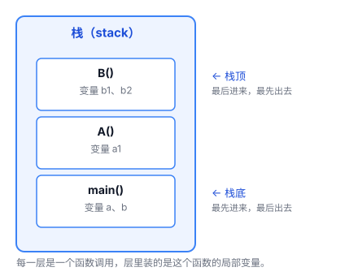
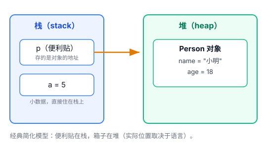
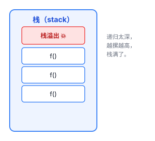
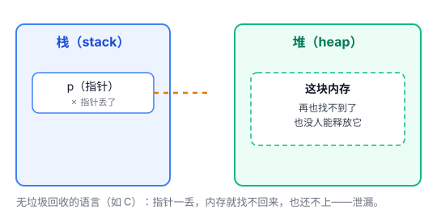

# 内存：栈 vs 堆，变量到底存在哪

你每天写代码，`int x = 1`、`String s = "hello"`。这些变量写出来之后，被电脑放到了哪里？

电脑的内存不是一整块随便塞的，它被分成了几片区域，其中最重要的两片，一个叫**栈**，一个叫**堆**。搞懂它俩，内存相关的一大半困惑就解开了。

## 一、栈：一摞盘子的故事

想象餐厅里洗好的一摞盘子。厨师要拿盘子，永远拿**最上面**那个；新洗好的盘子，也永远摞在**最上面**。这种"只能从顶上放、从顶上拿"的结构，就是栈。

程序里的栈，干的事情几乎一模一样。每当你调用一个函数，电脑就在栈顶上压入**一整层**，这一层装这个函数要用的参数、局部变量，还有一个"返回地址"（记着函数跑完要回到哪一行）；函数跑完，就照着返回地址跳回去，这一整层随之被"弹"出去，自动消失。

这个"后放进去的先拿走"的顺序，天然就配函数调用——因为函数调用是**一层套一层**的：A 调用 B，B 又调用 C，那一定是 C 先结束、再 B、再 A。后进去的先出来，刚刚好。

因为位置永远在"顶上"，放和拿都只需要挪动一下指针，所以栈**特别快**，而且**全自动**——你不用管它，函数结束，这一层自动就没了。

## 二、堆：一个自由的大仓库

但栈有个毛病：只能从顶上放、顶上拿，太死板。有些东西你不知道它什么时候用完，或者它个头特别大，塞不进这摞盘子里。

于是内存里还有第二片区域，叫**堆**。堆像个自由的大仓库：你想放东西，进去随便找个空位放下；放完以后，得拿张**便利贴**记下"东西放在 B 区 3 号架"。这张便利贴，就是你代码里的"引用"（也叫"指针"）。

堆的好处是灵活：东西想放多大放多大，想放多久放多久。代价是：它"还回来"这件事，比栈麻烦（具体后面讲）。

## 三、一张表看清两者的区别

|   | 栈            | 堆                |
| ------ | ------------ | ---------------- |
| 像什么    | 一摞盘子         | 自由仓库             |
| 放什么    | 函数调用时临时要用的东西 | 动态分配、想长期存在的东西    |
| 谁管     | 全自动（函数返回就清空） | 看语言：手动清 / 垃圾回收器清 |
| 速度     | 快            | 慢一些              |
| 大小     | 小（通常几兆）      | 大得多              |
| 什么时候没  | 函数返回，整层自动消失  | 看语言：手动释放 / 回收器回收 |

## 四、那变量到底存在哪？

一个常见困惑：`int a = 5` 和 `Person p = new Person()`，这俩存的地方一样吗？

先给你一个**经典简化模型**（很多教材都这么讲，好记）：

- 局部变量 `a` → 栈
- `new` 出来的对象 → 堆
- 指向它的引用 `p` → 栈

**这个模型好记，但它是"简化"的。** 真实情况要复杂一点，别把它当成铁律：

1. **局部变量不一定在栈上。** 编译器可能把它优化进寄存器（CPU 里超快的小格子）；某些语言的"逃逸分析"也可能把本该在栈上的东西挪到堆上。
2. **对象不一定在堆上。** 在 C++ 里你可以不用 `new`，直接写 `Person p;`，对象就躺在栈上。（`new` 本身就是"在堆上分配"的意思，所以一旦用了 `new`，对象就一定在堆。）
3. **引用变量不一定在栈上。** 如果引用是某个对象的属性，它就跟着那个对象待在堆上；如果是全局变量，它在全局数据区。

所以更准确的说法是：**"栈 vs 堆"讲的是内存的两种管理方式（栈 = 自动、后进先出；堆 = 自由、看语言管），而不是"某类变量一定在哪"。** 某个变量到底在哪，取决于语言和上下文。

## 五、两个最常见的坑

### 1. 栈溢出（Stack Overflow）

栈虽然快，但空间不大。如果你递归太深，或者往栈上塞了太大的东西，盘子摞得太高，塌了——这就是"栈溢出"。著名的程序员问答网站 Stack Overflow，名字就是这么来的。

### 2. 内存泄漏（Memory Leak）

"内存泄漏"的意思很简单：**该还的内存没还，程序占用的内存越滚越多。**

但它分两种情况，方向正好相反：

**没有垃圾回收的语言（C/C++）——"便利贴丢了"才是泄漏**

你自己申请的内存，得自己还。如果便利贴（指针）弄丢了，你就再也找不到那块内存，想还也还不回去，它永远占着那块地。

**有垃圾回收的语言（Java、Python、JavaScript）——"便利贴丢了"反而是正常回收**

这种语言有个"垃圾回收器"专门帮你清理。你主动把便利贴丢掉（引用断开）→ 对象变成"没人要" → 回收器会来把它收走。**这恰恰不是泄漏，是正常的释放。**

那这些语言里怎么会泄漏呢？方向反过来了：**你一直死死捏着便利贴不放，但程序其实早就不需要那个对象了。** 比如把对象塞进一个全局列表里忘了删——列表一直拽着它，回收器以为它还有用，就不敢收。这才是 GC 语言里真正的泄漏。

一句话：**"丢引用"在 C 里是泄漏，在 Java 里是交给回收器；GC 语言真正的泄漏，往往是"引用还在，但你忘了它"。**

## 六、总结

- **栈** = 一摞盘子，自动、快、小，管"函数临时要用的东西"。
- **堆** = 自由仓库，灵活、慢、大，管"动态分配、想长期存在的东西"。
- **谁在哪、要不要手动清理，取决于语言**——别用"局部变量一定在栈、对象一定在堆"去套所有语言。

记住"栈是后进先出的自动区、堆是自由分配的大仓库"这两个形象，内存的大半困惑就都解开了。

> 小提示：这篇文章画的是最通用的"栈 + 堆"模型。具体到某一种语言（Go 的逃逸分析、Java 的对象都在堆、C++ 的栈上对象和 RAII……）都有各自的细节，等你深入某一门语言时再去看它的具体规则。

