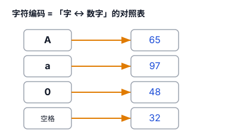
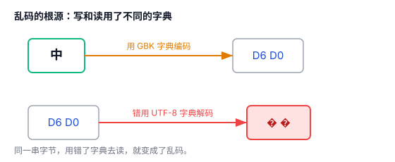
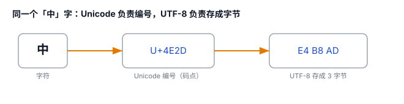

# 字符编码：ASCII / Unicode / UTF-8（乱码的根源）

你打开一个文件，有时会看到一堆"锟斤拷""烫烫烫"或者"�"，这就是乱码。要搞懂它的根源，得从"计算机怎么存文字"说起。

## 一、计算机只认识数字

计算机里的一切——文字、图片、声音——最终都是 **0 和 1**，也就是数字。

所以要把"字"存进计算机，就得给每个字一个编号，把字"翻译"成数字。这张"字 ↔ 数字"的对照表，就叫**字符编码**。

比如最老的一张表叫 ASCII，它规定：大写 A = 65、小写 a = 97、数字 0 = 48……

存文字时，计算机存下这些数字；显示时，再照着表把数字翻回文字。这个"翻过去"叫**编码**，"翻回来"叫**解码**。

## 二、ASCII：只够英语用的小字典

ASCII 是 1960 年代美国定的标准，一共只有 **128 个字符**（用 7 位二进制就能表示），覆盖英文字母、数字、标点和一些控制符。

128 个名额，装英语是够了，但全世界还有成千上万的中文、日文、韩文、各种符号……根本塞不下。

## 三、乱码的根源：各说各话

ASCII 不够用，于是各国各地区各自扩展，各搞各的"字典"：

- 中国大陆：GB2312 / GBK（用两个字节表示一个汉字）
- 日本：Shift-JIS
- 欧洲：Latin-1

麻烦在于：**这些字典互不相通。** 同一个数字，在不同字典里代表不同的字。

一份文件用 GBK"写"（编码）下来，别人却用 UTF-8 去"读"（解码），数字对不上号，读出来的就是一堆乱码。

**乱码的本质，就是"编码"和"解码"用了不同的字典。**

## 四、Unicode：全世界统一的大字典

要彻底解决乱码，办法只有一个：别再各搞各的，**全世界共用一张表**。

于是有了 **Unicode**：给世界上每一个字符（不分语言、不分地区）都分配一个**唯一编号**，叫"码点"（code point）。"中"的编号是 U+4E2D，"A"是 U+0041，连 emoji 😀 也有自己的编号。

注意一个关键点：**Unicode 只是"编号表"，只负责给字符发号码，不规定这些号码怎么存进磁盘。** 就像它只给你发身份证号，但没规定这串号码在纸上怎么写。

## 五、UTF-8：怎么把编号存起来

"怎么存"由另一层来干，叫**编码方式**。最流行的一种，就是 **UTF-8**。

UTF-8 的规则很聪明，是**变长编码**——不同的字符用不同的字节数：

- 英文字母等 ASCII 字符 → **1 个字节**（和 ASCII 完全一样，纯英文文件天然兼容）
- 常用汉字 → **3 个字节**
- emoji、生僻字 → **4 个字节**

UTF-8 能成为今天的事实标准，靠的是三个优点：**兼容 ASCII、省空间、没有字节顺序的坑**（最后一点初学者先不用管）。

## 六、现在该怎么办

到今天，业界基本统一用 UTF-8，乱码少了很多。但你写代码时还是可能碰到，诀窍就一条：**从头到尾，让"编码"和"解码"用同一个字典。**

- HTML 里写 `<meta charset="utf-8">`
- 数据库、HTTP 响应头、代码文件，全都声明 UTF-8
- 看到乱码，第一反应：是不是哪一步用错了编码去读

## 七、总结

- 计算机只懂数字，**字符编码 = 字和数字的对照表**。
- ASCII 只有 128 个，只够英语；各国各自扩展，**字典不统一 → 乱码**。
- **Unicode 统一编号，UTF-8 负责存储**，两者不是一回事。
- 乱码的本质：**编码和解码用了不同的字典**。

一句话：**乱码不是文件坏了，是"写"和"读"用了不同的字典——统一用 UTF-8，能消掉大多数乱码。**
