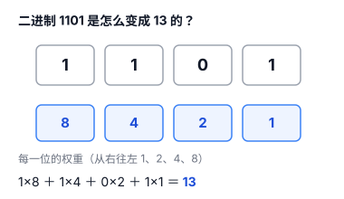
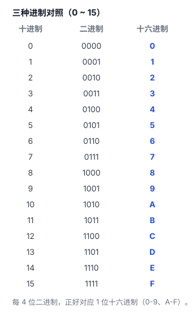
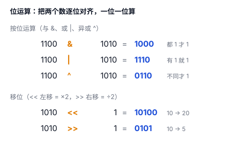

# 进制：二进制、十六进制、位运算

上一篇文章说，计算机只认识 0 和 1。那问题来了：我们人习惯用 10 个数字，计算机却只用 2 个，中间怎么对上？以及，程序员天天挂在嘴边的"十六进制""位运算"又是什么？

这一篇把它们一次讲清。

## 一、十进制：因为人有 10 根手指

我们平时用的十进制，有 0-9 十个数字，数到 9 就"进一位"变 10，这叫**逢十进一**。

为什么是十？大概因为人长着 10 根手指，好数。

计算机没手指，它底层靠**两种逻辑状态**来表示信息，我们记作 0 和 1（可以暂时理解成开关的"关"和"开"）。所以它只能用两个数字来数数，这就是**二进制**：逢二进一。

- 十进制：0、1、2、3、4、5、6、7、8、9、10、11……
- 二进制：0、1、10、11、100、101、110、111、1000……

看，二进制里"10"不是十，是"二"；"11"是三；"100"是四。只是换个进位规则，数的还是同一个东西。

## 二、二进制：计算机的母语

二进制里，一个 0 或 1 叫**一位（bit）**，这是计算机表示信息的基本单位。8 个位组成一个**字节（byte）**（现代计算机的通行约定，1 字节 = 8 位）。

一个字节有 8 位，每一位都能是 0 或 1，所以一个字节能表示 2×2×…×2（连乘 8 个）＝ **256 种**状态，也就是 0 到 255。

怎么把二进制翻译成我们熟悉的十进制？秘诀是：**每一位都有个"权重"，从右往左是 1、2、4、8……（每次都翻倍）**。



比如二进制 `1101`：从右往左权重是 1、2、4、8，对应位是 1、0、1、1，所以

1101 ＝ 8×1 ＋ 4×1 ＋ 2×0 ＋ 1×1 ＝ 8 ＋ 4 ＋ 0 ＋ 1 ＝ **13**。

反过来，十进制转二进制就是"一直除以 2、记下每次的余数"（知道原理就行，不用练到熟练）。

## 三、十六进制：二进制的"速记"

二进制有个毛病：**太长**。一个字节才 8 位，写出来就是一大串 `11111111`，看着头晕。

于是人们找来十六进制当"速记"：**每 4 位二进制，正好对应 1 位十六进制。**

- 4 位二进制能表示 0-15，正好 16 个数；
- 十六进制就用 0-9 继续，再用 A-F 补上 10-15（A=10、B=11……F=15）。



这样一来，一个字节（8 位）拆成两半，正好是两个十六进制字符：

`1111 1111` → `FF`

所以你在代码里看到的 `0xFF`、`0x4E2D`，那个 `0x` 开头就是在说"我后面是十六进制"。还记得上一篇"中"字的 Unicode 编号 U+4E2D、UTF-8 存成 E4 B8 AD 吗？那些数字都是十六进制。十六进制不是另一种数值，而是**另一种表示数值的方法**；因为每位十六进制正好对应 4 位二进制，所以特别适合用来简洁地表示二进制数据。

## 四、位运算：直接拨弄每一位

既然计算机里的数是一串 0/1，那能不能直接操作这些 0/1？可以，这就是**位运算**。

位运算就是**直接对整数的二进制位做操作**：有的要两个数逐位对齐来算（与、或、异或），有的只操作一个数（取反、左移、右移）。最常用的几个：



- **与（&）**：两位**都是 1** 才是 1，否则是 0。`1100 & 1010 = 1000`
- **或（|）**：两位**有一个是 1** 就是 1。`1100 | 1010 = 1110`
- **异或（^）**：两位**不一样**才是 1。`1100 ^ 1010 = 0110`
- **取反（~）**：把每一位翻转，0 变 1、1 变 0（实际结果和整数的位宽有关）。
- **左移（<<）**：全体往左挪一位，右边补 0，**等于乘以 2**。
- **右移（>>）**：全体往右挪一位，**等于除以 2**（对正数）。

这些运算有什么用？最典型、也最能体现它价值的是**标志位**：拿一个整数当一排开关用，每一位表示一个"是 / 否"。

比如文件权限，用 3 个位表示 3 种权限（1 = 有，0 = 没有）：

```
读   = 0x01  // 二进制 0001
写   = 0x02  // 二进制 0010
执行 = 0x04  // 二进制 0100
```

要给某个用户"读 + 写"权限，就用 `读 | 写` 拼出一个组合；想知道他有没有"写"权限，就用 `权限 & 写` 看结果是不是 0。一个整数就装下了一排开关，省内存又清晰——这才是位运算最不可替代的地方。

其他常见场景：

- **判断奇偶**：`x & 1` 结果是 1 就是奇数，0 就是偶数（二进制最低位是 1 就是奇数）。
- **乘除 2 的等价写法**：对非负整数、且结果不溢出时，`x << 1` 相当于 `x*2`，`x >> 1` 相当于整数除以 2。不过现代编译器通常会自动做这类优化，所以不必为了性能刻意用移位代替乘除。

## 五、总结

- **二进制**是计算机的母语，一位 = 一个 0/1，一个字节 = 8 位 = 256 种状态。
- 二进制每一位有**权重**（1、2、4、8……），这就是它和十进制互转的钥匙。
- **十六进制**是二进制的速记：每 4 位二进制 = 1 位十六进制（0-9、A-F）。
- **位运算**（& | ^ ~ << >>）直接操作每一位，用于判奇偶、乘除 2、标志位等。

一句话：**二进制是计算机的语言，十六进制是它的速记，位运算是你直接拨弄每一位的开关。**
