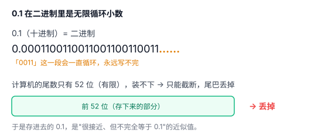
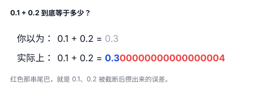

# 浮点数：为什么 0.1 + 0.2 ≠ 0.3

你有没有在代码里写过 `if (0.1 + 0.2 == 0.3)`，结果却是 false？在很多语言里，`0.1 + 0.2` 算出来不是 `0.3`，而是 `0.30000000000000004`。

这不是 bug，是**浮点数**的天性。这篇讲清楚它为什么。

## 一、计算机怎么存小数：科学计数法

整数怎么存，上一篇已经讲了（二进制）。但小数怎么办？

计算机用"**科学计数法**"的思路来存小数。十进制里的科学计数法你肯定见过：

`1234500000 = 1.2345 × 10^9`

它把一个大数拆成三样：**正负号、有效数字（1.2345）、指数（9）**。

浮点数也是这个思路，只不过底数从 10 换成 2：

`一个数 = 符号 × 1.尾数 × 2^指数`

IEEE 754 这个标准规定了具体怎么分配位数。以单精度 float（32 位）为例：


- **1 位**：符号（0 是正、1 是负）
- **8 位**：指数（决定小数点"浮"到哪）
- **23 位**：尾数（有效数字）

双精度 double 用 64 位，把指数和尾数加得更宽（11 位指数 + 52 位尾数），所以更精确。

## 二、0.1 在二进制里，是"无限循环小数"

问题就出在"位数有限"上。

你在十进制里见过无限循环小数：`1/3 = 0.33333……`，永远写不完，只能写个近似值。

**0.1 在二进制里，也是无限循环小数**：

`0.1（十进制）= 0.000110011001100110011……（二进制）`

那个 `0011` 会一直循环下去，没完没了。

可计算机给尾数留的位是**有限**的（double 也就 52 位），无限的小数装不下，只能**截断**，把尾巴丢掉。于是存进去的 `0.1`，其实是一个**很接近、但不完全等于 0.1 的近似值**。



## 三、所以 0.1 + 0.2 ≠ 0.3

现在三个数都是"近似值"：`0.1` 是近似的，`0.2` 是近似的，`0.3` 也是近似的。

两个近似值相加，误差攒在一起，结果就比真正的 0.3 多出来那么一丁点：



```
0.1 + 0.2 = 0.30000000000000004
```

于是 `0.1 + 0.2 == 0.3` 是 false。

顺便说一句：**不是所有小数都这样**。像 `0.5`、`0.25`、`0.125` 这些"2 的负幂次"，在二进制里能精确表示（正好是 0.1、0.01、0.001），就没有这个误差。中招的是那些在二进制里无限循环的小数，比如 `0.1`、`0.2`、`0.3`。

## 四、写代码时怎么办

既然浮点数天生带一点误差，写代码就要留个心眼：

1. **别用 `==` 直接比较浮点数**。改成比较"误差范围"：

   ```
   abs(a - b) < 0.000001
   ```

   意思不是"完全相等"，而是"足够接近"。

2. **涉及钱，用整数或 Decimal**。比如把金额存成"分"（整数：123.45 元 → 12345 分），或者用专门的十进制类型，避免浮点误差。

## 五、总结

- 浮点数用**科学计数法**存：符号 + 指数 + 尾数，位数是固定的。
- **0.1 在二进制里是无限循环小数**，计算机只能存近似值。
- 近似值相加，误差累积，所以 `0.1 + 0.2 ≠ 0.3`。
- 应对：别用 `==` 比浮点数，用误差范围；钱用整数或 Decimal。

一句话：**浮点数不是精确的数，而是"用有限的位数装无限的小数"留下的近似值——所以 0.1 + 0.2 永远差那么一点点。**
