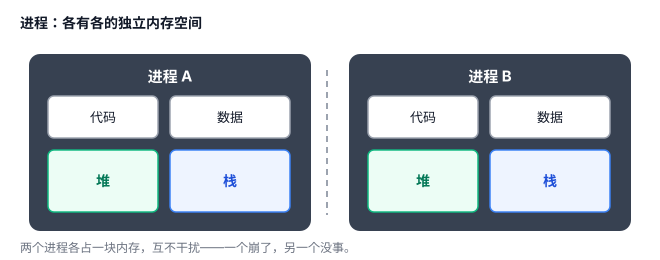
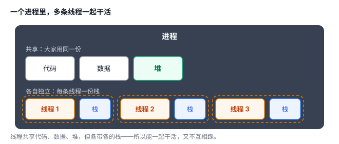

# 进程 vs 线程：程序是怎么"同时"干多件事的

你打开浏览器，一边放音乐、一边写文档、一边下载文件——电脑是怎么让这几件事"同时"进行的？答案落在两个概念上：**进程**和**线程**。

## 一、进程：一个正在运行的程序

你双击一个程序图标，操作系统就为它创建一个**进程**。

**进程 = 一个正在运行的程序**，拥有自己**独立的内存空间**，还有属于它的资源（打开的文件、网络连接等）。

打个比方：**进程 = 一座独立的房子**。它有独立的门牌号、水电表，里面的家具、住户都归这座房子自己管。

进程之间最重要的特点是**隔离**：一座房子着火（一个进程崩溃），**通常不会直接烧到隔壁**（别的进程）——不过它要是把公共的水电、道路占光了，邻居也会跟着遭殃。正因如此，现代浏览器采用**多进程架构**，把不同网页或站点的部分工作隔离到不同进程里：一个标签页卡死了，关掉它就行，整个浏览器不会跟着崩。

## 二、线程：进程里"干活的人"

光有房子（进程）还不够，得有人（线程）在里面干活。

**线程 = 进程内部的一条执行流**，是真正一句一句跑代码的。一个进程至少有一条线程（叫**主线程**），也可以同时有好几条。

继续用房子的比喻：**线程 = 房子里的人**。多线程，就是一座房子里住着好几个人，他们：

- **共享**厨房、客厅——对应共享进程的**代码、数据、堆**；
- **各有各的卧室**——对应每条线程有自己独立的**调用栈**（用来管理函数调用，以及调用过程中的局部状态）。

为什么这么分？

- **共享**代码、数据、堆：因为大家本来就在干同一件事，得用同一份数据；而且共享内存让线程之间"传话"特别快。
- **独立**的调用栈：每个人调用函数、管理自己的局部状态，不能互相踩到，所以各自一份。

## 三、一张表看懂区别

| 对比项 | 进程 | 线程 |
|---|---|---|
| 是什么 | 运行中的程序 | 进程里的执行流 |
| 内存 | 各有一份，独立 | 共享（栈各自独立） |
| 隔离 | 强，通常不直接拖累别人 | 弱，共享的东西容易互相干扰 |
| 切换开销 | 通常更大 | 通常更小 |
| 通信 | 麻烦（要走进程间通信） | 方便（直接读写共享内存） |

切换开销为什么有差别？用房子打比方，再对应到计算机：

- **切换进程**，好比「换一栋房子」：房子整个换，水电、家具都要重新对一遍。
  - 对应到计算机：要把**地址空间映射**换掉，再保存、恢复 CPU 的执行现场。
- **切换线程**，好比「同一栋房子里换个人」：房子没动，家具、水电照旧，只是换个人接着干活。
  - 对应到计算机：**不用换地址空间**，只切换执行现场（寄存器、栈指针这些）。

所以线程切换通常更轻。不过这只是"通常"，具体开销还得看操作系统和硬件。

## 四、并发 vs 并行：到底怎么"同时"干多件事

标题里说的"同时"，其实有两种情况：

- **并发**：同一个 CPU 核心在任务 A、B 之间来回切换，一会儿跑 A、一会儿跑 B——看起来在同时推进，其实任一时刻只跑一个。
- **并行**：多个 CPU 核心分别跑 A、B，两个任务在同一时刻真正执行。

一句话：**并发是"轮流做、看起来同时"，并行是"真的同时做"**。

进程和线程都能参与并发和并行；真正安排谁先跑、谁后跑、跑在哪个核心上的，是操作系统的**调度器**。

## 五、什么时候用哪个

- **要强隔离** → 用多进程。典型：浏览器标签页、主程序带一个"守护"子进程，防止一处崩了全崩。
- **要共享内存、通信快、切换省** → 用多线程。典型：服务器同时接待很多请求、游戏里一边渲染画面一边处理声音。

多线程有个绕不开的坑：大家共享同一份数据，一个人改、一个人读，容易"打架"（这叫**竞态条件**）。这个坑放到后面「并发」那篇专门讲。

为什么不能只留一个？如果只有进程：每次想"多人协作"都要开新进程，隔离是强了，但共享数据、通信、切换都变得又慢又麻烦；如果只有线程：大家都挤在一个进程里，一处崩了全崩，没有隔离这堵"防火墙"。所以操作系统才把"隔离"和"协作"拆成两个层次。

## 六、总结

- **进程** = 运行中的程序，独立内存，隔离强，切换通常更贵。
- **线程** = 进程里的执行流，共享进程内存，但各有独立的调用栈，切换通常更省。
- 进程求隔离，线程求共享——各管各的场景。

再往本质走一步，两个概念的设计目的其实是：

- **进程**：资源管理与隔离的基本单位——解决"资源归谁、如何隔离"的问题。
- **线程**：CPU 调度执行的基本单位——解决"代码由谁执行、如何调度"的问题。

一句话：**进程是"各自独立的房子"，线程是"同一屋檐下一起干活的人"——进程求隔离，线程求协作。**
