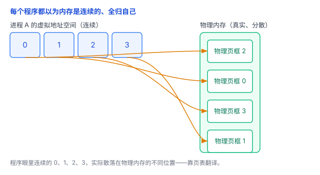
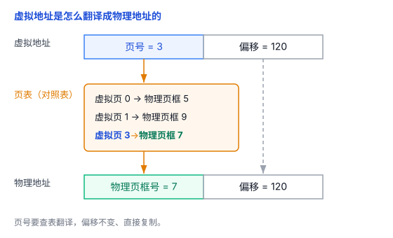
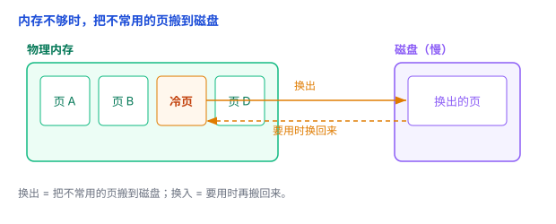
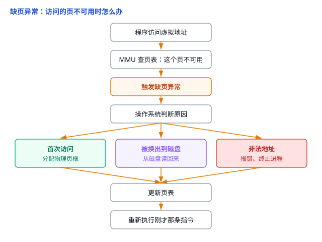

# 虚拟内存：每个程序都以为内存是自己的

你的电脑可能只有 16G 内存，却能同时开着浏览器、微信、游戏几十个程序，每个都觉得自己占了好几个 G——加起来早就超过 16G 了。为什么没崩？答案就是**虚拟内存**，以及它背后的一整套机制。

## 一、问题：程序都想要一整块内存

早期的一些系统，程序是直接用**物理地址**访问内存的（就是真实内存的地址）。这么干有两个麻烦：

1. **互相踩**：程序 A 和程序 B 都往同一个位置写数据，谁后写谁覆盖谁。
2. **要操心位置**：程序得知道自己被放在内存的哪个位置，写起来很痛苦。

一句话：程序直接操作真实内存，又危险又麻烦。

## 二、虚拟内存：给每个程序一张"假地图"

操作系统想了个办法：程序改用**虚拟地址**访问内存，真实的地址转换交给硬件去做。于是每个程序拿到一张"假地图"，叫**虚拟地址空间**。

在这张假地图上，程序看到一套**从 0 开始、连续编号**的地址，而且每个程序都有自己独立的一套。但有两件事要澄清：

- **0 号地址通常不能碰**。从 0 开始编号，不代表 0 号能用——0 附近往往故意不让访问，就是为了抓住"空指针"这类错误。
- **连续编号 ≠ 每一段都真的分了内存**。中间可能有大片"没映射"的空洞，访问它们会出错。

程序用的是虚拟地址（假地址），真实的内存（**物理内存**）由操作系统统一管理。CPU 每次要访问内存，都得靠一张"对照表"（**页表**）把假地址翻译成真地址——这个翻译由硬件完成。

打个比方：**每个程序都以为自己独占一整条街（虚拟地址空间），其实真正住哪个门牌，由"前台对照表"（页表）说了算。**

## 三、页表：假地址怎么翻译成真地址

翻译不是一位一位翻，而是**按"页"来翻**。

操作系统把**虚拟地址空间**切成固定大小的一块块，叫**页**（page，常见是 4KB）；**物理内存**也切成同样大小的一块块，叫**页框**（page frame）。翻译，就是把一个虚拟页对应到某个物理页框上。

于是一个虚拟地址可以拆成两半：

- **前半**：第几页（页号）；
- **后半**：页里的哪个位置（偏移）。

翻译的过程：拿**页号**去查页表 → 得到对应的**物理页框号** → 再拼上**偏移** → 就是物理地址。注意：**偏移是不变的**，翻的只有页号。

这个翻译由 CPU 里一个叫 **MMU**（内存管理单元）的硬件来完成，页表则由操作系统维护。

## 四、虚拟内存的三个好处

### 1. 隔离：谁也碰不到谁

每个进程有**自己的一套页表**（独立的地址映射）。操作系统通过页表控制每个进程能访问哪些内存、是读还是写。所以进程 A 通常访问不到 B 的内存；就算某个物理页框被多个进程共享（见下文），也得经过操作系统授权，不能随便读写。

这正是上一篇讲进程时说的"独立内存空间"——虚拟内存是它的实现基础。

### 2. 按需分配与换页：地址空间可以比内存大

所有程序的虚拟地址空间加起来，可以**超过物理内存**。凭什么？因为不是所有地址都要同时占用真实的物理内存：

- **按需分配**：程序申请了一大块虚拟地址，但还没真正用到的地方，先不分配物理内存，用到再给。
- **共享**：多个进程用同一份代码（比如系统库），物理内存里只存一份。
- **换页**：不常用的页搬到**磁盘**（叫**换出**），腾出内存给别的页，要用再搬回来（叫**换入**）。

所以"内存看起来比实际大"，是这几种机制一起作用的结果，换页只是其中之一。这也解释了为什么"内存不够"时电脑会变卡——它其实在频繁地往磁盘倒腾数据，而磁盘比内存慢好几个数量级。

（提醒一句：很多人以为"虚拟内存 = 硬盘当内存用"，这是不完整的。它的核心是**地址翻译 + 隔离 + 按需分配**，换页只是其中一个功能。）

### 3. 共享：同一份代码，只存一份

不同进程的虚拟页，可以**映射到同一个物理页框**。比如几十个程序都用到同一个系统库（比如 libc），内存里其实只存了一份，大家各自映射过去用就行，省下大量内存。

## 五、缺页异常：把这些串起来

前面留了个问题：程序访问某个虚拟地址，如果这个地址**还没分配物理内存**（或者被换到磁盘了），怎么办？

答案是**缺页异常**（page fault）。它是把虚拟内存、页表、物理内存、swap 串起来的核心：

1. 程序访问某个虚拟地址；
2. MMU 去查页表，发现这个页**当前不可用**（没分配、或被换出）；
3. 触发一次缺页异常，把控制权交给操作系统；
4. 操作系统判断原因：
   - **第一次访问**这个地址 → 分配一个物理页框；
   - 这个页之前**被换出到磁盘** → 从磁盘读回来；
   - 根本**不该访问**（比如野指针） → 报错、终止程序；
5. 更新页表，重新执行刚才那条指令——程序像什么都没发生过一样。

缺页异常背后有个重要思想：**延迟处理**。操作系统不用在程序申请内存时就立刻准备好一切，而是等到真正用到时再处理。这也是为什么"申请 1GB 内存"不一定立刻消耗 1GB 物理内存。

## 六、TLB：页表查起来慢，怎么办

每次访问内存都要做地址转换，如果每次都去**遍历页表**，太慢了。所以加了个"快表"，叫 **TLB**（Translation Lookaside Buffer，中文常译为"地址转换后备缓冲"）：缓存最近用过的"虚拟页 → 物理页框"的转换信息（以及相关权限）。访问内存时先查 TLB，命中就直接翻译，不用再去查页表。

这其实就是上一篇缓存那篇讲的**局部性**思想：最近用过的，很快还会再用。

## 七、总结

- 虚拟内存给每个程序一张"假地图"——独立、连续编号的**虚拟地址空间**（但并非每个地址都能访问）。
- **页表**负责把虚拟地址翻译成物理地址，翻译按"页"进行：虚拟页对应到物理页框，偏移不变。
- 好处：**隔离**（页表控制权限）、**按需分配 + 换页**（地址空间可大于内存）、**共享**（同一份代码只存一份）。
- **缺页异常**是核心机制：用到才处理，把虚拟内存、页表、磁盘串起来。
- **TLB** 缓存页表项，加速翻译。

一句话：**虚拟内存让每个程序都以为整块内存是自己的，实际上靠一张页表悄悄翻译成真实地址——既隔离了程序，又通过按需分配和换页，让内存"看起来"用不完。**
