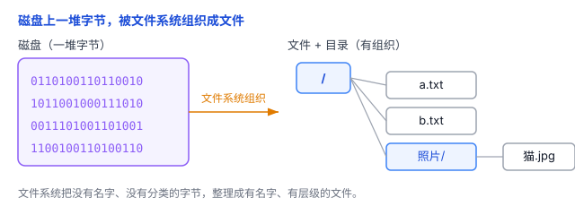
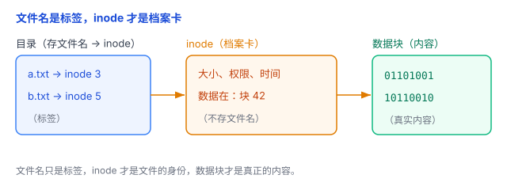
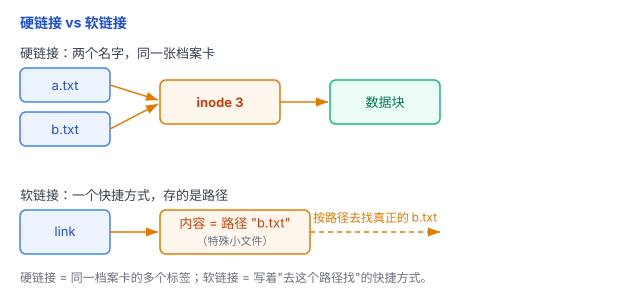

# 文件系统：文件到底存在磁盘的哪里

你双击一个文档，电脑怎么知道它的内容存在磁盘的哪个位置？内存一断电就没了，可文件关机后一直留着——这背后就是**文件系统**在管。

## 一、问题：磁盘只是一堆字节

磁盘（硬盘、SSD）本质上是一大块能存 0 和 1 的地方，断电也不丢。但如果你直接往上面乱写数据，会有一堆麻烦：

- **写完就忘了在哪**：下次怎么找到刚才存的东西？
- **不知道哪块被占了**：新数据该往哪写，会不会覆盖旧的？
- **没有名字、没有分类**：一堆 0 和 1，分不清谁是谁。

所以需要一套规则，把这块"裸磁盘"组织成我们能用的**文件**和**目录**。这套规则就是**文件系统**。

## 二、文件系统 = 磁盘上的"档案管理系统"

打个比方：**磁盘 = 一个大仓库，文件系统 = 仓库的管理系统**。它主要干四件事：

1. **组织文件**：把数据存成一个个有名字的**文件**；
2. **组织目录**：用**目录**（文件夹）把文件分类，形成一棵树；
3. **记账**：记录每个文件存哪、占多大、谁有权访问；
4. **分配空间**：新数据往哪写、空出来的空间怎么回收，都归它管。

你看到的"打开文件""新建文件夹"，背后都是文件系统在仓库里登记、查找、分配位置。

顺便回答一个自然的问题：一个 10MB 的文件，一定要连续存在磁盘上吗？**不用**。文件系统可以把文件拆成若干块、分散放在不同的数据块里，再靠 inode 记下这些块各自在哪。所以文件系统不只是"记录文件在哪"，还得负责**分配、回收、管理**磁盘空间。



## 三、inode：文件名是标签，真正的身份是"档案卡"

先划个范围：下面讲的是 **Unix/Linux 常见的 inode 型文件系统**（比如 ext4）。Windows 的 NTFS 用的是「主文件表（MFT）」，FAT32 又是另一套结构，内部不叫 inode——但它们都遵循"文件名 → 元数据 → 数据块"这条主线，只是具体实现不同。

这是文件系统里最反直觉的一点：**文件名并不是文件本身**。目录项把文件名关联到 inode，inode 记录文件的元数据，以及"数据存在磁盘哪些块"的信息。另外 inode 编号通常只在它所属的文件系统内有效，换个文件系统就对不上号了。

- **inode**：每个文件有一张"档案卡"，记着这个文件的元数据——大小、权限、时间戳，以及**数据实际存在磁盘的哪些块**。但它**不记文件名**。
- **目录项**：目录里存的，是"文件名 → inode 编号"的对照，就像货架上的标签。
- **数据块**：真正存内容的地方。

所以一个文件是三层结构：**文件名（标签）→ inode（档案卡）→ 数据块（内容）**。

这就带来两个有意思的结论：

- 同一个 inode 可以有好几个文件名——这叫**硬链接**，就像同一件货贴了两张标签。
- 删文件名，本质是**撕标签**（删掉目录项），而不是立刻清掉数据。



## 四、打开文件：拿到一个"借阅卡号"

程序要读一个文件，流程是：根据路径找到目录项 → 找到 inode → 打开。打开成功后，操作系统会给程序一个整数，叫**文件描述符**（file descriptor，简称 fd）。

之后程序就用这个 fd 来读、写，不用每次重新按路径去查。就像你借书时，管理员给你一张借阅卡号，之后报卡号就能取书。

要注意：fd 只是**这个进程自己**用来指代"已打开文件"的编号，不是文件的全局唯一编号。两个进程可以各有一个 `fd = 3`，指向的却是完全不同的文件：

```
进程 A：fd = 3 → 打开文件记录 → inode A
进程 B：fd = 3 → 打开文件记录 → inode B
```

所以 fd 和 inode 编号是两码事。

## 五、硬链接 vs 软链接

- **硬链接**：两个文件名指向**同一个 inode**（同一张档案卡）。删掉其中一个名字，另一个还在，因为档案卡还在。只有当最后一个硬链接被删掉、**并且没有进程还打开着这个文件**时，inode 和数据块才会被回收。
- **软链接**（符号链接）：一个特殊的小文件，内容写的是一个**路径**（可以是绝对路径 `/home/user/a.txt`，也可以是相对路径 `../a.txt`）。它就像**快捷方式**——原文件被删了，软链接还在，但一点就失效（因为指向的路径没了）；反过来，如果之后在原路径又建了个新文件，软链接会重新"活过来"指向它，因为它认的是路径，不是原来那个文件的固定身份。



## 六、删除文件 ≠ 抹掉数据

删除文件，准确说是分两步走：

- **删掉一个硬链接**：移除对应的目录项，把 inode 的链接计数减一。
- **删掉最后一个硬链接**：如果没有其他进程还打开着它，文件系统就可以回收 inode 和数据块。

所谓"回收"，通常是把这些块**标记为可再次分配**，而不是立刻清零。所以数据可能还躺在磁盘上，直到被新数据覆盖——这正是"误删文件能恢复"的原因。

但"彻底删除"没那么简单，得看设备：

- **机械硬盘（HDD）**：用工具反复覆盖，通常能有效抹掉目标数据。
- **固态硬盘（SSD）**：不一定。SSD 有 TRIM、磨损均衡、垃圾回收等机制，你让它覆盖某个逻辑地址，它未必写回原来的物理位置；TRIM 还可能让删除的数据很快读不出来。想彻底清除 SSD，更靠谱的是用设备支持的 Secure Erase、Sanitize，或加密擦除。

所以不能简单认为"反复覆盖就一定删干净"，要看文件系统、存储设备和后续操作。

## 七、总结

- 文件系统把"裸磁盘"组织成有名字的**文件**和树状的**目录**，还负责分配、回收磁盘空间。
- 在 Unix/Linux 常见的 inode 型文件系统中，文件是三层结构：**文件名（标签）→ inode（档案卡）→ 数据块（内容）**。
- **硬链接**是同一 inode 的多个名字；**软链接**是"指向路径的快捷方式"。
- 打开文件拿到**文件描述符**（fd，只在进程内有效）；删除文件通常只是撕标签、数据还在，SSD 上想彻底删光不能只靠反复覆盖。

一句话：**文件系统是磁盘上的"档案管理系统"——文件名只是标签，inode 才是档案，删文件不过是撕掉标签、数据还躺在磁盘上。**
