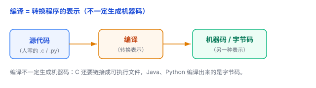
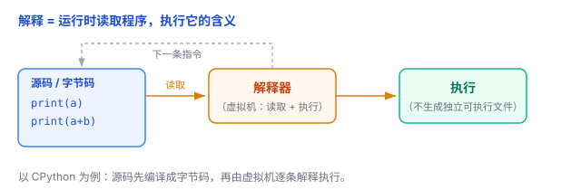

# 编译 vs 解释：你的代码是怎么"翻译"给机器的

你写下的 `print("hello")`，人一眼就懂；但 CPU 只认识一串 0 和 1。中间这个"把人的话变成机器能执行的东西"的步骤，就是**编译**和**解释**两种做法。

## 一、问题：你写的是人话，CPU 只听 0 和 1

程序员用**高级语言**（C、Python、Java……）写代码，因为好读、好写。但 CPU 只懂**机器码**——一长串由 0 和 1 组成的指令，人几乎没法直接读。

所以代码要跑起来，必须先"翻译"一道：把**源代码**（source code，人写的东西）变成机器能执行的形式。这一步有两条路线，先记两个最核心的定义：

- **编译（Compile）**：把程序的**一种表示**转换成**另一种表示**——比如把 C 代码变成机器码，或者把 Python 代码变成字节码。
- **解释（Interpret）**：由**解释器**在运行时读取程序的指令或结构，**执行它的含义**，而不要求先把整个程序转成原生机器码。

一句话理解：**编译解决的是"转换表示"，解释解决的是"按表示执行"**。这是两个不同的问题，所以它们经常被组合起来用。

## 二、编译：把"一种表示"换成"另一种表示"

打个比方：你想让一个只懂英文的人读一本中文书，**编译**就像把整本书翻译成英文、印成一本成品书。翻译工作先做好，之后这个人每次读，都是直接读那本成品书。

对应到计算机，**编译就是转换程序的表示形式**。注意：它**不一定生成机器码，也不一定生成可执行文件**。举两个例子：

- **C 语言**：`源码(.c) → 编译 → 目标文件(.o) → 链接 → 可执行文件`。这里"编译"只把源码转成目标文件，真正拼出可执行文件的是后面的**链接**步骤。
- **Java**：`源码(.java) → 编译 → 字节码(.class)`。编译出来的是**字节码**，不是 CPU 原生机器码，还得交给 JVM 去跑。

所以更准确的说法是：**编译器把源代码（或其他程序表示）转换成另一种形式，可能是机器码、目标文件，也可能是字节码。**

## 三、解释：运行时读取程序，执行它的含义

**解释**就像**同声传译**：演讲者说一句，翻译马上翻一句，手上没有一份完整的成品稿，说完就过去了。

对应到计算机，**解释 = 解释器在运行时读取程序的某种表示，按指令执行**。同样要注意：它**不一定是"逐行读源代码"**。

以最常见的 Python（CPython）为例：程序先被**编译成字节码**，再由 Python 虚拟机**逐条解释执行字节码**，还可能生成 `.pyc` 字节码缓存文件（这个文件不能脱离解释器独立运行）。所以"解释"读的是字节码这类中间表示，不是源码的每一行文本。

好处是改完立刻能跑、方便交互；代价是运行时多了一层"读取并执行"的开销。

## 四、连接两者的中间层：字节码

讲到这里就绕不开**字节码（bytecode）**了——它是介于"源码"和"机器码"之间的一种**中间指令表示**，专门给虚拟机执行。

看两条典型的执行路径：

- **C（常见工具链）**：`源码 → 编译、链接 → 原生机器码 → CPU 直接执行`
- **Python（CPython）**：`源码 → 编译 → 字节码 → 解释器（虚拟机）执行字节码`

这就解释了一个常见疑惑：**Python 明明也有"编译"这一步（编译成字节码），为什么还被叫"解释型语言"？** 因为它的字节码最终是**被解释器执行**的，而不是变成 CPU 直接跑的原生机器码。

所以**编译和解释不是非此即彼**——它们经常串在同一条流水线上。

## 五、编译 vs 解释，谁快谁慢？

先把结论说清楚：**"编译一定快、解释一定慢"并不严格成立**。更准确的是对比两种**典型的执行方案**：

| 比较维度 | 运行前先编译成机器码 | 运行时边解释边执行 |
|---|---|---|
| 核心机制 | 预先生成可执行的机器指令 | 运行时由解释器执行程序指令 |
| 执行依赖 | 通常不需要源语言解释器 | 需要解释器或虚拟机 |
| 运行性能 | 通常有优势 | 通常存在解释开销 |
| 启动成本 | 可能需要提前编译 | 可能有运行时解析或编译成本 |
| 修改程序 | 通常需要重新编译 | 通常可以直接执行修改后的源码 |
| 典型例子 | C、Go、Rust 常见实现 | CPython 的字节码解释器 |

注意：这里比较的是两种**执行方案**，不是把语言永久分成两类。

另外，**"错误什么时候被发现"是另一个维度**，别和编译/解释混在一起。它取决于语言的**类型系统**：

- Java 通常在**编译期**做类型检查，写错类型会直接报错。
- Python 通常在**运行时**才检查类型。
- 但 TypeScript 可以先做静态类型检查再转成 JavaScript；Python 也能用 mypy、Pyright 等工具在运行前做静态分析。

所以"编译期报错 vs 运行时报错"，跟"编译 vs 解释"不是一回事。

## 六、现实里很多语言是"混合"的

现实中的语言实现，大多是**解释 + 编译结合**，还常带**分层优化**：

- **Java**：先编译成字节码，再由 JVM 解释执行，热代码用 **JIT（即时编译）**进一步编译成机器码加速。
- **Python**：先编译成字节码，再由虚拟机解释执行。
- **JavaScript**：现代引擎（如 V8）结合了解释执行和**多层 JIT 编译**（比如 Ignition、Sparkplug、Maglev、TurboFan），边解释边把热代码逐步编译、优化成机器码。

所以"编译型语言 / 解释型语言"这个标签并不绝对——**同一种语言可以有不同的实现，编译和解释是可以组合使用的两种策略。**

## 七、总结

- **编译** = 转换程序的表示（C 源码 → 机器码，Python 源码 → 字节码）。
- **解释** = 解释器在运行时读取程序表示、执行它的含义。
- 两者是不同的问题，现实中经常**组合**使用（字节码 + 解释 + JIT）。
- "谁快谁慢"、"错误何时暴露"都不是编译/解释本身决定的，要看具体实现和类型系统。

一句话：**编译解决"怎么转换表示"，解释解决"怎么按表示执行"——一个像翻译整本书，一个像同声传译，而现实里的语言，往往是两者一起用。**
