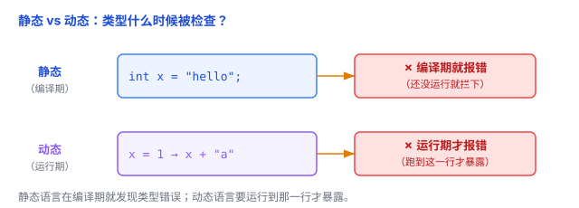
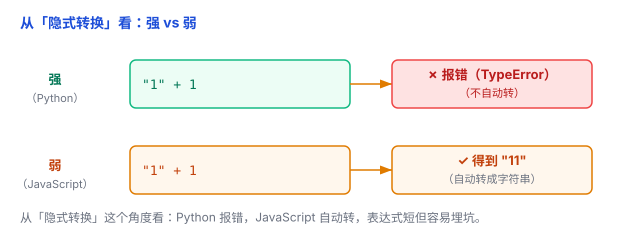

# 类型系统：静态与动态是明确分类，强与弱为什么难以定义？

同一个 `+`，在 `1 + 1` 里是加法，在 `"a" + "b"` 里是拼接。为什么？因为它们的**类型**不同。**类型系统**就是语言里管这些的一套规则。

## 一、类型：对值和表达式做分类与约束

- 值有类型，变量、函数、表达式也都有类型。类型规定了"它是什么"以及"能对它做什么操作"。
- `1 + 1` 是整数相加 = `2`；`"a" + "b"` 是字符串拼接 = `"ab"`。同样的 `+`，类型不同，含义就不同。
- **类型系统**的核心价值，不是给语言贴标签，而是规定：**什么操作合法、什么时候检查、能在多大程度上保证类型安全。**

## 二、先分清两个维度（这是最容易搞混的地方）

"静态/动态"和"强/弱"不是一回事，而是**两个独立的维度**：

- **静态 vs 动态**，问的是"**什么时候**检查类型"——运行前，还是运行时。
- **强 vs 弱**，问的是"**类型约束有多严**"——但这其实是个**没有统一定义**的模糊概念（后面细说）。

很多人以为"动态 = 弱、静态 = 强"，其实不对。经典反例：

- Python：**动态**，但通常被算作"强"——`"1" + 1` 会直接报错，不给你自动转。
- JavaScript：**动态又弱**——`"1" + 1` 自动变成 `"11"`。

所以这两个词要分开看，下面逐一讲。

## 三、静态类型 vs 动态类型：什么时候检查

**静态类型（static typing）**：程序在**运行前**就做主要类型检查，编译器根据类型声明或类型推断，判断每处操作是否合法。

注意两点：

- 静态 ≠ 必须手写类型声明。很多静态语言支持**类型推断**：Go 的 `age := 20`、Rust 的 `let age = 20;` 都能自动推出类型。
- 静态也不意味着运行时没有类型信息。比如一个 Go 接口变量 `var a Animal`，编译时类型是 `Animal`，运行时却可以先存 `Dog`、再存 `Cat`——对象的实际类型照样会变。

好处：错误早发现、IDE 补全和提示更准、编译器知道类型通常能优化得更快。代价：有时要写类型标注、灵活性和快速原型上略逊。

例子：Java、Go、Rust、TypeScript。

**动态类型（dynamic typing）**：类型主要在**运行时**检查，变量可以一会儿存整数、一会儿存字符串。就像箱子运到收银台才打开看里面是啥。

好处：写起来快、灵活、适合快速原型。代价：类型错误要跑到那一行才暴露；静态分析相对更困难（不过现代工具靠类型标注和静态分析，仍能给出不错的补全和提示）。

例子：Python、JavaScript、Ruby。



## 四、强类型 vs 弱类型：一个"没有统一定义"的概念

先说结论：**"强类型""弱类型"没有一套被普遍接受的严格定义**，更像一个光谱。不同资料关注的角度不一样——有的看**是否允许隐式类型转换**，有的看**类型安全**，有的看**能否绕过类型检查**。

所以，**不能用"允不允许自动转换"这一条来简单判断**。很多公认的"强类型"语言也允许隐式转换：

```java
int a = 10;
double b = a;   // 合法，int 自动转成 double
```

Java 允许这种转换，但 Java 通常仍被归为"强类型"。

不过，**从"隐式转换"这个角度看**，下面的对比依然很有教学价值：

- **Python**：`"1" + 1` 直接抛 `TypeError`——不做这种隐式转换，更可预测、更安全。
- **JavaScript**：`"1" + 1` 结果是字符串 `"11"`（把 1 自动转成字符串），`1 == "1"` 是 `true`——表达式短，但容易埋坑（这也是 JS 推荐用 `===` 的原因）。



记住：这个例子说明的是**隐式转换行为**的差别，而不是强/弱的完整定义。

## 五、常见语言，"约束"各有多严

既然强/弱没有统一的量化标准，与其硬分成四格，不如看看几类语言的**典型行为**：

| 静态/动态 | 语言 | 常见类型行为 |
|---|---|---|
| 静态 | Go、Rust | 类型约束较严格 |
| 静态 | C、C++ | 支持更多底层类型操作和转换 |
| 静态 | Java、TypeScript | 有静态类型检查，也允许一定的隐式转换或类型逃逸 |
| 动态 | Python、Ruby | 运行时类型检查，通常不允许随意混用不兼容类型 |
| 动态 | JavaScript、PHP | 允许较丰富的隐式类型转换 |

几点补充：

- C、C++ 不能简单贴"弱类型"标签：它们允许大量底层操作，但 C++ 本身也有丰富的静态检查机制。
- TypeScript 给 JavaScript 加了一层静态检查，但有 `any`、类型断言等"逃生门"，类型安全并不绝对（术语叫**不完全健全 / unsoundness**）。

## 六、总结

- **类型** = 对值和表达式的分类与约束。
- **静态/动态** = 什么时候检查（运行前 vs 运行时），这是**明确**的分类。
- **强/弱** = 类型约束的严格程度，是**没有统一定义**的模糊概念，别硬分。
- 类型系统的价值不在"贴标签"，而在规定**什么合法、何时检查、多安全**。

一句话：**静态/动态说的是"什么时候查"，这是清楚的；强/弱说的是"查多严"，却没有统一标准——Python 动态但通常算强，JavaScript 动态又弱，理解这一点，比背标签重要得多。**
