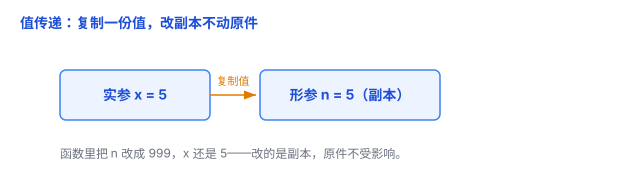
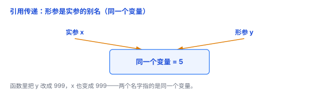
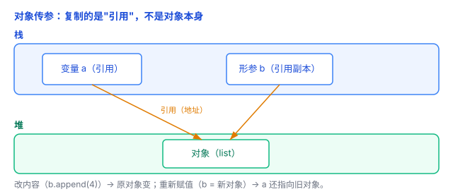

# 值传递 vs 引用传递：函数拿到的是"副本"还是"原件"

写一个函数想交换两个数，结果没生效——很多人第一次踩这个坑，都栽在**值传递 vs 引用传递**上。这篇文章把它讲清楚。

## 一、一个经典翻车现场：swap 为什么没生效

```c
void swap(int a, int b) {
    int t = a; a = b; b = t;   // 想把 a、b 交换
}

int x = 1, y = 2;
swap(x, y);      // 调用后 x、y 还是 1 和 2，根本没换！
```

为什么？因为 C 的普通参数是**值传递**——函数拿到的是 `x`、`y` 的**副本**，改副本当然不影响原件。

这就引出今天要说的两种方式：

- **值传递**：把值**复制一份**给函数。
- **引用传递**：把变量**本身**（的别名）交给函数。

## 二、值传递：复制一份给你

**值传递（pass by value）**，就像**复印一份文件**给你：你在复印件上随便涂改，我手里的原件一点没变。

对应到代码：调用函数时，把实参的**值**复制一份，塞给形参。函数里对这个形参怎么改，都只是改那个副本，外面的原变量不动。

```c
void add1(int n) {
    n = n + 1;      // 改的是副本
}
int x = 10;
add1(x);
// x 还是 10
```

C、Java、Go 的基本类型（int、double 这些）都是值传递。



## 三、引用传递：直接把"原件"的位置告诉你

**引用传递（pass by reference）**，就像**告诉你原件放在哪个柜子**：你走到那个柜子去改，改的就是原件本身。

对应到代码：形参直接是实参的**别名**，它们指向同一个变量。函数里改形参，就是在改外面的原变量。

C++ 用 `&` 表示引用：

```cpp
void swap(int &a, int &b) {   // & 表示引用传递
    int t = a; a = b; b = t;
}
int x = 1, y = 2;
swap(x, y);      // 这次 x、y 真的交换了
```

C# 的 `ref`、`out` 也是同理。C 没有内置引用，要用**指针** `int *p` 来模拟。



## 四、最容易搞混的地方：对象"传引用"其实是"复制引用"

前面说 Java、Python 是值传递，可你明明写过这样的代码：

```java
void add4(List<Integer> list) {
    list.add(4);    // 调用后，外面的 list 也多了个 4！
}
```

这不是"引用传递"吗？**不是。** 这里有个关键细节：

Java、Python、JavaScript 这些语言，**对象类型的"值"本身就是引用（可以理解成对象的地址）**。值传递时，复制的是这个**引用**，而不是对象本身。

打个比方：对象是放在仓库里的**文件**，变量是写有文件位置的**地址纸条**。值传递时，复印的是**纸条**——纸条复印了一份，但两张纸条指向**同一个文件**。

这就带来两个截然不同的现象：

1. **通过引用改内容** → 会影响原对象。因为两张纸条指向同一个文件，你按纸条去改文件，原件当然变了。

   ```java
   list.add(4);    // 改的是同一个对象的内容，外面的 list 也变了
   ```

2. **给形参重新赋值**（让纸条指向别处）→ 不影响原引用。因为你改的是自己那张**纸条副本**，别人手里的纸条还指着原文件。

   ```java
   list = new ArrayList<>();   // 只让你这张纸条指向新对象，外面那张不变
   ```

Python 的 list 也是同样道理：

```python
def f(lst):
    lst.append(4)     # 改内容 → 影响原对象
    lst = [99]        # 重新赋值 → 不影响原对象

a = [1, 2, 3]
f(a)
print(a)              # [1, 2, 3, 4]，不是 [99]
```

C 的指针其实也是这套逻辑：`void f(int *p)` 里 `p` 是地址的副本，`*p = 5` 能改原值，但 `p = 别的地址` 改不了外面的指针。



## 五、一句话判断标准

想知道某语言某情况是哪种传递，看一件事：**在函数里给形参"重新赋值"，外面的变量会不会跟着变？**

- **会变** → 引用传递（C++ 的 `&`、C# 的 `ref`）。
- **不会变** → 值传递。哪怕传的是对象，也属于这一类——因为复制的是引用，"改内容"能影响原对象，但"重新赋值"不能。

## 六、总结

- **值传递** = 复制值，改副本不动原件。
- **引用传递** = 形参是实参的别名，改形参就是改原件。
- Java、Python、JavaScript 都是**值传递**；传对象时，复制的是**引用**，所以"改内容"影响原对象、"重新赋值"不影响。
- 判断口诀：**函数里重新赋值，外面变没变？变了才叫引用传递。**

一句话：**值传递是"给你复印件"，引用传递是"给你原件"——而 Java/Python 传对象，其实是"给你一张指向原件的地址纸条"。**
