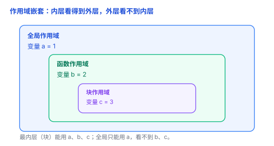
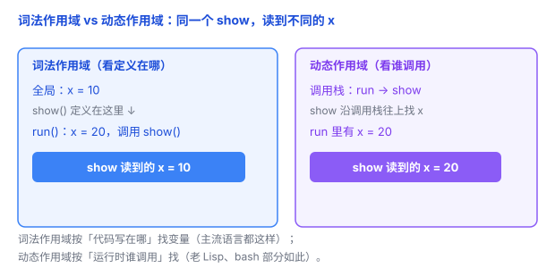
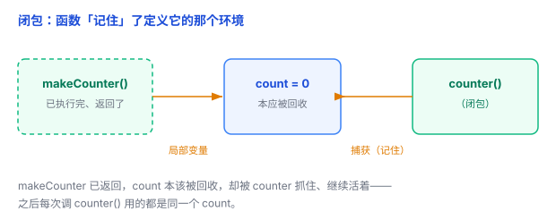

# 作用域与闭包：变量在哪「看得见」，函数怎么「记住」家

变量不是到处都能用的：有的全局都能用，有的只在函数里用，有的只在某个代码块里用——这就是**作用域**。而**闭包**是个更奇妙的特性：函数能「记住」它出生时的环境，哪怕那个环境早就结束了。

## 一、作用域：变量在哪些地方「看得见」

作用域（scope）回答一个问题：**一个变量名，在程序的哪些位置能访问到？**

打个比方：作用域就像一间间办公室。你在自己办公室（函数）里，能看到自己的东西（局部变量），也能看到公司大厅（全局）的公告；但大厅里的人，看不到你办公室里的私人物品。

最常见的三种作用域：

- **全局作用域**：整个程序任何地方都能访问。
- **函数作用域（局部）**：只在某个函数内部能访问。
- **块作用域**：只在 `{}`（大括号）包住的代码块里能访问。

```javascript
let a = 1;            // 全局作用域

function f() {
    let b = 2;        // 函数作用域（局部）
    {
        let c = 3;    // 块作用域
    }
    // 这里 c 已经看不见了
}
```

（C、Java、Python 这些语言里「函数内定义的变量」都是局部的；「块作用域」在 JavaScript 的 `let`/`const`、C/Java 的 `{}` 里都有。）

## 二、嵌套作用域：内层看得到外层，外层看不到内层

作用域是可以**嵌套**的：函数里可以再定义块，块里还能再定义块，就像俄罗斯套娃。

规则只有一条：**内层能访问外层的变量，外层不能访问内层的变量。**

```javascript
let a = 1;              // 全局
function f() {
    let b = 2;          // f 的局部
    function g() {
        let c = 3;      // g 的局部
        console.log(a, b, c);  // 1 2 3 —— g 能看到 a、b、c
    }
    g();
    // 这里看不到 c
}
```

找变量时，从**自己这一层**开始，一层层**往外找**，直到找到或到全局。这条「从内到外的查找链」叫**作用域链**。



## 三、词法作用域：变量归谁，看「定义在哪」，不看「在哪调用」

理解闭包之前，必须先搞清楚一个更底层的规则——**词法作用域**。

词法作用域（也叫静态作用域）：一个函数能访问哪些变量，取决于**它被定义在代码的哪个位置**，而不是**它在运行时被谁调用**。

绝大多数语言（C、Java、Python、JavaScript、Go、Rust……）都是词法作用域。看个例子：

```javascript
let x = 10;

function show() {
    console.log(x);   // 这里的 x 是哪一个？
}

function run() {
    let x = 20;
    show();           // 输出 10，还是 20？
}

run();
```

答案是 **10**。因为 `show` 定义在**全局**，它看到的 `x` 是全局那个 `10`；跟它被 `run` 调用（`run` 里有 `x = 20`）没关系。

另一种古老的规则叫**动态作用域**：变量按**运行时调用栈**找，`show` 被 `run` 调用，就去 `run` 里找 `x`，会输出 20。老 Lisp、bash 的某些情况就是这么干的。记住词法作用域就行——它是现代主流，也是闭包的根基。



## 四、闭包：函数「记住」了定义它的家

现在终于到闭包了。

闭包 = **一个函数 + 它定义时所在的作用域**。换句话说，函数不仅是一段代码，还**随身带着它出生时的那个环境**——包括那个环境里的变量。

看这个经典例子：

```javascript
function makeCounter() {
    let count = 0;               // count 是 makeCounter 的局部变量
    return function() {
        count = count + 1;       // 内层函数用到了外层的 count
        return count;
    };
}

const counter = makeCounter();
counter();   // 1
counter();   // 2
counter();   // 3
```

注意一个反直觉的点：`makeCounter()` 已经**执行完、返回了**。按常理，局部变量 `count` 应该随着函数结束而被回收。但它没有——因为返回的那个内层函数（`counter`）**还抓着** **`count`** **不放**。

这个「抓着」就是闭包：`counter` 记住了它定义时所在的作用域（`makeCounter` 里面），那个作用域里的 `count` 因此多活了下来，而且**每次调用** **`counter()`** **操作的都是同一个** **`count`**。

（Python、Go、Rust 等也都支持闭包，道理一样——函数带着它定义时的环境。）



## 五、闭包有什么用（和一个经典坑）

**用途：**

1. **私有变量 / 数据隐藏**：`count` 只在 `makeCounter` 里能改，外面碰不到，只能通过返回的函数间接操作。
2. **回调**：`setTimeout`、事件处理函数里访问外部变量，靠的就是闭包。
3. **记住状态**：上面的计数器，就是「记住上次数到几」。

**经典坑：循环里的闭包共享同一个变量。**

```javascript
for (var i = 1; i <= 3; i++) {
    setTimeout(function() {
        console.log(i);   // 输出 4 4 4，不是 1 2 3！
    }, 0);
}
```

为什么？`var` 是函数作用域，整个循环**共享同一个** **`i`**，三个回调都抓的是同一个 `i`；等循环跑完，`i` 已经变成 4，三个回调再打印，就都是 4。

把 `var` 换成 `let` 就对了——`let` 是块作用域，**每次循环都有一个新的** **`i`**，每个回调抓住各自的 `i`：

```javascript
for (let i = 1; i <= 3; i++) {
    setTimeout(function() {
        console.log(i);   // 1 2 3
    }, 0);
}
```

## 六、总结

- **作用域**：变量名在哪些位置能被访问；分全局 / 局部（函数）/ 块三种。
- **嵌套作用域**：内层看得到外层，外层看不到内层；查找时从内往外（作用域链）。
- **词法作用域**：变量归谁看「定义在哪」，不看「在哪调用」——这是闭包的根基。
- **闭包** = 函数 + 它定义时的作用域；函数返回后仍能访问出生环境的变量，那些变量因此活得更久。
- **坑**：循环里用 `var` 会让所有闭包共享同一个变量；用 `let` 每次迭代一个新绑定。

一句话：**作用域决定「谁看得见谁」，闭包让函数「记住出生时的家」——哪怕那个家早就散了。**
