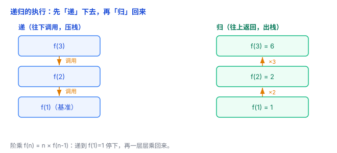
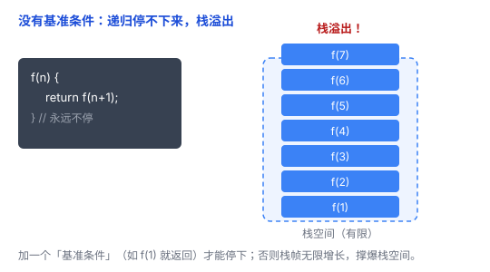

# 递归：函数调用自己，问题越拆越小

递归是编程里一个绕不开、又让很多人犯迷糊的概念。其实它的核心就一句话：**函数调用自己**。这篇文章把它讲清楚。

## 一、递归是什么：函数调用自己

**递归（recursion）**，就是一个函数**直接或间接地调用自己**。

打个比方：俄罗斯套娃——打开一个，里面还是一个同样的套娃，只是更小一点；再打开，还是套娃……直到最小的那个，不再有下一层。

代码上，最简单的递归长这样：

```python
def countdown(n):
    print(n)
    if n == 1:          # 停下来的条件
        return
    countdown(n - 1)    # 调用自己，参数更小

countdown(3)   # 打印 3 2 1
```

## 二、两个必备条件：基准 + 递归

一个递归函数必须有**两个部分**，缺一不可：

1. **基准条件（base case）**：什么时候停下来，不再调用自己。
2. **递归条件（recursive case）**：怎么把问题拆成一个**更小的自己**，然后调用自己。

对应套娃：基准条件就是「最小的那个套娃，打开后没有下一层」；递归条件就是「每一层都拆开，往里看更小的一层」。

**少了基准条件，就会无限递归下去**，最后把内存的调用栈撑爆（栈溢出）——这是递归最容易犯的错。

## 三、经典例子：阶乘

阶乘 `n! = 1 × 2 × … × n`，可以写成递归：

```python
def factorial(n):
    if n == 1:                # 基准条件：到 1 就停
        return 1
    return n * factorial(n - 1)   # 递归条件：拆成更小的自己

factorial(3)   # 6
```

一步步看 `factorial(3)` 干了什么：

- `factorial(3)` = `3 * factorial(2)`，得先算出 `factorial(2)`
- `factorial(2)` = `2 * factorial(1)`，得先算出 `factorial(1)`
- `factorial(1)` 命中基准，直接返回 `1`
- 于是倒着算回来：`factorial(2)` = `2 * 1` = `2`，`factorial(3)` = `3 * 2` = `6`

## 四、递归是怎么执行的：调用栈

递归能跑起来，靠的是**调用栈**（call stack）——就是前面《栈与堆》里说的那个栈。

每次调用 `factorial`，都会往调用栈上**压一个栈帧**，里面存着这一层自己的参数和局部变量（各层之间是**独立的副本**，互不干扰）。

整个过程分两段：

- **「递」下去**：`factorial(3)` 调 `factorial(2)` 调 `factorial(1)`，栈帧一层层压进去。
- **「归」回来**：`factorial(1)` 返回 1，再一层层往外算，栈帧逐个弹出。

所以递归不是「从头到尾一条线」，而是**先钻进去、再退出来**。



## 五、递归 vs 迭代：一回事，两种写法

递归和循环是**等价**的，任何递归都能改写成循环（反过来也一样）。

```python
# 递归
def factorial(n):
    if n == 1: return 1
    return n * factorial(n - 1)

# 迭代（循环）
def factorial_iter(n):
    result = 1
    for i in range(1, n + 1):
        result *= i
    return result
```

那什么时候用递归？当问题的结构**天生就是嵌套的**——比如树、图、分治（把大问题拆成小问题）——递归往往比循环更自然、代码更短。但如果只是简单计数，循环更省内存（因为不压栈）。

## 六、递归的代价和坑

**1. 栈溢出（Stack Overflow）**

递归每调一层就压一个栈帧，而栈空间是有限的。递归太深（比如几万层），栈就满了，程序报「栈溢出」崩溃。



**2. 重复计算**

看斐波那契数列的朴素递归：

```python
def fib(n):
    if n <= 1:      # 基准：fib(0)=0，fib(1)=1
        return n
    return fib(n - 1) + fib(n - 2)   # 拆成两个更小的问题
```

算 `fib(5)` 时，`fib(3)` 被重复算了好几次，`n` 越大重复越夸张，时间呈指数增长。解决办法是**记忆化**（把算过的结果存起来）或动态规划——那是后面的内容，这里先记住「朴素递归会重复计算」这个坑。

**3. 尾递归（可优化）**

如果「调用自己」是函数的**最后一步**，有些编译器能把它优化成循环，从而不占栈、不溢出。这是进阶话题，知道有这么回事即可。

## 七、总结

- **递归** = 函数调用自己；把大问题拆成**更小的自己**。
- 必须有**基准条件**（何时停）和**递归条件**（如何拆），缺了基准就栈溢出。
- 执行靠**调用栈**：先「递」下去（压栈），再「归」回来（出栈）。
- 递归和循环**等价**；树/分治这类天然嵌套的问题用递归更自然。
- 两个坑：**栈溢出**（太深）、**重复计算**（朴素斐波那契）。

一句话：**递归就是「把大问题拆成更小的自己，先递进去、再归回来」——但必须有一个基准让它停下来，否则栈会被撑爆。**
