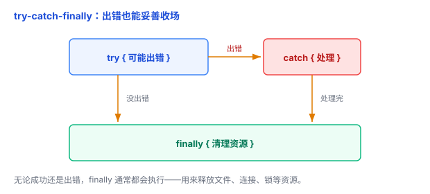
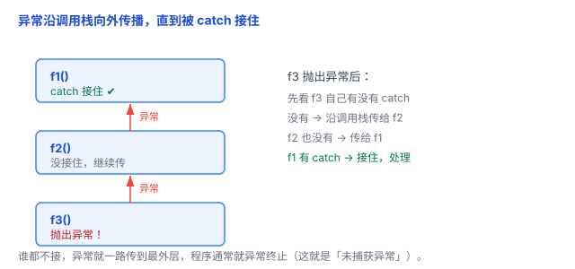

# 异常与错误处理：程序出错了，该怎么办

程序不可能永远顺利：除以零、文件不存在、网络断了、内存不够……错误躲不掉。关键不是「不犯错」，而是「犯错之后怎么办」。这篇文章讲清楚。

## 一、错误躲不掉：程序总会有意外

写代码时，有些错误**编译期**就能发现（语法写错、类型不匹配），还有许多错误只有**运行时**才能发现：

- 用户传了个 0，程序要除以它；
- 要读的文件被人删了；
- 网络请求超时；
- 内存不够分配。

打个比方：开车上路，总有爆胎、堵车、闯红灯的电动车——你不能假装这些不存在，得提前想好「遇到这种情况怎么办」。

## 二、两种处理风格：返回值 vs 异常

不同语言处理错误，主要有两种风格：

**风格一：用返回值 / 错误码**——函数出错时返回一个特殊值，调用方自己检查。

```c
FILE *f = fopen("data.txt", "r");
if (f == NULL) {
    return -1;    // 返回错误码，表示失败
}
```

Go 通常用 `(结果, error)` 返回操作结果和错误，让调用方显式判断是否成功（下面这段是示意片段）：

```go
result, err := readFile("data.txt")
if err != nil {
    return err    // 出错，把错误往上交
}
```

Rust 主要用 `Result<T, E>` 处理可恢复的错误（不可恢复的情况用 `panic`）：

```rust
let n = match parse(s) {
    Ok(v) => v,
    Err(e) => return Err(e),
};
```

**风格二：用异常（exception）**——出错时「抛」一个异常对象，由专门的代码「捕获」处理。Java、Python、JavaScript、C++、C# 都用这种。

```python
try:
    result = 10 / x            # 可能出错：x 是 0
except ZeroDivisionError:
    print("不能除以零")
```

两种风格各有拥趸，没有绝对优劣。本文重点讲**异常**这一套（更常见），但你要知道还有「返回值」这条路。

## 三、异常三件套：try / catch / finally

很多语言用 `try / catch / finally` 处理异常，但语法各有区别，有些语言甚至没有 `finally`：

- **try**：把「可能出错」的代码圈起来。
- **catch**（Python 里叫 `except`）：捕获并处理异常。
- **finally**：控制流离开 `try` 结构时**通常都会执行**的收尾代码，用来释放资源。

```python
try:
    result = 10 / x            # 尝试执行，可能出错
except ZeroDivisionError:
    print("不能除以零")         # 出错时走这里
finally:
    print("这行通常都会执行")    # 出错与否都走这里
```

`finally` 特别重要：文件、数据库连接、锁这些资源，**不管成功还是失败都得关掉**，放在 `finally` 里最稳。但要注意，它**不保证任何情况下都执行**——进程被强制终止（如 `os._exit()`、断电）时，`finally` 也可能来不及跑。

另外，很多语言有更省心的语法：Python 的 `with`、Java 的 try-with-resources、C++ 的 RAII，都能在离开作用域时自动清理，比手动写 `finally` 更不容易漏。



## 四、异常怎么传播：沿调用栈往外抛

如果 `try` 里出了错，但**当前函数没有 catch**（或者压根没写 try），异常不会消失，而是**沿调用栈一层层往外抛**，直到被某个 catch 接住。

打个比方：像把球往上抛——每一层都有机会接住，谁接了谁处理；如果一路没人接，球就砸在地上，通常导致程序异常终止。

```python
def f3():
    return 10 / 0           # 这里抛异常，但没 catch

def f2():
    return f3()             # 也没 catch

def f1():
    try:
        f2()
    except ZeroDivisionError:
        print("在 f1 接住了")   # 异常从 f3 一路传到这，被接住
```

在异常往外传的过程中，沿途的 `finally` 块会依次执行（这叫**栈展开**），让每一层该释放的资源尽量都释放掉。



## 五、该在哪里处理：在能处理的地方处理

一个重要的设计原则：**发现错误的地方，不一定是最适合处理错误的地方。**

比如这个读配置的函数：

```python
def read_config():
    with open("config.json") as f:
        return f.read()
```

如果文件不存在，`read_config` 自己**不一定知道该怎么办**——是重试？还是用默认配置？还是提示用户？这些它都决定不了。

但上层调用者可能知道：

```python
try:
    config = read_config()
except FileNotFoundError:
    config = "{}"    # 上层决定：用默认配置
```

所以：**底层负责发现问题、把错误信息传出去；上层根据业务决定怎么处理**（重试、降级、提示用户，还是干脆终止）。

这条原则不止适用于异常，Go 的 `error`、Rust 的 `Result` 也一样——它们只是把「错误」作为值一层层往上交，直到某个能决定怎么处理的地方。

## 六、异常的价值，和三个坑

**价值**：把「正常逻辑」和「出错处理」分开，代码更清爽；错误能跨好多层函数直接传播，不用每层都写 `if err != nil`；`finally` 让资源无论成败都能得到释放。

**坑 1：吞异常（空 catch）**

```python
try:
    risky()
except:
    pass        # 出错假装没看见 —— 反模式！
```

错误被藏起来，程序带着隐患继续跑，出了问题极难排查。**要么处理，要么让它往上抛**，别吞。

**坑 2：捕获太宽**

```python
try:
    risky()
except Exception:   # 什么错都接，分不清是哪种
    print("出错了")
```

一把梭接住所有异常，会把真正的 bug 也一起掩盖掉。尽量**捕获具体的异常类型**，只处理你真正能处理的那几种。

**坑 3：滥用异常做正常流程控制**

异常**可以**用于流程控制——比如 Python 里用捕获 `KeyError` 来处理「字典里没有这个键」，就是合理写法（Python 管这种风格叫 **EAFP**，见文末名词解释）：

```python
try:
    value = d[key]
except KeyError:
    value = None    # Python 里这么写很正常
```

但「坑」在于：**把异常当成普通的 if/else 或循环来用，会掩盖代码本来的意图**。比如有人用「越界异常」来结束循环：

```python
# 不好：靠异常来结束循环
i = 0
try:
    while True:
        print(arr[i])
        i += 1
except IndexError:
    pass    # 真正的「结束条件」藏在 except 里
```

问题在哪？`while True` 看起来像死循环，到底什么时候停、为什么停，都藏在 `except` 里，一眼看不出来；而且「走到数组末尾」本该是正常要发生的事，不是意外，拿异常去兜底，逻辑是绕的。

正常写法把「结束条件」摆到明面上：

```python
for item in arr:    # 结束条件一目了然
    print(item)
```

所以判断标准是：**异常用来应对「意外」；如果一件事属于正常业务分支，用专门的写法往往更直白。**（补充一句：进入 `try` 块本身开销很小，真正贵的是「真的抛出并捕获异常」那一刻——频繁靠异常控制流程才可能有性能问题。）

## 七、总结

- **错误**躲不掉，关键是想好「出错后怎么办」。
- 两种风格：**返回值 / 错误码**（C、Go、Rust），**异常**（Java、Python、JS、C++、C#）。
- 异常三件套：**try** 圈风险、**catch** 接住处理、**finally** 兜底收尾。
- 异常没被接住时**沿调用栈往外抛**，沿途 `finally` 依次执行；没人接，程序通常就异常终止。
- **在能处理错误的地方处理**：底层发现问题，上层决定怎么处理。
- 三个坑：**吞异常**、**捕获太宽**、**滥用异常做流程控制**。

一句话：**try 圈出风险、catch 接住意外、finally 兜底收尾——错误顺着调用栈往外抛，在能处理它的那一层处理它。**

### 名词解释

- **EAFP**（Easier to Ask Forgiveness than Permission）：直译「请求原谅比请求许可更容易」，即**先直接做、出错再补救**。Python 鼓励这种风格，所以捕获 `KeyError` 处理「字典里没这个键」很正常。
- **LBYL**（Look Before You Leap）：直译「先看再跳」，即**先检查条件、没问题再动手**，和 EAFP 相反。

```python
# EAFP：先直接做，出错再补救
try:
    value = d[key]
except KeyError:
    value = None

# LBYL：先检查，再动手
if key in d:
    value = d[key]
else:
    value = None
```
