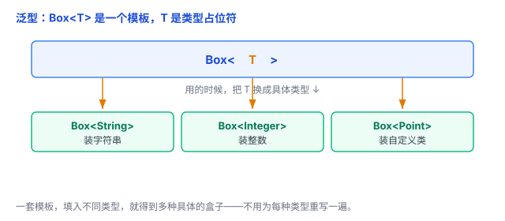
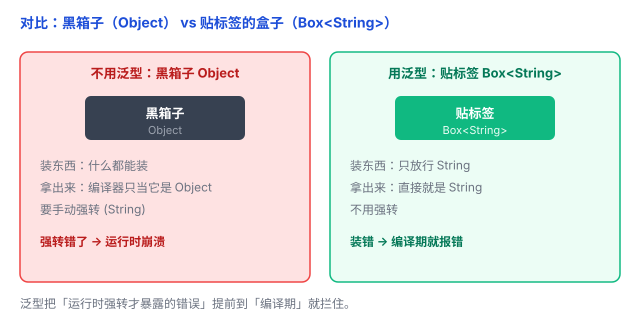

# 泛型：一套代码，适配多种类型

写代码时，经常遇到「逻辑一模一样，只是类型不同」的情况。比如一个装东西的盒子，装整数要写一个类，装字符串又要写一个类——几乎全是复制粘贴。泛型就是来解决这个的。这篇文章把它讲清楚。

## 一、一个问题：同样的逻辑，为每种类型重写一遍

假设你要一个「装东西的盒子」，先装整数，再装字符串，代码会长这样：

```java
class IntBox {
    int value;
    IntBox(int value) { this.value = value; }
    int get() { return value; }
}

class StringBox {
    String value;
    StringBox(String value) { this.value = value; }
    String get() { return value; }
}
// 再来一个 DoubleBox、一个 PointBox……没完没了
```

两个类**逻辑一模一样**，只有 `int` 和 `String` 这两个类型不同。能不能只写一遍？

## 二、泛型：把「类型」也变成参数

函数参数你熟：一个「值」的占位，调用时传具体值。**泛型是同一套思路，只不过把「类型」也变成参数**——写一个占位符 `<T>`，用的时候再填具体类型。

```java
class Box<T> {              // T 是「类型参数」，一个占位符
    T value;
    Box(T value) { this.value = value; }
    T get() { return value; }
}
```

`T` 只是占位符（Type 的首字母），你写 `E`、`K`、`V` 也行。这一个 `Box<T>` 顶前面所有 Box：

```java
Box<Integer> b1 = new Box<>(1);
Box<String>  b2 = new Box<>("hello");
```



「泛型」里的「泛」，就是「泛化、通用」的意思——写一套通用的代码，适配多种类型。泛型在 C++、Java、C#、Rust、TypeScript、Go、Swift 里都有，写法略有差异（比如 C++ 写成 `template<typename T>`），但思想完全一样。

## 三、一个例子贯穿：带标签的盒子

泛型的价值，用一个对比最能看清楚。

**不用泛型**（很多老代码用 `Object` 硬扛）：盒子什么都装，但拿出来时是 `Object`，得自己强转。

```java
class Box {
    Object value;              // 用最通用的 Object 装
    Box(Object value) { this.value = value; }
    Object get() { return value; }
}

Box box = new Box("hello");
String s = (String) box.get();   // 手动强转，因为你「知道」里面是 String

Box box2 = new Box(123);         // 123 自动装箱成 Integer
String s2 = (String) box2.get(); // 编译能过！运行时才报 ClassCastException
```

问题在于：**编译器不知道盒子里装的是啥**，你强转时它没法拦；等程序跑起来、真把一个整数当字符串用，才「啪」地炸掉。

**用泛型**：盒子贴上「标签」，装什么、拿什么，类型都清清楚楚。

```java
Box<String> box = new Box<>("hello");
String s = box.get();            // 不用强转，直接就是 String

Box<Integer> box2 = new Box<>(123);
String s2 = box2.get();          // 这里编译直接报错，而不是运行才炸
```



## 四、泛型的两个价值

1. **代码复用**：`Box<T>` 一个类，顶过去 N 个几乎一样的类。
2. **类型安全**：把「运行时的强转错误」提前到「编译期」发现——早发现、早改，不留给线上崩溃。

一句话：**泛型用「编译期的一点约束」，换来「运行时的安全」。**

## 五、泛型函数：不只用在类上

泛型不只用在类上，函数也行。比如「交换两个元素」：

```java
static <T> void swap(T[] arr, int i, int j) {
    T tmp = arr[i];
    arr[i] = arr[j];
    arr[j] = tmp;
}
```

`<T>` 写在返回类型前面，之后函数里的这个 `T` 就代表「随便哪个类型」。字符串数组、整数数组……都能用这同一个函数换，不用各写一遍。

## 六、两个容易误解的点

**1. 泛型 ≠ any**

有人以为「泛型就是随便装、不管类型」。正好相反——**泛型让类型信息保留下来，编译器好帮你检查**。`Object` 才是真正的「不管类型」，所以才要强转、才容易炸。

**2. 可以给类型参数加约束**

很多语言还支持给 `T` 加约束，比如「`T` 必须是 `Number` 的子类」（Java 里写 `Box<T extends Number>`）。这样既能复用代码，又能把 `T` 圈定在某个范围里。这是进阶话题，知道有这回事就行。

## 七、总结

- 泛型 = **把「类型」也变成参数**，一套代码适配多种类型。
- 解决的是「逻辑一样、只是类型不同」的重复代码。
- 两个价值：**代码复用** + **类型安全**（编译期发现错误，而不是运行时强转崩溃）。
- `Box<T>` 里的 `T` 是占位符，用的时候填具体类型。
- 泛型 ≠ any：它不是「不管类型」，而是「保留类型信息，让编译器检查」。

一句话：**泛型就是给「类型」留一个占位符——一套代码适配多种类型，还把运行时的强转错误提前到编译期拦住。**
