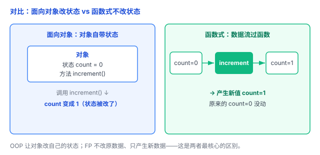
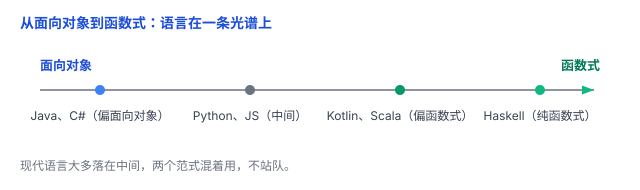

# 面向对象 vs 函数式：两种组织代码的思路

「编程范式」这个词听起来玄，其实就一件事：**你习惯用哪种方式组织、思考代码**。主流的两种是**面向对象**（OOP）和**函数式**（FP）。它们不是二选一的对立关系，现代语言大多混着用。这篇文章把两者最核心的区别讲清楚。

## 一、两种看世界的方式

**面向对象**：把程序看成**一群对象**——每个对象有自己的**状态**（数据）和**行为**（方法），数据和操作数据的代码打包在一起。三大特征：封装、继承、多态。

**函数式**：把程序看成**数据的流动**——数据在一堆**函数**之间传来传去，每个函数只做「输入 → 输出」，不修改数据。三大特征：纯函数、不可变数据、函数是一等公民（能当参数、当返回值）。

打个比方：

- OOP 像**一群办事员**：每人手里有本账本（状态），你让他办事（调方法），他自己改自己的账本。
- FP 像**流水线**：原料（数据）从一头进去，经过一道道工序（函数），每道工序不改原料，只把加工好的东西传给下一道。

## 二、核心区别一：状态怎么管

这是两者最本质的区别。

OOP 用**可变状态**：对象的属性可以随时改。

```java
class Counter {
    int count = 0;          // 状态
    void increment() {
        count++;            // 方法直接改自己的状态
    }
}
```

FP 用**不可变数据**：不改原值，返回一个新值。

```python
def increment(count):
    return count + 1    # 原来的 count 没动，返回一个新值

c = 0
c = increment(c)        # 想用新值，就用返回值覆盖
```

前者是「把账本上的数字擦掉重写」，后者是「照抄一份、写上新的、把新的递给你，旧的不动」。

## 三、核心区别二：有没有副作用

FP 特别强调**纯函数**：同样的输入，永远得到同样的输出，而且**不改外面的任何东西**（无副作用）。

```python
def add(a, b):
    return a + b        # 纯函数：不碰外面，只返回结果

def append_to_list(lst, x):
    lst.append(x)       # 有副作用：改了外面传进来的 list
```

纯函数的好处：好测试、好推理、能放心并行（因为它不抢着改同一份数据）。OOP 的方法经常有副作用（改对象状态、写文件、发请求）——这**不是错**，只是两者的默认倾向不同。

## 四、区别三：常见的代码复用方式

**OOP 常通过继承、组合等方式复用代码。**

例如，继承可以让子类直接使用父类已经实现的方法：

```java
class Animal {
    void move() { System.out.println("移动"); }
}
class Dog extends Animal { }   // Dog 不用重写 move
```

除了继承，OOP 还可以通过**组合**，让一个对象使用其他对象已有的功能。

**FP 常通过函数组合、高阶函数等方式复用代码。**

例如，高阶函数可以把函数当参数传递，让同一套逻辑搭配不同的函数：

```python
def apply_twice(f, x):
    return f(f(x))

def add_one(x): return x + 1
def double(x):  return x * 2

apply_twice(add_one, 3)     # 5
apply_twice(double, 3)      # 12
```

**本质区别：OOP 倾向于围绕对象组织和复用行为；FP 倾向于通过函数的组合与传递组织和复用计算逻辑。**

两者不是互斥的——面向对象里也能用高阶函数，函数式里也能用对象。

## 五、一个例子，两种写法

同一个任务——把一份价格列表全部打 9 折再求和：

```python
prices = [100, 200, 300]

# 函数式：数据流过「打折」「求和」两个函数，不建对象、不改原数据
total = sum(map(lambda p: p * 0.9, prices))   # 270

# 面向对象：建一个 Order 对象，它自己存着价格、自己算
class Order:
    def __init__(self, prices):
        self.prices = prices
    def discounted_total(self):
        total = 0
        for p in self.prices:
            total += p * 0.9
        return total

total = Order(prices).discounted_total()      # 270
```

两种都正确。函数式更短、更「声明式」（说「要什么」，不管一步步怎么做）；面向对象更「命令式」（一步步说「怎么做」）。



## 六、现实：两个范式混着用

很少语言是「纯」的，大多落在中间一条光谱上：

- Java、C# 老牌面向对象，后来都加了 lambda、Stream 这些函数式特性；
- Python、JavaScript 两边都支持，你爱怎么写怎么写；
- Kotlin、Scala、Swift 天生混合，函数式支持很强；
- Haskell 是纯函数式的代表，但比较小众。



所以不用站队。理解两边的工具，哪个顺手、哪个更清楚就用哪个。

## 七、总结

- **面向对象**：对象 = 状态 + 行为，靠封装/继承/多态组织代码，倾向**可变状态**。
- **函数式**：数据 + 纯函数，靠函数组合组织代码，倾向**不可变数据、无副作用**。
- 三方面区别：**状态怎么管**、**有没有副作用**、**怎么复用代码**。
- 现实是**混合使用**，不是二选一。

一句话：**面向对象把程序组织成「带状态的对象」，函数式把程序组织成「流动的数据 + 纯函数」——核心差别在「怎么管状态」，而现实是两者混着用。**
