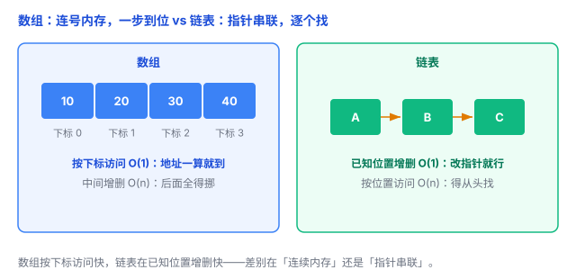
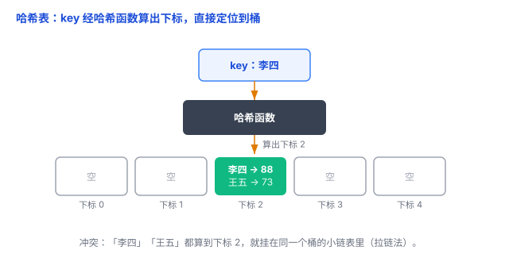

# 数组、链表、哈希表：三种最常用的数据容器

程序里数据一多，就得找个地方「装」起来。装法不同，查找、增删的速度就天差地别——这就是「数据结构」要管的事。最基础、用得最多的三种：**数组、链表、哈希表**。这篇文章把它们讲清楚。

先说个记号：**O(1)** 表示「一步到位」，跟数据多少无关；**O(n)** 表示「要一个个找」，数据越多越慢。大 O 的完整含义后面有专门一篇，这里先记住这个直觉。

## 一、数组：一排连号的内存

**数组（array）**：一块**连续**的内存，元素一个挨一个，每个占一样大的空间，靠**下标（索引）** 直接定位。

```python
arr = [10, 20, 30, 40]
arr[2]   # 30，按下标一步拿到
```

为什么快？因为地址能「算」出来：`起始地址 + 下标 × 每个元素的大小`，不用挨个找，所以**按下标访问是 O(1)**。

但代价是：

- 传统数组大小**固定**（C 语言里就是这样）。Python 的 `list` 是「动态数组」，会自动扩容，但扩容时要另找一块更大的连续内存、把旧的整个搬过去，也有代价；
- 在**中间插入或删除**一个元素，后面的元素全得往后挪，**O(n)**。

打个比方：**一排编好号的储物柜**。知道柜号，直接走过去开柜；但要在中间硬塞一个新柜子，后面的全得往后挪。

## 二、链表：一条首尾相连的链条

**链表（linked list）**：每个元素（叫「节点」）里存两样东西——**自己的值**，加一个**指向下一个节点的指针**。节点可以散落在内存各处，靠指针串起来。

```python
class Node:
    def __init__(self, value):
        self.value = value
        self.next = None   # 指向下一个节点

a = Node("A")
b = Node("B")
c = Node("C")
a.next = b
b.next = c
# 一条链：A → B → C
```

它的特点正好和数组相反：

- **插入/删除快**：找到位置后，改改指针就行，**O(1)**，不用挪一堆元素；
- **按下标访问慢**：没有下标，得从头一个个往下走，**O(n)**；
- 每个节点要多存一个指针，**额外占内存**。

打个比方：**寻宝游戏**——每个人只知道「下一个藏宝人在哪」，要找到第 10 个，只能从第 1 个开始一个个问下去。

> 小提醒：链表的「插入/删除 O(1)」指的是**已经找到位置之后**；光是要找到那个位置，本身就得 O(n) 往下走。这是很多人容易混淆的点。

## 三、数组 vs 链表：一张对比图

| 对比 | 数组 | 链表 |
|---|---|---|
| 按下标访问 | O(1)，快 | O(n)，慢 |
| 已知位置后插入/删除 | O(n)，通常要移动元素 | O(1)，通常只需改指针 |
| 内存布局 | 连续 | 节点可以分散 |
| 额外内存 | 通常较少 | 每个节点额外存一个指针 |
| 长度变化 | 传统数组固定，动态数组可扩容 | 可以动态增删节点 |

一句话：**数组擅长按下标访问，链表擅长在已知位置增删节点，哈希表擅长按 key 快速查找。**



## 四、哈希表：给个 key，一步找到 value

数组要下标，链表要挨个找——有没有「给个名字，一步到位」的办法？这就是**哈希表（hash table）**，也就是 Python 的 `dict`、Java 的 `HashMap`。

它 = **数组 + 哈希函数**：

1. 你给一个 **key**（比如名字「李四」）；
2. **哈希函数**把它算成一个**下标**；
3. 直接去数组的对应位置拿 value。

```python
d = {"张三": 95, "李四": 88, "王五": 73}
d["李四"]   # 88，给 key 一步拿到 value
```

查找、插入、删除**平均都是 O(1)**——这是它最迷人的地方。

打个比方：**图书馆的索书号**——书名经过一套编号规则，对应到具体的书架和层，照着编号直接走过去拿，不用从第一排开始翻。

**一个必须知道的坑：哈希冲突。** 两个不同的 key，哈希函数可能算出**同一个下标**（比如「李四」和「王五」都算到 2 号）。常见解法是**拉链法**：同一个位置挂一条小链表，冲突的 key 串在一起，到了那一格再在小链表里翻一下。冲突严重时，查找会退化变慢（最坏 O(n)），但好的哈希函数能让冲突很少，平均仍是 O(1)。



## 五、怎么选：看你的主要操作

- **常按下标/顺序访问** → 数组（内存连续，还能更好地利用缓存）。
- **经常在已知节点位置插入、删除** → 考虑链表。
- **常按 key 查找** → 哈希表。

实际工程里，数组（和它的变体「动态数组」，比如 Python 的 `list`）用得最多；链表常在底层结构里出现；哈希表是「快速查找」的默认答案。

## 六、总结

- **数组**：连续内存 + 下标，按下标访问 O(1)，中间增删 O(n)。
- **链表**：节点 + 指针串联，已知位置增删 O(1)，按下标访问 O(n)。
- **哈希表**：数组 + 哈希函数，按 key 平均 O(1)，但要注意哈希冲突。
- 选哪个，看你的主要操作：**按位置访问**、**按位置增删**，还是**按 key 查找**。

一句话：**数组靠下标一步到位、链表靠指针在已知位置灵活增删、哈希表靠哈希函数给 key 一步找到 value。**
