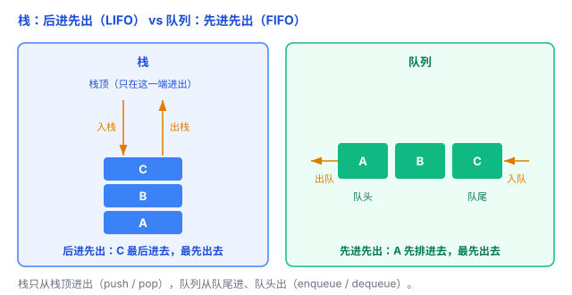

# 栈、队列：两种「有规矩」的容器

数组、链表、哈希表你想怎么存取都行。但有些场景，得给存取立个规矩——比如「只能从顶拿」或「先来先走」。这就是**栈**和**队列**：两种「受限制」的容器，规则简单，用处却极广。

## 一、栈：后进先出（LIFO）

**栈（stack）**：像**一叠盘子**——只能从「顶」放、从「顶」拿。最后放上去的，最先被拿走，这叫**后进先出（LIFO，Last In First Out）**。

两个操作：

- **push（压栈）**：把一个元素放到栈顶；
- **pop（弹栈）**：从栈顶拿走一个元素。

```python
stack = []
stack.append("A")   # push A
stack.append("B")   # push B
stack.append("C")   # push C（此时 C 在栈顶）
stack.pop()         # "C" —— 最后进去的，最先出来
```

只能动栈顶，中间的元素够不着——这就是「规矩」。

你早见过它了：前面《递归》里的**调用栈**、以及《栈与堆》里的**内存栈区**，都是栈。生活中的例子还有 **Ctrl+Z 撤销**、**浏览器后退**、**括号匹配**（左括号压栈，遇到右括号就弹栈配对）。

## 二、队列：先进先出（FIFO）

**队列（queue）**：像**排队买票**——从队尾进、从队头出。先来的先服务，这叫**先进先出（FIFO，First In First Out）**。

两个操作：

- **enqueue（入队）**：排到队尾；
- **dequeue（出队）**：从队头离开。

```python
from collections import deque
q = deque()
q.append("A")      # 入队 A（排到队尾）
q.append("B")      # 入队 B
q.append("C")      # 入队 C
q.popleft()        # "A" —— 最先来的，最先走
```

（Python 里 `list` 也能当队列用，但 `pop(0)` 要挪一整个列表，很慢，所以通常用 `deque`。）

应用：**任务队列**、**消息队列**、**打印机排队**、**CPU 调度**，还有图的**广度优先搜索（BFS）**。

## 三、一张对比表

| | 规则 | 操作端 | 比喻 |
|---|---|---|---|
| 栈 | 后进先出 LIFO | 一端（栈顶） | 一叠盘子 |
| 队列 | 先进先出 FIFO | 两端（队尾入、队头出） | 排队买票 |



## 四、底层用什么实现

栈和队列是「**规则**」（接口），底层可以用**数组**或**链表**实现。比如 Python 的 `list` 能当栈用，`deque` 能当队列用。你只需要关心规则，不用管它内部是数组还是链表。

## 五、怎么选

一句话判断：

- 要「**最后来的先处理**」——撤销、递归、回溯、括号匹配 → **栈**。
- 要「**先来的先处理**」——排队、消息、任务调度、BFS → **队列**。

## 六、总结

- **栈**：后进先出（LIFO），只能动栈顶，push / pop。
- **队列**：先进先出（FIFO），队尾入、队头出，enqueue / dequeue。
- 两者都是「受限制」的容器，规则简单但用途极广。
- 底层可用数组或链表实现；选哪个，只看你需要「后进先出」还是「先进先出」。

一句话：**栈是「一叠盘子」——后进先出，只能动栈顶；队列是「排队买票」——先进先出，队尾进、队头出。**
