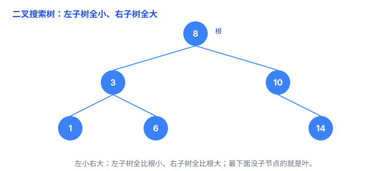
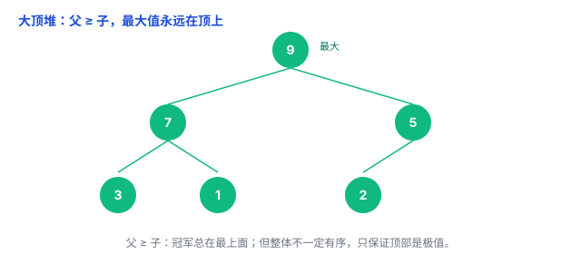
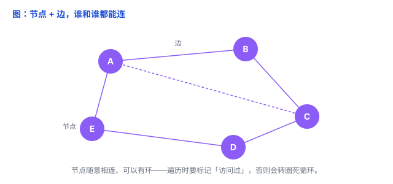

# 树、堆、图：会「长形状」的数据结构

前面几篇——数组、链表、栈、队列——都有一个共同点：元素**排成一条线**，一个接一个。但现实里的关系，很多不是一条线能装下的：文件夹一层套一层、任务总有「最紧急」的要排在最前、社交网络里人和人随意相连。

这三类问题，分别由**树**、**图**，还有专门管「优先级」的**堆**来解决。这篇文章把它们讲清楚。

## 一、树：一层层分叉的层级

**树**（tree）：一个**根**，往下分叉出**子节点**，子节点再往下分叉……像一棵倒过来的树（根在上、叶在下）。文件目录、公司组织架构、网页的 DOM、家谱，都是树。

几个词，一次记下：

- **根**：最上面唯一的起点；
- **父子**：上面的是父、下面的是子，**每个节点只能有一个父**（这是树和图的关键区别）；
- **叶**：最下面、没有子节点的节点；
- 树里**不能有环**——不能走着走着绕回自己。

树里最常用的是**二叉树**：每个节点**最多两个**子节点。再进一步，**二叉搜索树**（BST）：整个左子树都比它小、整个右子树都比它大。于是查找就像「猜数字」——每比较一次，就排除一侧子树。树比较均衡时，查找只要 O(log n)；树长歪时，最坏会退化成 O(n)。

**坑**：如果按 1、2、3、4、5 的顺序往二叉搜索树里插，它就会一路长歪成**一条链表**，查找直接退化到 O(n)。所以人们造出「平衡树」（AVL、红黑树），让树高保持 O(log n)、不会长歪——知道有这回事就行。

**何时用**：表达层级关系；既要「有序」又要「快速查找」。

## 二、堆：永远把「最大/最小」顶在最上面

先说一句容易混的：**这里的「堆」，和内存里的「堆」是两码事，只是撞了名字。** 内存堆是「自由分配内存的区域」；数据结构的堆是一种「能快速拿极值的结构」。可回看 [内存：栈 vs 堆](../01-计算机系统/01-栈与堆.md)。

**痛点**：程序经常要反复问「现在最大/最小/最优先的是哪个」——任务调度里最紧急的任务、排行榜前 10、导航里离得最近的节点。用普通数组，每次找最大要扫一遍，O(n)。

**堆**（heap）：一类满足特殊大小关系的数据结构。最常见的是**二叉堆**——一种特殊的完全二叉树，要求**父节点始终 ≥ 子节点**（大顶堆），或者 ≤ 子节点（小顶堆）。后文都简称「堆」。

「完全二叉树」指：除了最后一层，其他层都填满；最后一层的节点从左向右连续排列。

于是**最大值永远在根上**，查看最大值只要 O(1)；如果要把它**取出来并从堆里删掉**，得重新调整堆，耗时 O(log n)。

打个比方：**冠军永远站在最顶上**。新人进来和上面的比，赢的往上顶；冠军走了，下面补上来。调整只要 O(log n)——因为树只有 log n 层高。

**关键直觉（也是最大的坑）**：堆**只保证顶上是极值，整体不是有序的**。别想「遍历一个堆得到从小到大」——堆不干这个，它只承诺一件事：随时能把「最优先的那个」取出来。

**何时用**：优先队列、任务调度、top-k（前 k 大/小）、堆排序。

## 三、图：谁和谁都能连的网

树有「一个父、不能有环」的限制，可现实里很多关系不受这限制——**社交网络、地图道路、网页之间的链接、包的依赖**，都是「多对多」，谁和谁都能连。

**图**（graph）：一堆**节点**（顶点）加一堆**边**把它们连起来。边可以有**方向**（有向图，比如「A 关注 B」是单向的）、有**长度**（加权图，比如地图上的距离）。

打个比方：**一张网 / 地铁线路图**——站点是节点，线路是边。

图最关心的几个问题（这里只讲直觉，具体算法后面单开）：

- 能不能从 A 走到 B（**连通性**）；
- 怎么走**最短**（最短路径，导航就干这个）；
- 遍历的两个经典姿势：**DFS**（深度优先搜索，一条道走到黑）和 **BFS**（广度优先搜索，一圈圈往外扩）；BFS 一层层扩散，正好用来找「最短步数」。

**坑**：图里有环，遍历时**一定要标记「访问过」**，否则会在环里转圈、死循环。

**何时用**：社交关系、地图导航、推荐、依赖解析。

## 四、一张表看清它们的关系

| 数据结构 | 形状 | 核心特点 |
|---|---|---|
| 数组、链表 | 线性 | 元素按一定顺序组织 |
| 栈、队列 | 线性逻辑 | 限制元素的进出顺序 |
| 树 | 层级 | 父子关系、无环 |
| 二叉堆 | 完全二叉树 | 快速获取最大值或最小值 |
| 图 | 网状 | 可以表示任意连接关系 |

从线性结构到树，再到更一般的图，数据之间能表达的关系越来越丰富；而**堆**是一类专门高效管理最大/最小值、优先级的结构，最常见的**二叉堆**就是一种特殊的树。

## 五、怎么选

- 表达**层级**（目录、组织、父子）→ **树**；
- 要反复拿**最大/最小/最优先** → **堆**；
- 表达**任意连接**（社交、地图、依赖）→ **图**。

## 六、总结

- **树**：根 + 父子 + 叶，无环，表达层级；二叉搜索树「左小右大」，均衡时查找 O(log n)，长歪会退化。
- **堆**：一类管「优先级」的结构，最常见的是**二叉堆**（完全二叉树 + 父 ≥ 子），**极值永远在顶上**；只保证顶部是极值，整体不有序。
- **图**：节点 + 边，任意连，可以有环/方向/权重；遍历要标记访问过。
- 关系：**线性 → 树 → 图**，能表达的关系越来越丰富；堆专门管极值/优先级，最常见的二叉堆是一种特殊的树。

一句话：**树表达层级、图表达任意连接、堆专门管「优先级」——从线到树到图，数据能表达的关系越来越丰富，而堆最常见的形态就是一种特殊的树。**
