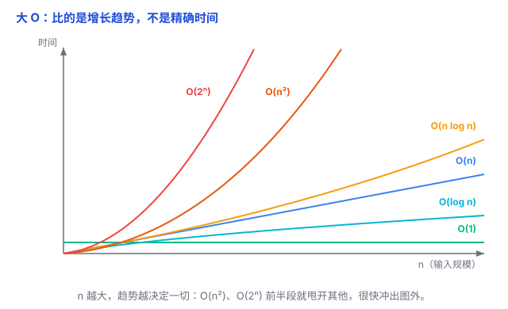

# 复杂度分析：一句话判断「快不快」

前面几篇反复出现「O(1)」「O(log n)」「O(n)」这些记号——数组按下标取是 O(1)、平衡树查找是 O(log n)、扫一遍是 O(n)。这一篇把它们一次讲透：这串符号到底在量什么、怎么读、怎么算。

先分清一件事：复杂度分**两种**——**时间复杂度**（花多少时间）和**空间复杂度**（占多少内存），两者用的是同一套大 O 记法。本文主要讲**时间复杂度**——日常说「快不快」指的就是它；空间复杂度道理完全一样，放到第三节末尾补一句。

## 一、大 O 量的是「增长趋势」，不是秒表

怎么判断一个算法快不快？最朴素的答案是「跑一下看看」——但这不靠谱：同一段代码，换台快机器、换个小数据，结果完全不一样。

我们需要一把**跟机器无关的尺子**：当输入规模 n 越来越大时，算法花的**时间**以多快的速度增长。这就是**时间复杂度**，用**大 O 表示法**来写。

打个比方：大 O 不量「跑了几秒」，量的是「n 翻倍时多花多少」。

- O(n)：数据翻一倍，时间大约翻一倍；
- O(n²)：数据翻一倍，时间大约变 4 倍；
- O(2ⁿ)：数据多一个，时间大约翻一倍。

它描述的是**趋势**，所以会扔掉所有「小项」：

- O(3n + 5) 写成 O(n)——常数 3 和 5 不影响「线性增长」这个趋势；
- O(n² + n) 写成 O(n²)——n 很大时，n 相比 n² 小到可以忽略。

（大 O 通常指**最坏情况**：最坏也不过如此；平均情况另说，先不展开。）

## 二、一张图看懂：从快到慢

越靠下、越平，越快。常见复杂度从快到慢：

- **O(1)**：不管 n 多大，时间固定——数组按下标取元素（见 [数组、链表、哈希表](01-数组链表哈希表.md)）。
- **O(log n)**：每一步把规模砍半——二分查找、平衡树（见 [树、堆、图](03-树与堆与图.md)）。
- **O(n)**：把 n 个元素挨个看一遍——遍历。
- **O(n log n)**：一共分 log n 层、每层都扫一遍 n——快排、归并、堆排序。
- **O(n²)**：双重循环。
- **O(2ⁿ)**：指数爆炸——每多一个元素，规模翻倍；n 稍微大一点就彻底跑不动。

## 三、怎么算：三个规则

1. **看循环怎么走**：一层循环把 n 个扫一遍 = O(n)，两层嵌套 = O(n²)，三层 = O(n³)。但如果循环里每次把范围砍半，就不是 O(n)——见下一条。
2. **看每次砍多少**：每步把范围砍半，总共要 log n 步（二分查找）；每步只减一个（一个个排除），要 n 步。
3. **忽略常数和低阶项**：O(2n)、O(n/2)、O(3n+5) 都是 O(n)。

空间复杂度同理：量的是「**额外**用了多少内存」随 n 怎么涨，记号一样，只是量内存不量时间。

## 四、最容易犯的三个错

**1. O(1) 不是「只做一次」，是「不随 n 增长」。**
一段固定执行 100 步、跟输入大小无关的代码，也是 O(1)。

**2. log 的底数无所谓。**
O(log₂n)、O(log₁₀n) 只差一个常数倍（换底公式），大 O 把常数扔掉了，所以统一写 O(log n)。

**3. 大 O 只告诉你趋势，不告诉你实际快慢。**
两个都是 O(n) 的算法，实际速度可能差 10 倍（常数、缓存友好度不同）。而且 n 很小时，O(n) 可能比 O(log n) 还快——大 O 只在 **n 足够大**时才准。

## 五、什么时候在乎

- 估算一个算法**在数据变大时会不会扛不住**——比如 n 从 1 万涨到 100 万，O(n²) 会从 1 亿涨到 1 万亿，基本废了。
- 数据规模**已知很小**时，不必过度纠结大 O——这时常数项、代码好不好读更重要。
- 面试、读源码、设计数据结构时，它是判断「这么干行不行」的第一道尺子。

## 六、总结

- 大 O 量的是**增长趋势**：n 变大时，工作量以多快速度增长，跟具体机器、精确时间无关。
- 从快到慢：**O(1) < O(log n) < O(n) < O(n log n) < O(n²) < O(2ⁿ)**。
- 计算靠三个规则：看循环怎么走、看每次砍多少、忽略常数和低阶项。
- 它给的是趋势不是精确值：n 很小时不准，n 很大时决定一切。

一句话：**大 O 是一把跟机器无关的尺子，量的是「n 翻倍时工作量翻几倍」的增长趋势——O(1) 最快、O(log n) 砍半、O(n) 线性、O(n²) 双重循环、O(2ⁿ) 指数爆炸。**
