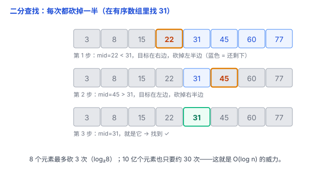

# 排序与查找：先排好序，查找就能从「一个个找」变成「砍半找」

查找和排序，是程序里最常做的两件事：在名单里找人、把成绩从高到低排、给商品按价格排序……它们其实是一对搭档——**排序的最大价值之一，就是让「按大小 / 顺序」的查找从 O(n) 快进到 O(log n)**。这篇把两个一起讲透。

O(1)、O(n)、O(log n)、O(n log n) 这些记号的完整含义见 [复杂度分析](04-复杂度分析.md)，这里直接拿来用：O(1) 一步到位、O(n) 一个个扫、O(log n) 每次砍半、O(n log n) 分 log n 层、每层扫 n 个。

## 一、查找：三种姿势，从慢到快

### 1. 线性查找 O(n)：不管三七二十一，从头扫到尾

最朴素的办法：从第一个开始，一个个问「是不是你」。数据**有没有排好序都无所谓**，反正全扫一遍。

```python
def linear_search(arr, target):
    for i, x in enumerate(arr):
        if x == target:
            return i
    return -1
```

打个比方：**在乱糟糟的书架上找一本书**，只能从第一本翻到最后一本，运气好一下就中，运气差要翻到最后，平均翻一半。数据越多越慢，O(n)。

### 2. 二分查找 O(log n)：前提是有序，每次砍半

如果数据**已经排好序**，就能用**二分查找（binary search）**：每次取「中间」那个元素，和目标比大小——比目标小，说明目标在右半边；比目标大，说明在左半边。**每比一次，砍掉一半。**

```python
def binary_search(arr, target):
    low, high = 0, len(arr) - 1
    while low <= high:
        mid = (low + high) // 2
        if arr[mid] == target:
            return mid
        elif arr[mid] < target:
            low = mid + 1      # 目标在右半边
        else:
            high = mid - 1     # 目标在左半边
    return -1                  # 没找到
```



打个比方：**翻字典 / 猜数字**。猜 1~100 的数字，每次猜中间（50），对方说大了就往小的一半猜（25），小了就往大的一半猜——最多 7 次就能锁定（log₂100 ≈ 7）。

两个硬前提要记牢：

- **必须有序**：顺序是乱的，二分就失灵了；
- **必须能快速访问中间元素**：数组可以一步跳到中间，所以适合二分；链表只能一个个往后走，即使有序，也没法获得 O(log n) 的查找优势。

### 3. 哈希表 O(1)：给 key 一步到位

如果按「名字」查，而不是按「大小顺序」查，哈希表一步到位（见 [数组、链表、哈希表](01-数组链表哈希表.md)）。它比二分还快，但**不擅长「范围」查询**——比如「找出分数在 80~90 之间的所有人」，哈希表得全表扫一遍，有序数组 + 二分却很快。

## 二、排序：把乱序整理成有序

**痛点**：二分查找要求有序，可数据天生是乱的。所以需要**排序（sorting）**——把一堆元素按大小重新排好。排序的价值不只是「看着整齐」，更重要的是**为二分查找这类高效算法铺路**。

### 简单排序 O(n²)：数据小的时候够用

**冒泡排序**是最直观的一种：一趟趟比较相邻两个，大的往后「冒」，最大的先沉到底。要 n 趟、每趟比 n 次，所以 O(n²)。

```python
def bubble_sort(arr):
    n = len(arr)
    for i in range(n):
        for j in range(n - 1 - i):
            if arr[j] > arr[j + 1]:
                arr[j], arr[j + 1] = arr[j + 1], arr[j]  # 大的往后冒
```

还有**选择排序**（每趟挑出最小的放前面）、**插入排序**（像抓牌一样，一张张插进已经排好的手里）。它们都是 O(n²)，胜在**好懂、好写**；数据量较小时可能够用，甚至因为常数小，比高级算法还快。

### 高效排序 O(n log n)：数据一大就必须上

数据到几百万、几千万，O(n²) 直接跑不动（n 翻 1000 倍，工作量翻 100 万倍）。这时换成 O(n log n) 的算法，各有各的思路——归并和快排靠**分治**（见 [递归](../02-编程语言通用概念/04-递归.md)），堆排靠堆结构。

**归并排序（merge sort）** 最直观地体现了这个思想：

1. 把数组**对半拆**，拆到只剩一个元素（单个元素天然有序）；
2. 再**两两合并**成有序序列——合并两个有序序列很简单：每次取两个队头里较小的那个。

```python
def merge_sort(arr):
    if len(arr) <= 1:
        return arr
    mid = len(arr) // 2
    left = merge_sort(arr[:mid])
    right = merge_sort(arr[mid:])
    return merge(left, right)

def merge(a, b):
    result = []
    i = j = 0
    while i < len(a) and j < len(b):
        if a[i] <= b[j]:
            result.append(a[i])
            i += 1
        else:
            result.append(b[j])
            j += 1
    result += a[i:]
    result += b[j:]
    return result
```

打个比方：**一堆扑克牌分成两半，各自先排好，再像「合流」一样，每次从两堆顶上取小的那张**。

**快速排序（quicksort）**：挑一个「基准」，把比它小的放左边、比它大的放右边，再对左右两边递归做同样的事。平均 O(n log n)。经典实现可以**原地**交换元素——不需要像归并排序那样额外准备一份数组，但递归本身仍会占用一点栈空间。

**堆排序** 则借助堆（见 [树、堆、图](03-树与堆与图.md)）——堆能随时把最大值顶到根上，反复取最大值就完成了排序。

### 一句话记住这三档

| 复杂度 | 代表 | 什么时候用 |
| --- | --- | --- |
| O(n²) | 冒泡、选择、插入 | 数据量小、图省事 |
| O(n log n) | 归并、快排、堆排 | 数据量大，默认答案 |
| O(n) | 计数排序等特殊排序 | 数据范围很小、能「数个数」时（先不展开） |

## 三、核心：数据怎么组织，取决于你准备怎么查

这是理解「排序 vs 查找」关系最重要的一句话：**先想清楚自己主要怎么查，再决定怎么组织数据。**

- **只查一次**：直接线性扫 O(n) 就够了，**不用排序**——排序本身就要 O(n log n)，比查一次还慢；
- **要反复按大小 / 范围查**（找中位数、找 80~90 分的人）：先花 O(n log n) 排一次序，之后每次二分 O(log n)；
- **只按 key 精确查**（某个用户名在不在）：建哈希表（见 [数组、链表、哈希表](01-数组链表哈希表.md)），平均建表 O(n)，之后每次查找平均 O(1)，比排序 + 二分还快。

打个比方：**整理字典 vs 翻散纸 vs 做索引卡片**。整理字典（排序）方便按顺序查；给每个词做张索引卡片（哈希表）方便按名字一步查到；如果只是偶尔找一次，翻散纸就行。

所以关键不是「查多少次」，而是「**按什么方式查**」：按大小顺序 → 排序；按 key 精确 → 哈希表；偶尔一次 → 直接扫。

## 四、易错点

1. **二分查找的前提别忘了**：必须有序 + 能快速访问中间元素。给链表或乱序数组套二分，是常见错误。另外写 mid 时用 `low + (high - low) // 2` 更稳，能防止 `low + high` 在超大数组里溢出（Python 不会溢出，但 C/Java 会）。
2. **快排最坏会退化到 O(n²)**：如果每次挑的基准都刚好是最大/最小值，分治就「分」不动了，退化成 O(n²)。工程上会用「随机选基准 / 三数取中」来降低退化概率，平均仍是 O(n log n)。
3. **归并要额外 O(n) 空间**：合并时要临时存一份，不是原地。内存紧张时要注意；快排原地分区、不额外要数组（只递归占栈）。
4. **「稳定」和「快」可能冲突**：稳定排序指「相等的元素保持原来的先后顺序」，归并稳定、快排不稳定。如果你先按分数排序，还要求「分数相同时保持报名顺序」，就得选稳定排序。多数场景不 care 这一点，知道有这回事即可。
5. **小数据别迷信高级算法**：n 很小时，O(n²) 的常数更小、更好写，反而更快。大 O 只看趋势，n 小时不作数（见 [复杂度分析](04-复杂度分析.md)）。

## 五、何时选

- **要按顺序 / 范围查**（找中位数、找 80~90 分的所有人）→ 先排序，再二分；
- **只按 key 精确查** → 哈希表；
- **数据要经常增删、又保持有序** → 用平衡树（见 [树、堆、图](03-树与堆与图.md)），别每次增删后都整体重排；
- **排序算法怎么挑** → 数据量小随便，数据量大默认快排 / 归并 / 堆排，内存紧张优先快排（原地、比归并省空间），要稳定优先归并。

## 六、总结

- **查找三姿势**：线性 O(n)（无序也行）、二分 O(log n)（要有序 + 能快速访问中间）、哈希 O(1)（按 key，不擅长范围）。
- **排序两档**：简单排序 O(n²)（数据量小时可能够用）、高效排序 O(n log n)（归并 / 快排用分治、堆排靠堆）。
- **核心关系**：数据怎么组织，取决于你准备怎么查——按大小 / 范围 → 先排序再二分；按 key 精确 → 哈希表；偶尔一次 → 直接扫。
- **易错点**：二分要有序、快排最坏 O(n²)、归并要多占空间、稳定排序 vs 不稳定。

一句话：**算法的效率不只取决于算法本身，更取决于数据是怎么组织的——没排序时通常只能一个个找，排好序就能二分、每次砍掉一半，建了哈希表则能按 key 一步到位。**
