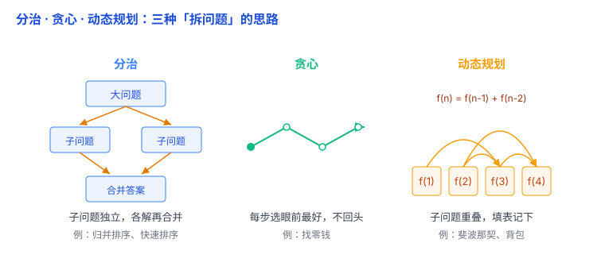

# 分治、贪心、动态规划：三种「拆问题」的思路

前面几篇讲的都是具体的东西——数组、链表、树、排序、查找。但还有一类更「上层」的东西：**遇到一个没见过的算法题，该从哪个方向下手？** 分治、贪心、动态规划，就是三种最常用的解题套路。这篇不讲公式证明，只讲清楚**每种思路长什么样、什么时候该用哪一种**。

它们都是解决复杂问题的常见思路，但方法不同：分治把问题拆开分别解决，贪心每一步做当前最好的选择，动态规划利用小问题的答案逐步求出大问题的答案。

## 一、分治：拆成独立的子问题，各自解决再合并

**分治（divide and conquer）** 字面就是「分开 + 征服」：把大问题拆成几个**互相独立**的小问题（和小问题同类、只是规模更小），分别解决，再把结果**合并**起来。

画面：**归并排序**就是典型（见 [排序与查找](05-排序与查找.md)）——把数组对半拆、各自排好、再像「合流」一样合并。

它的关键特征是三个词：**拆 → 各解 → 组合**。子问题之间**互不干扰**，可以各算各的（甚至并行），最后再把各部分的结果组合成整个问题的答案——有时是真正「合并」（如归并排序），有时各部分一完成、整体也就完成了（如快速排序）。

打个比方：**把一项大工程分成几个小组分头干，最后把各组的成果拼起来**（通常用递归来拆，见 [递归](../02-编程语言通用概念/04-递归.md)）。

**何时用**：问题能干净地拆成互不重叠的子块，且子块的结果能轻松合并时——归并排序、快速排序。

## 二、贪心：每一步都选眼前最好的，不回头

**贪心（greedy）** 是另一种思路：**每一步都做「当前看起来最好」的选择**，选完就往前走，**从不反悔、不重算**。

画面：**找零钱**——要凑 63 元，就每次拿还能拿的最大面额：50 → 再拿 10 → 再拿 1、1、1。每一步都拿当前最大，绝不回头重新组合。

它的好处是快、好写；坏处是——**局部最优不一定等于全局最优**。

**这是贪心最大的坑，必须记住**：贪心不是万能药，很多问题用贪心会得到**错误答案**。比如经典背包问题（「每次都挑最贵的东西装」往往装不满最优解）；找零钱也一样——如果只有 1、3、4 三种硬币，凑 6 元，贪心会先拿 4、再拿 1、1，共 3 枚，但最优是 3 + 3，只要 2 枚。贪心**只在问题具备「贪心选择性质」时才对**（能证明「每步选当前最好，最终也全局最好」）。

打个比方：**爬山只看脚下哪一步最陡就迈哪一步**——可能爬到一个「小山头」就再也上不去了，其实旁边还有更高的主峰，但你已经回不了头。

**何时用**：能确定「眼前最优 = 全局最优」的问题——某些面额体系下的找零钱、活动选择、哈夫曼编码、最小生成树。**拿不准时，别用贪心。**

## 三、动态规划：子问题会重复，就把答案记下来

**动态规划（dynamic programming）**：把大问题拆成小问题，**利用小问题的答案一步步求出大问题的答案**。如果同一个小问题反复出现，就把算过的结果记下来，避免重复计算。它特别适合解决「怎么选才能最好」这类问题，比如背包问题、最长公共子序列。

画面：**斐波那契数列** f(n) = f(n-1) + f(n-2)。暴力递归算 f(5) 时，f(3) 被算 2 次、f(2) 被算 3 次……n 一大，重复计算直接爆炸。动态规划就是：**从最小的 f(0)、f(1) 开始，一路填表算上去，每个值只算一次。**

斐波那契是把前面算出的两个数加起来得到下一个数；背包问题则是比较「装」和「不装」两种选择，利用更小背包问题的最优答案算出当前的最优答案。它们看起来完全不同，但本质相同：**大问题的答案依赖小问题的答案，小问题算过就不用再算。**

它和分治的关键区别：分治的子问题**互相独立、不重叠**；动态规划的子问题**大量重叠**——所以才需要「记住」。

打个比方：**把算过的中间结果抄在小本本上，下次要用时直接查，不重算。**

「动态规划」这名字唬人，但别怕——据说发明者 Bellman 当年取这个名字，部分是为了让研究听起来更有分量，跟「动态」其实没多大关系。它本质就是**填表 + 记忆**。

**何时用**：子问题会大量重复、且能写成一个递推关系时——斐波那契、爬楼梯、最长公共子序列、背包问题，以及部分最短路径算法。

## 四、一张表分清三种思路

| 思路 | 子问题关系 | 关键动作 | 典型例子 | 最大的风险 |
| --- | --- | --- | --- | --- |
| 分治 | 互相独立 | 拆 → 各解 → 组合 | 归并排序、快排 | 组合那步难 |
| 贪心 | 每步只看眼前 | 选局部最优，不回头 | 找零钱、活动选择 | 局部最优 ≠ 全局最优 |
| 动态规划 | 大量重叠 | 用小答案求大答案 + 填表记忆 | 斐波那契、背包 | 递推关系不好找 |

## 五、怎么判断用哪个（实战直觉）

拿到一个「拆问题」的题，按这个顺序问自己：

1. **子问题能干净分开、互不干扰，结果还能组合起来吗？** → 分治。
2. **是不是每一步选「当前最好的」之后，就永远不用后悔了？** 如果能确定局部最优就是全局最优 → 贪心（**但一定要先验证，拿不准就别贪心**）。
3. **是不是同一个子问题会被反复算很多次？** → 动态规划（先写暴力递归，看到重复，就加一张表记住）。

最经典的一组对比，帮你建立手感：**贪心是「只顾眼前」，动态规划是「比较必要的选择、复用中间结果」**。同一个问题（比如背包），贪心往往答错，动态规划才对——因为贪心赌「眼前最优」，而 DP 把每个子问题的最优答案算出来存着，一步步拼出全局最优。

顺带说一句：这三种思路不是互斥的三个盒子，一个算法可能混用多种思想。入门阶段先抓住各自最典型的特征即可，不必急着建立严格的分类。

## 六、总结

- **分治**：子问题**独立**，拆开各解再**组合**（归并、快排）。
- **贪心**：每步选**眼前最优**、不回头，只在特定问题上正确，**局部最优不一定等于全局最优**。
- **动态规划**：大问题的答案建立在小问题的答案上，子问题**重叠**就**填表记忆**避免重算（斐波那契、背包）。
- **判断顺序**：能干净拆开组合 → 分治；确定眼前最优就是全局最优 → 贪心；子问题反复重算 → 动态规划。

一句话：**分治解决「怎么拆开做」、贪心解决「每一步怎么选」、动态规划解决「怎么利用小问题的答案、避免重复劳动」——子问题独立用分治，能保证眼前最优才敢贪心，子问题反复出现就上动态规划。**
