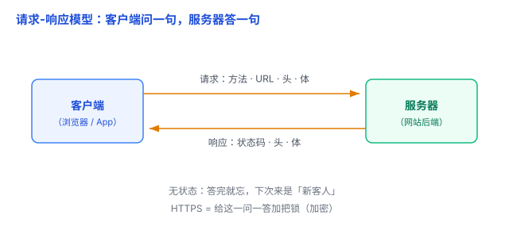

# HTTP 与 HTTPS：网络世界里的一问一答

你打开浏览器、输入网址、回车，页面「刷」地就出来了。这几百毫秒里，其实发生了一场对话：**你的浏览器（客户端）问了一句，远处的服务器答了一句**。这场对话要遵守的规矩，就是 HTTP。这篇把「请求-响应模型」和「HTTP / HTTPS」一次讲透。

## 一、请求-响应模型：一问一答

Web 的一切都建立在一个最简单的模型上——**客户端主动发请求，服务器被动回响应**。

- **客户端**（浏览器、手机 App）：发起提问的一方；
- **服务器**：等着回答问题的一方，在普通 HTTP 请求-响应模型里，**它不会主动找你**，只有你问了它才答。

打个比方：**点外卖**。你（客户端）打电话给餐厅（服务器）下单——这是「请求」；餐厅告诉你「好的，马上做」或「这道菜没有了」——这是「响应」。一问一答，答完这轮就结束。

这个模型看着简单，却是理解后面所有网络概念的基石。

## 二、请求和响应里，各装了什么

HTTP（HyperText Transfer Protocol，超文本传输协议）就是规定「请求长什么样、响应长什么样」的一套格式。寄信要按格式写信封和正文，HTTP 也一样。

### 请求：我要干什么 + 对谁干 + 附带的说明

一次请求，主要有四样东西：

- **方法（Method）**：告诉服务器「你要干嘛」。最常用的两个——**GET**（要东西，比如打开网页）、**POST**（提交 / 新建东西，比如注册、发评论）。还有 PUT（改）、DELETE（删）。
- **URL**：要对哪个资源操作，比如 `https://example.com/user/123`。
- **头（Headers）**：附加说明，比如「我是浏览器」「我能接受网页格式」。
- **体（Body，可选）**：正文数据，不一定有。GET 一般没有体；POST 提交表单时，表单内容就装在体里。

### 响应：结果怎么样 + 附带的说明

服务器回你三样东西：

- **状态码（Status Code）**：一个三位数，一句话说清结果。最该记住的几个——
  - **200**：成了（OK）；
  - **301 / 302**：东西搬走了，去别处找（重定向）；
  - **404**：没找到这个资源；
  - **500**：服务器自己出错了。
- **头（Headers）**：附加信息，比如返回的内容是什么类型、多长。
- **体（Body，可选）**：真正的内容——网页的 HTML、图片、接口返回的 JSON 等，也可能没有。

打个比方：**请求像点菜单，响应像上菜**。菜单（请求）写清楚「要什么、怎么做」；上菜（响应）要么端上来（200），要么告诉你「卖完了」（404）。

## 三、无状态：答完就忘

HTTP 有个重要特性——**无状态（stateless）**：协议本身**不会自动记住上一次请求是谁发的、做过什么**，每个请求原则上都是独立的。你刷新一下页面、点开一个链接，HTTP 都不会自动把它们和「你之前来过」联系起来。

但这不代表服务器不能存状态——服务器当然能保存用户信息、登录状态、购物车。**关键在**：HTTP 自己不记，网站要「记住你」，得靠额外机制——在请求里带上身份凭证，比如 **Cookie / Session / Token**（后面专题再讲）。这里先记住一句话：**HTTP 天生不记状态，记住状态是额外想办法补上的。**

## 四、HTTPS：给这一问一答加把锁

HTTP 是**明文**传输：请求和响应在路上「裸奔」，经过的每一台机器都能偷看、甚至篡改。你在咖啡馆连公共 WiFi 登录网站，账号密码可能被人截获。

**HTTPS = HTTP + 加密层（TLS / SSL）**。在 HTTP 下面加一层加密，把请求和响应都加密后再传，于是：

- **防偷看**：内容加密，中间人看不懂；
- **防篡改**：内容被改过，接收方会发现；
- **验身份**：靠数字证书，确认你连的是真网站、不是冒牌货。

打个比方：**HTTP 是明信片**——路上谁都能看；**HTTPS 是把信装进加密的保险箱**——只有通信双方能解开，路上的人即使截获也看不懂。怎么认？看地址栏是 `https://` 开头，并检查浏览器的连接安全信息（「小锁」标识是老做法，现代浏览器已在调整）。

## 五、易错点

1. **「无状态」≠「不记得登录」**：HTTP 本身健忘，但网站靠 Cookie / Session 在 HTTP 之上「补」出记住状态的效果。别把两层混为一谈。
2. **HTTPS 保护的是「传输过程」，不是「数据存在哪」**：加密防止路上被偷看，但服务器收到后要解密处理；如果服务器的数据库被人拖库（直接偷走存储的数据），HTTPS 救不了。
3. **4xx 和 5xx 是协议上的分类，不等于「谁犯了错」**：4xx 表示请求没能按预期完成（404 资源不存在、403 没权限），5xx 表示服务器处理时出了问题（500）。别简单记成「4xx 一定是用户错了、5xx 一定是程序写错了」——404 也可能是服务器路由配错了。
4. **GET 也能带数据，别以为「GET 不能传参」**：GET 和 POST 的主要区别是**操作语义**，而不是加密能力。GET 通常通过 URL 传递参数，POST 通常通过请求体提交数据。对于密码等敏感信息，POST 配合 HTTPS 通常更安全，因为能减少敏感数据通过 URL 意外泄露的风险。

## 六、总结

- **请求-响应模型**：客户端主动问、服务器被动答，一问一答。
- **请求四样**：方法 + URL + 头 + 体；**响应三样**：状态码 + 头 + 体。
- **无状态**：答完就忘，登录状态靠 Cookie / Session / Token 额外补上。
- **HTTPS**：给明文 HTTP 加一层加密（TLS），防偷看、防篡改、验身份。
- **何时选**：对外正式服务默认上 HTTPS（现代浏览器还会给明文 HTTP 标「不安全」）；明文 HTTP 基本只出现在本地开发、内网调试。

一句话：**HTTP 规定「客户端怎么问、服务器怎么答」，一问一答、答完就忘；HTTPS 就是给这「一问一答」加把锁，让路上的内容谁也偷看不了。**
