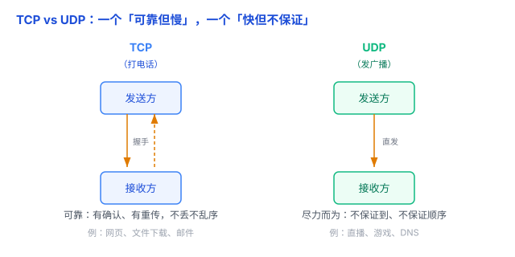

# TCP 与 UDP：一个「可靠但慢」，一个「快但不保证」

上一篇讲了 HTTP 的「一问一答」，但请求和响应这些数据，到底是怎么从你的电脑，稳稳（或不稳）地送到服务器上的？这一步靠的是**传输层**的两大协议——**TCP** 和 **UDP**。它们一个求稳、一个求快，选哪个直接决定了传输的体验。

一句话先记住：**TCP 可靠但慢，UDP 快但不保证。**

## 一、TCP：可靠的「打电话」

**TCP（Transmission Control Protocol，传输控制协议）** 最看重「可靠」。它像**打电话**：

- **先握手再说话**：拨通电话、对方「喂」了一声，双方确认「能听到」才开始讲——这叫**建立连接（三次握手）**。
- **说话有来有回**：你讲一句，对方「嗯」一声表示听到；你没听到回应就再说一遍——这叫**确认 + 重传**。
- **顺序不乱**：每句话都编了号，就算到达顺序乱了，对方也能按编号重新排好。

所以 TCP 保证：**数据不丢、不乱序、不重复**。代价是——握手、确认、重传都要花时间，**开销大、偏慢**。

典型用途：**网页（HTTP/HTTPS）、文件下载、邮件**——这些场景少一个字节都不行，宁可慢一点也要完整。

## 二、UDP：尽力而为的「发广播」

**UDP（User Datagram Protocol，用户数据报协议）** 反着来，最看重「快」。它像**发广播 / 寄明信片**：

- **不握手，直接发**：拿起喇叭就喊，不管对方在不在。
- **不确认、不重传**：发出去就不管了，丢了也不知道。
- **不保证顺序**：先发的可能后到。

所以 UDP **不保证数据到达、不保证顺序**。但它**极快、开销小**——没有握手、没有确认，头部只有 8 字节（TCP 是 20 字节）。

典型用途：**视频直播、网络电话（VoIP）、在线游戏、DNS 查询**——这些场景更怕「卡」、不怕「偶尔丢一点」。直播掉了一帧，你几乎察觉不到；但要是等重传，画面反而会卡成幻灯片。

## 三、一张表分清

| 维度 | TCP | UDP |
| --- | --- | --- |
| 是否先建立连接 | 要（三次握手） | 不要，直接发 |
| 可靠吗 | 可靠：确认 + 重传 + 有序 | 不可靠：尽力而为 |
| 顺序 | 保证 | 不保证 |
| 速度 / 开销 | 慢、开销大 | 快、开销小 |
| 类比 | 打电话 | 发广播 / 明信片 |
| 典型用途 | 网页、文件、邮件 | 直播、游戏、DNS |

## 四、易错点

1. **「UDP 不可靠」≠「UDP 不能用」**：实际网络里丢包率并不高，而且实时应用**宁可丢几帧，也不要卡住等重传**。真需要可靠时，也可以在 UDP 之上自己加一层保证（比如 QUIC 就是这么干的）。
2. **别以为「HTTP 一定走 TCP」**：HTTP/1.1 和 HTTP/2 走 TCP，但最新的 **HTTP/3 改用 QUIC，而 QUIC 基于 UDP**。这条最容易被当成「铁律」记错。
3. **TCP 的「慢」是相对 UDP 的**：慢在握手和确认重传的额外开销，不是 TCP 本身写得差。同一网络下，TCP 传输效率并不低。
4. **「可靠」是有代价的**：TCP 的连接建立、确认、重传、拥塞控制，都要占资源和时间；UDP 把这些全省了，所以快，但也把「保不保证」的责任丢给了应用自己。

## 五、何时选

- **要完整、要正确、一个字节都不能错** → TCP：网页、下载、发邮件。
- **要快、要实时、能容忍偶尔丢一点** → UDP：直播、视频通话、游戏、DNS。
- 一句话判断：**「丢了会出大事」选 TCP；「卡了才难受、丢一点无所谓」选 UDP。**

## 六、总结

- **TCP**：面向连接（三次握手）、可靠（确认 + 重传 + 有序）、慢。像打电话。
- **UDP**：无连接、不可靠、不保证顺序、快。像发广播。
- **选择**：可靠优先 → TCP；实时 / 低延迟 / 能容忍丢包 → UDP。

一句话：**TCP 是「先握手、有确认、保证送到」的电话，慢一点但可靠；UDP 是「直接喊、不确认、丢了拉倒」的广播，快但不管送到没送到。**
