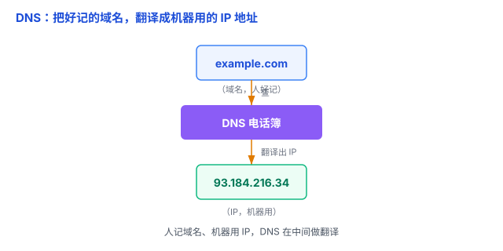

# DNS：互联网的电话簿，把域名翻译成 IP 地址

你在浏览器里敲 `www.example.com` 就能打开网页，但计算机之间真正通信用的是一串数字——**IP 地址**（比如 `93.184.216.34`）。人记不住一堆数字，机器又只认数字，谁来当中间的「翻译」？就是 **DNS**。

## 一、为什么需要 DNS：人记域名，机器用 IP

- **域名**（`example.com`）：给人看的，好记、有意义。
- **IP 地址**（`93.184.216.34`）：给机器用的，通信必须靠它。
- **DNS（Domain Name System，域名系统）**：就是夹在中间的**电话簿**，负责把域名翻译成 IP。

打个比方：**手机通讯录**。你存的是「张三」这个名字（域名），拨号时手机自动查通讯录、拨出「138xxxx」（IP）。你不用记号码，号码变了改一下通讯录就行——这也是域名的好处：**服务器换了 IP，域名不用变，改 DNS 记录即可**。

## 二、DNS 怎么运转：分级查询 + 缓存

域名是**分级**的，从右往左读：`www.example.com` 里，`.com` 是**顶级域**，`example` 是**二级域**，`www` 是**主机名 / 子域**。

查询时，也是按这个层级**逐级问下去**的（简化版）：

1. 你在浏览器输入 `www.example.com`；
2. 浏览器先看**本地缓存**——以前查过就直接用；
3. 没查到，就去问本地的**递归解析器**（通常由运营商或公共 DNS 提供）；
4. 解析器逐级问：先问**根服务器**「.com 的服务器在哪」，再问 **.com 服务器**「example.com 在哪」，再问 **example.com 的权威服务器**「www 的 IP 是多少」；
5. 拿到 IP，层层返回给浏览器。

**缓存**是关键：查过的结果会缓存一段时间（记作 **TTL**），这段时间内直接复用，不用每次都从根问起——否则全世界的查询都压到根服务器，早就爆了。

## 三、DNS 走什么协议：通常是 UDP

DNS 查询通常走 **UDP**（53 端口）。为什么？一次 DNS 查询就一问一答、内容很小，用 UDP 又快又够用（呼应 [TCP 与 UDP](02-TCP与UDP.md) 里讲的「UDP 快但不保证」）。只有大数据量的场景（比如服务器之间同步完整记录，叫「区域传送」）才会用 TCP。

## 四、易错点

1. **「改 DNS 能加速上网」是误解**：DNS 只负责「查地址」这一小步，查完就把 IP 交给浏览器去连服务器、下数据。改 DNS 最多让「查地址」快一点点，**不影响网页和文件的下载速度**。
2. **「DNS 是一台服务器」是误解**：DNS 是全球分布、分级的**一套系统**——根服务器、顶级域服务器、权威服务器、本地递归解析器，层层协作，不是某一台机器。
3. **「域名换了 IP 立刻生效」是误解**：因为有缓存和 TTL，改了 DNS 记录后，要等各地缓存的 TTL 过期才会逐步生效，快则几分钟、慢则几小时。
4. **DNS 可能被劫持 / 污染**：你用的递归解析器（或中途的节点）可能返回一个**错误的 IP**，把你引到假网站。这正是 HTTPS 证书要防的事之一——就算 IP 被指错了，假网站也拿不出真网站的证书。

## 五、总结

- **DNS = 互联网的电话簿**：把好记的域名翻译成机器用的 IP。
- **分级查询**：根 → 顶级域 → 权威服务器，逐级问下去。
- **缓存 + TTL**：查过的记下来，一段时间内直接复用。
- **通常走 UDP**：单次查询小、一问一答，快就够用。

一句话：**DNS 是互联网的电话簿——你记「张三」这个域名，DNS 帮你查出「138xxxx」这个 IP，机器才能连上对方。**
