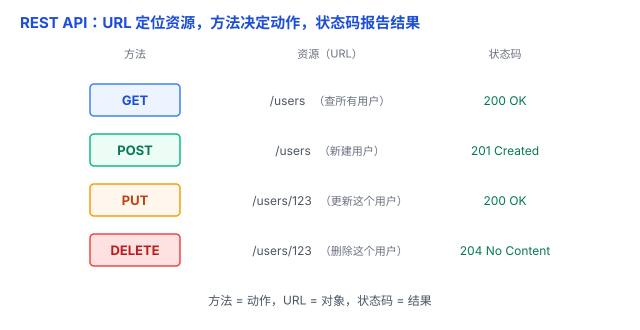

# REST API 与状态码：把后端的东西当「资源」，用 HTTP 方法去操作

前后端要协作，第三方要接入你的服务，都得先约定一套「怎么调用」的规矩。**REST** 是 Web API 中最常见的设计风格之一，而**状态码**是它用来「报告结果」的语言。这篇把两者一起讲透。

## 一、API：程序之间的「接口」

- **UI**：人和程序之间的界面——按钮、输入框，是给你点的。
- **API（Application Programming Interface）**：程序和程序之间的接口——是给「别的程序」调用的。
- **Web API**：通过网络暴露的接口，前端、手机 App、第三方服务都靠它和后端通信。

打个比方：**餐厅**。UI 是摆在桌上的菜单（给你看）；API 是后厨出菜的窗口（给服务员、给系统用的），你按格式下单，它按格式出菜。

## 二、REST：一种设计 Web API 的风格

**REST（Representational State Transfer）** 不是一种新协议，而是一种设计 Web API 的**架构风格**。核心思想就一句话：**把系统中的东西看成「资源」，通过统一的接口来操作它们**。

几条核心原则：

1. **资源用 URL 表示**：`/users` 是「所有用户」，`/users/123` 是「id=123 的那个用户」。URL 通常用**名词**表示资源，不写动词。
2. **用 HTTP 方法表达动作**：**GET**（查）、**POST**（提交 / 创建）、**PUT**（整体替换 / 更新）、**PATCH**（部分修改）、**DELETE**（删）。所以不用写 `/getUser`、`/deleteUser` 这种把动词塞进 URL 的接口。
3. **无状态**：每个请求自带完整信息，服务器不记「你上次到哪了」（见 [HTTP 与 HTTPS](01-HTTP与HTTPS.md)）。
4. **用状态码报告结果**：成功还是失败，都用状态码说清楚。

## 三、状态码：REST 用来「报告结果」的语言

状态码就是服务器对请求的一句「回复」。REST 风格下，要**用对**它：

- **2xx 成功**：**200 OK**（查询 / 更新成功）、**201 Created**（新建成功）、**204 No Content**（删除成功，没内容可返回）。
- **3xx 重定向**：301 / 302（东西搬走了）。
- **4xx 客户端错**：**400**（请求本身有问题）、**401**（未通过身份认证）、**403**（服务器拒绝访问）、**404**（资源不存在）。
- **5xx 服务器错**：**500**（服务器内部出错）。

关键在最后一句：**请求处理失败时，就该返回合适的 4xx / 5xx**，而不是「不管成功失败都返回 200、把错误信息塞进正文」——后者是很常见的反模式，让调用方还得扒正文才知道失败。反过来，如果请求成功处理、只是查询结果为空，返回 200 也是合理的。

## 四、易错点

1. **「REST 就是 URL 用名词 + 用 GET/POST」**：这只是皮毛。REST 的核心是资源 + 统一接口 + 无状态，还有 HATEOAS 等更严格的要求（初学者先不必深究）。
2. **「接口统一返回 200，错误写正文」**：错。状态码就是给你表达「结果」用的，正确用 4xx / 5xx，调用方才能一眼判断成功还是失败。
3. **「REST 一定用 JSON」**：REST 不规定数据格式，JSON 只是最常见的约定，XML 等也可以。
4. **「REST 和 HTTP 是一回事」**：REST 是一种设计风格，通常用 HTTP 实现，但概念上是独立的。现实里很多自称「RESTful」的接口也没那么严格，做折中很正常。

## 五、总结

- **API**：程序之间的接口；**Web API**：通过网络暴露的接口。
- **REST**：把后端当资源、用 HTTP 方法操作、无状态、用状态码报结果。
- **状态码**：2xx 成功、4xx 客户端错、5xx 服务器错，用对了才有 REST 的味道。

一句话：**REST 把「后端的数据」看成一个个资源——URL 说「是谁」、方法说「干嘛」、状态码说「结果如何」；写接口时，别再所有情况都返回 200 了。**
