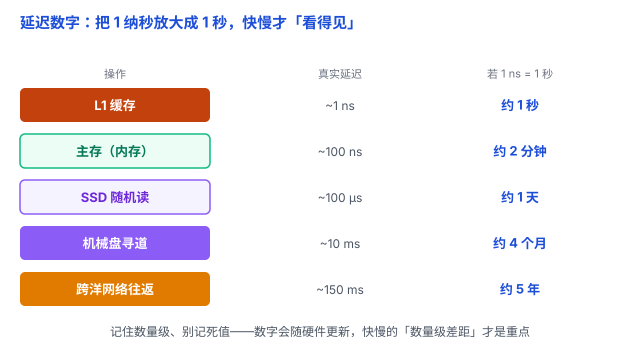

# 延迟数字：把 1 纳秒放大成 1 秒，快慢才「看得见」

程序慢，往往不是算法写得烂，而是你把时间花在了「你以为很快、其实很慢」的地方。判断哪里慢，需要一把「尺子」——这就是「每个程序员都该知道的延迟数字」。

## 一、痛点：性能问题靠猜，猜不准

人脑对「纳秒」没有体感。结果就是：有人拼命优化循环里的一次加法（纳秒级），却放任代码每次都去查一次磁盘（毫秒级）——**本末倒置**。

这些延迟数字给你的是一张**数量级地图**：哪些操作是「秒级」、哪些是「年级」，一眼看清性能的钱该花在哪。

## 二、一张表：从快到慢，差了几百万倍

以下参考 Peter Norvig、Jeff Dean 等人整理和传播的经典延迟数字，数值主要用于建立数量级直觉，不代表现代硬件的统一性能水平：

| 操作 | 大致延迟 |
|---|---|
| L1 缓存 | ~1 ns |
| 分支预测失败 | ~5 ns |
| L2 缓存 | ~7 ns |
| 加锁 / 解锁（mutex） | ~25 ns |
| 主存（内存）访问 | ~100 ns |
| SSD 随机读 4 KB | ~100 μs |
| 磁盘寻道（机械盘） | ~10 ms |
| 跨洋网络往返 | ~150 ms |

光看数字没感觉。**关键在一个类比**：把 1 纳秒放大成 1 秒，再体会每个操作要「等」多久——

| 操作 | 真实延迟 | 若 1 ns = 1 秒 |
|---|---|---|
| L1 缓存 | ~1 ns | 约 1 秒 |
| 主存 | ~100 ns | 约 2 分钟 |
| SSD 随机读 | ~100 μs | 约 1 天 |
| 磁盘寻道 | ~10 ms | 约 4 个月 |
| 跨洋网络往返 | ~150 ms | 约 5 年 |

**L1 缓存到磁盘，差了约一千万倍**；到跨洋网络，差了约一亿倍。这就是「离 CPU 越近越快」这句话的量化版本（呼应 [缓存与局部性原理](../01-计算机系统/02-缓存与局部性.md)）。

## 三、为什么差这么多：物理距离 + 介质 + 有没有机械运动

- **缓存**：做在 CPU 内部，SRAM，快但贵、容量小。
- **主存**：DRAM，在 CPU 外面一点，稍慢、容量大。
- **磁盘**：最慢，因为要**机械寻道**——磁头物理地移动到目标位置。SSD 没有机械部件，所以快了几个数量级，但仍远慢于内存。
- **网络**：受光速上限 + 多跳中转限制，跨洋单程物理上就得好几十毫秒，没有任何技术能突破这个下限。

## 四、这些数字怎么用：四条推论

1. **缓存命中 vs 未命中，天壤之别**：命中是 ~1 ns；如果没命中、最终需要访问内存，就掉到 ~100 ns，差 100 倍（没命中还可能先命中 L2、L3 缓存，不一定是直接访问内存）。
2. **磁盘通常更擅长顺序读，而不是大量零散的随机读**：机械硬盘随机读要移动磁头，开销很大；SSD 虽然没有机械寻道，但批量、顺序读取通常仍能拿到更好的吞吐量。
3. **网络往返可能很昂贵**：能合并的请求就合并、能缓存就缓存、能少一次往返就少一次。一次远程调用可能需要几毫秒，几十次**串行**调用就可能累计到几百毫秒甚至更久（并发执行的话，延迟就不一定简单相加）。
4. **优化先找瓶颈，别凭感觉**：先测量时间到底花在哪——大量时间耗在磁盘 / 网络，就优先减少这些昂贵操作；瓶颈在 CPU 计算，就优化计算本身。

一句话收尾：**延迟数字告诉你哪里可能慢，性能测量才告诉你哪里真的慢。**

## 五、易错点

1. **死记数字**：这些数字会随硬件迭代（比如 NVMe SSD 已经远快于旧表里的值）。**记住数量级和相对关系，别记死值**——0.5 ns 还是 1 ns 不重要，重要的是「L1 和磁盘差了 7 个数量级」。
2. **单位搞混**：ns（10⁻⁹）、μs（10⁻⁶）、ms（10⁻³）各差三个零。`100 ns` 和 `100 μs` 差了整整 1000 倍，一个写错就全盘皆错。
3. **「换 SSD 就快了」**：SSD 比机械盘快，但仍比内存慢约 3 个数量级。真正的瓶颈（比如每次随机读）没消除，换 SSD 只是把 10 ms 变成 100 μs，不是根治。
4. **忽略网络**：本地跑得飞快，一上分布式 / 微服务，几十次串行的远程调用叠加起来就可能到几百毫秒甚至更久。本地测试快 ≠ 线上快，网络往返永远要单独算。

## 六、总结

- **核心数量级**：L1 ~1 ns，内存 ~100 ns，SSD ~100 μs，磁盘 ~10 ms，跨洋 ~150 ms。
- **记数量级，不记死值**：数字会随硬件更新，快慢的「相对差距」才是不变的重点。
- **性能的钱花在「离 CPU 近、少走慢设备」上**：先砍磁盘随机读和网络往返，再谈别的。

一句话：**性能瓶颈，可能藏在那些看似普通、实际却很昂贵的操作里——从 L1 缓存到磁盘差了约一千万倍；记住这些延迟数量级，你才不会被纳秒和毫秒的差距蒙蔽，一眼看出哪里值得重点检查。**
