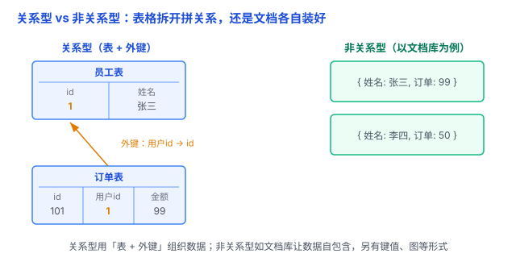

# 关系型 vs 非关系型：数据组织的方式不同，而不是谁更快

存数据最简单的方式，是开几张 Excel 那样的**表格**——用户一张、订单一张，用编号对上号，这就是**关系型数据库**。可网站越做越复杂，数据结构经常变、表格开始束手束脚，于是有了另一套存法：不非得用表格，爱存成什么就存成什么（JSON 文档、键值对……），这就是**非关系型数据库（NoSQL）**。这篇讲清它们差在哪、各适合什么场景。

## 一、关系型：用「表」组织数据，靠「外键」关联

**关系型数据库（RDBMS）** 用**表**组织数据：一行是一条记录，一列是一个字段。每一列要**先定义好类型**（这叫**模式 / schema**），变更结构需要额外管理。

注意：这里的「关系」是数学上的**关系模型**，可以简单理解成「一张表」，**不是专指表与表之间的关联**——哪怕只有一个表、没有任何外键，它也是关系型数据库。

表与表之间若要关联，靠的是**外键**：比如「订单表」里的 `用户 id` 指向「用户表」里的 `id`，要查「张三有哪些订单」，就用 SQL 把两张表 **JOIN** 起来。

代表：**MySQL、PostgreSQL、SQLite**。

打个比方：**图书馆**。每本书都编目、摆在固定书架，借书靠目录查编号。规矩、可靠，但书目一调整就麻烦。

## 二、非关系型：一大类，各有各的组织方式

**非关系型数据库（NoSQL）** 不是某一种具体的库，而是一大类，数据模型多样：**JSON 文档**（MongoDB）、**键值对**（Redis）、**宽列**（Cassandra）、**图**（Neo4j）等。

它们各有所长：有的擅长高性能键值访问，有的适合存结构灵活的文档，有的专门面向大规模分布式数据。**并不是所有 NoSQL 都更快、更容易扩展。**

打个比方：**大仓库**。箱子自己贴标签、随便堆，存取快，但想「找出所有张三的箱子」就费劲。

## 三、核心区别，一张表说清

| 维度 | 关系型数据库 | 非关系型数据库 |
|---|---|---|
| 数据模型 | 关系（表） | 文档、键值、宽列、图等 |
| 数据结构 | 通常预先定义表结构 | 因产品而异，部分更灵活 |
| 数据关联 | SQL JOIN、外键等 | 根据数据模型采用不同方式 |
| 事务 | 通常提供成熟的 ACID 事务 | 不同产品能力差异较大 |
| 一致性 | 取决于事务和部署方式 | 取决于具体产品和配置 |
| 扩展方式 | 支持垂直和水平扩展 | 部分产品针对水平扩展设计 |
| 典型产品 | MySQL、PostgreSQL | MongoDB、Redis、Cassandra、Neo4j |

注意表格里的措辞都是「通常」「取决于」——这些不是非此即彼，而是大类下的常见情况。

## 四、易错点

1. **「NoSQL 比 SQL 更快、更好」**：错。它们不是新旧替代，是不同场景的不同选择，谁都不天然「更优」。
2. **「NoSQL 没有结构」**：不准确。它是不强制统一 schema，但实际存什么、长什么样，你还是得设计好。
3. **「NoSQL 不支持事务」**：过时了。MongoDB 4.0+ 支持多文档 ACID 事务，但不同 NoSQL 的事务能力差异很大，不能一概而论。
4. **「关系型不能水平扩展」**：错。分库分表就能横向扩，只是通常比部分 NoSQL 更费劲。
5. **「ACID 里的 C = 强一致」是两码事**：ACID 的 C（一致性）说的是**事务**让数据始终满足约束（比如余额不能为负）；「强一致 / 最终一致」说的是**多个副本**之间数据是否同步。别把这两个混成一个，也别把「NoSQL = 最终一致」当普遍规律。
6. **「选型跟风」**：先看数据长什么样、要什么查询、要不要事务、规模多大，再选，别听「我们公司都用 XX」。

## 五、何时选哪种

- **选关系型**：数据结构固定、要复杂查询（JOIN）和成熟事务——订单、账户这类场景。但它也能处理海量数据，「数据一大就得换 NoSQL」是误解。
- **选非关系型**：数据更适合某种特定形式（文档 / 键值 / 图）、或有特定访问模式和扩展需求——缓存、全文搜索、社交关系这类场景。
- **现实里常混用**：比如 PostgreSQL 存订单、Redis 存缓存和热点状态、Elasticsearch 做全文搜索，各干各擅长的。

选哪个，主要看**数据结构和访问需求**，而不是简单区分「谁更严谨、谁更快」。

## 六、总结

- **关系型 = 用「表」（关系）组织数据**：结构通常预先定义，擅长复杂查询和成熟事务。
- **非关系型 = 一大类**：文档、键值、图等，提供更多数据组织方式，各有专长。
- **最本质的区别**：组织和处理数据的模型不同，而不是谁更快、谁更安全、谁更先进。

一句话：**关系型与非关系型，最本质的区别是「怎么组织数据」——前者用「表 + 关系模型」，后者用文档 / 键值 / 图等多种方式；选型看数据结构和访问需求，别掉进「数据大就用 MongoDB」这种简单二分。**
