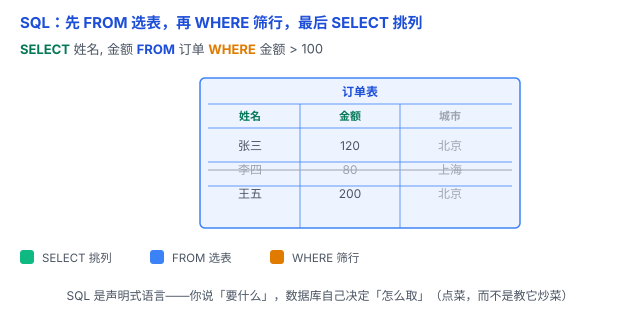

# SQL 基础：跟数据库「点菜」，而不是「教它炒菜」

数据存进关系型数据库的表里了，下一步就是：怎么把它查出来、改进去？答案是一门专门跟数据库对话的语言——**SQL**。



## 一、SQL 是什么：一门「声明式」语言

**SQL（Structured Query Language，结构化查询语言）** 是操作关系型数据库的标准语言。

它最重要的特点是**声明式**：你只描述「想要什么结果」，不用指挥数据库「一步步怎么算」。数据库自己决定走哪个索引、怎么 join、怎么排序。

打个比方：**去餐厅点菜**。声明式 = 你告诉服务员「来份宫保鸡丁」，怎么切、怎么炒，后厨自己搞定；命令式 = 你亲自进后厨，一步步指挥「倒油、下料、翻炒」。SQL 是前者——省心，但也要求你说清楚「到底要什么」。

## 二、最核心的一句：SELECT ... FROM ... WHERE

查询是 SQL 最常用的能力。记住这一句就够上手：

```sql
SELECT 姓名, 金额 FROM 订单 WHERE 金额 > 100;
```

三个部分各管一件事：

- **SELECT** 挑**列**：结果里要哪几个字段。
- **FROM** 定**表**：数据从哪张表来。
- **WHERE** 筛**行**：只留下满足条件的记录。

读的顺序有讲究——**先 FROM 找到表，再 WHERE 筛行，最后 SELECT 挑列**。就像在 Excel 里：先选哪张表，再筛选，最后看哪几列。

## 三、增删改查：CRUD 四件套

对表的操作，翻来覆去就这四种：

| 动作 | 语句 | 例 |
|---|---|---|
| 增 | INSERT | `INSERT INTO 订单 (姓名, 金额) VALUES ('赵六', 300);` |
| 查 | SELECT | `SELECT * FROM 订单;` |
| 改 | UPDATE | `UPDATE 订单 SET 金额 = 150 WHERE 姓名 = '张三';` |
| 删 | DELETE | `DELETE FROM 订单 WHERE 姓名 = '李四';` |

记住：**改和删一定要带 WHERE**，否则 UPDATE / DELETE 会作用到整张表。

## 四、再往上走一步：JOIN、GROUP BY、ORDER BY

- **JOIN**：把两张表按外键连起来查（呼应 [关系型 vs 非关系型](01-关系型与非关系型.md) 里的外键）。
- **GROUP BY**：分组统计，比如「每个用户的总订单金额」。
- **ORDER BY / LIMIT**：排序、只取前几条。

这些是常用进阶。基础阶段先吃透 SELECT / FROM / WHERE，再往上加不迟。

## 五、易错点

1. **改删不带 WHERE**：UPDATE / DELETE 忘了 WHERE 会误伤整张表，尤其 `DELETE FROM 订单;` 会清空。
2. **WHERE 和 HAVING 分不清**：WHERE 在分组前筛**行**，HAVING 在 GROUP BY 之后筛**分组**。
3. **`=` 和 NULL**：SQL 判断相等用单个 `=`；但 `列 = NULL` 永远不成立，查空值要用 `IS NULL`。
4. **SQL 注入**：把用户输入直接拼进 SQL 字符串，是最常见也最危险的安全漏洞（第 6 章会细讲）。
5. **方言差异**：不同数据库（MySQL、PostgreSQL）语法有细微差别，但核心的 SELECT / WHERE 通用。

## 六、何时用

- 只要操作**关系型数据库**，就用 SQL——它是这类数据库的通用语言。
- **非关系型**（MongoDB、Redis）不用 SQL，各有自己的查询方式（呼应上一篇）。

一句话：**SQL 是声明式语言——你只管说「要什么」，数据库自己决定「怎么取」；记住「先 FROM 选表、再 WHERE 筛行、最后 SELECT 挑列」，增删改查就通了。**
