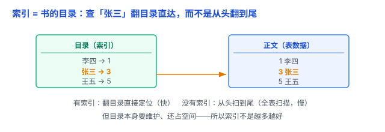

# 索引：给表配一本「目录」，查数据不用从头翻到尾

表里存了几百万行，要查其中一条（`WHERE 姓名 = '张三'`），难道从头扫到尾？那样太慢。数据库的解法是给表配一本「目录」——这就是**索引**。

## 一、痛点：全表扫描，数据一多就慢

没有索引时，查一条记录，数据库只能**一行行扫过去**（叫**全表扫描**）：N 行数据就要扫 N 次，复杂度 O(N)。

比如订单表有 1000 万行，查「张三」的一笔订单，平均得扫 500 万行才能命中；每次查询都这么扫，并发一高数据库就扛不住。更要命的是「碰一次磁盘」本来就很贵（见 [延迟数字](../04-网络/05-延迟数字.md) 里「磁盘寻道约 10 ms」），全表扫描等于把整张表从磁盘读一遍。索引的价值，就是让数据库**少碰磁盘**。

## 二、索引是什么：表上的「目录」（B+ 树）

**索引**是单独维护的一份「键 → 位置」的目录，数据库最常用 **B+ 树**来实现它。

（注意：这里的「索引」不是数组下标的那个「索引」，而是一个专门用来加速查找的结构。）

打个比方：**书的目录**。想找「张三」这一章，你不用从第一页翻到最后一页，翻目录直接找到页码。索引干的正是这件事。

B+ 树之所以快，是因为它**矮**：一个节点能存几百上千个键，所以几百万数据，整棵树也就 3~4 层。查一次，从根下探 3~4 层就到叶子——这就是「从 O(N) 降到 O(log N)」的含义。

## 三、索引怎么运转：从根一路比下去

想象索引把「姓名」排好序，做成树。查「张三」的过程：

1. 先和**根节点**的键比，判断「张三」落在哪一段（左还是右）；
2. 下探到对应的**中间节点**，再比，再排除一大片；
3. 一路落到**叶子节点**，那里存着「张三」这行数据的位置。

每下一层就排除掉绝大部分数据，所以几百万行也只要几步。更妙的是：**叶子节点是有序的、还互相连成链表**——所以范围查询（`WHERE age BETWEEN 20 AND 30`）和排序（`ORDER BY`）也能沾光，不用每次重新排。

## 四、索引的代价：不是白来的

- **占空间**：索引本身是一份额外数据，存在磁盘 / 内存里。表越大、索引越多，占得越多。
- **拖慢写**：每次 INSERT / UPDATE / DELETE，除了改表本身，还要同步更新索引树；节点满了还要**页分裂**（拆成两个节点），写开销更明显。

用书打比方：书每增删一章，目录都得跟着重印；书改得越勤，维护目录越麻烦。所以**索引不是越多越好**——加错索引反而更慢。

## 五、索引的常见类型

- **主键索引**：主键会自动建索引，值唯一。
- **唯一索引**：保证这一列的值不重复（比如「用户名」）。
- **普通索引**：最常见，纯粹为了加速查询，允许重复。
- **联合索引**：多列组成一个索引，注意「最左前缀」规则。

## 六、易错点

1. **给每列都建索引**：浪费空间、拖慢写。只给 WHERE、JOIN 连接列、ORDER BY 排序列这些**真正常查**的列建。
2. **索引失效**：WHERE 里对列套函数（如 `YEAR(date) = 2020`）走不了索引；`LIKE '%xx'`（开头就模糊）也走不了。
3. **联合索引的最左前缀**：联合索引 `(a, b)` 只查 `b` 时用不上，得从最左列 `a` 开始查。
4. **主键天然有索引**：主键会自动建索引，不用重复建。
5. **有索引不一定被用**：数据量很小、或查出的行占比太大时，数据库可能觉得全表扫描反而更快，就弃用索引。

## 七、何时建

- **建**：给经常出现在 WHERE、JOIN 连接列、ORDER BY 排序列里的列建索引——比如「按用户查订单」就给订单表的 `用户 id` 建索引（呼应 [SQL 基础](02-SQL基础.md) 里的 JOIN）。
- **不建**：频繁更新、区分度很低的列（比如「性别」只有男/女两种值）别乱建；几百行的表也没必要，索引带来的收益还盖不住维护成本。

一句话：**索引是表上的「目录」——查数据从全表扫描 O(N) 变成树查找 O(log N)；但它占空间、拖慢写，所以只给真正常查的列建，不是越多越好。**
