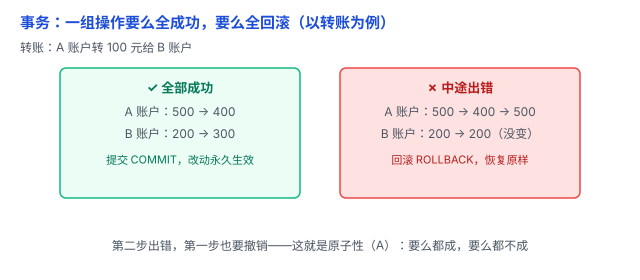

# 事务（ACID）：一组操作，要么全成，要么全败

转账这个动作，其实是两步——A 扣钱、B 加钱。如果只做了一半（扣了 A 的钱，B 却没加到），钱就凭空消失了。数据库必须保证这两步「同生共死」。这就是**事务**。

## 一、痛点：一组操作，不能只做一半

很多业务是「一组操作」：

- 转账：A 扣 100 + B 加 100。
- 下单：扣库存 + 生成订单 + 扣余额。
- 修改订单：更新订单状态 + 记录订单变更日志。

如果只执行一半（A 扣了钱 B 没加到；库存扣了订单没生成），数据就错乱了。事务解决的就是这个：**把一组操作打包，要么全部执行，要么全部撤销。**

## 二、事务是什么：一个「原子」的操作单元

事务是由数据库操作组成的一个工作单元，可以包含一条或多条 SQL 语句。只有两种结局：

- **COMMIT（提交）**：全部成功，改动永久生效。
- **ROLLBACK（回滚）**：中途出错，之前做的全部撤销，回到事务开始前的状态。

类比：**转账**。要么「扣 A + 加 B」都完成；要么出了错，把 A 扣的钱也还回去。不存在「只扣了 A」这种中间状态。

## 三、ACID：事务的四个承诺

数据库保证一个事务有四个性质，缩写 **ACID**：

- **A（Atomicity，原子性）**：事务里的操作是「一个整体」，要么全做、要么全不做。扣了 A 就一定要加 B，加不了就把 A 还回去。
- **C（Consistency，一致性）**：事务执行前后，数据都要**满足约束**。比如「余额不能为负」「总数不变」——转账前后，A + B 的总数始终不变。
- **I（Isolation，隔离性）**：多个事务并发执行时，数据库通过隔离机制控制它们之间的相互影响。隔离程度越高，事务之间的干扰通常越少，但可能付出性能代价。
- **D（Durability，持久性）**：事务一旦 COMMIT，改动就**永久保存**，断电、重启也不丢。

用转账把四个串起来：原子性保证「扣 A、加 B」同步；一致性保证转账后账目还是平的；隔离性保证两个人同时转账不会互相覆盖；持久性保证钱转完就落盘、不会凭空消失。

## 四、隔离性最容易出问题（下一篇细讲）

四个性质里，**隔离性（I）** 最微妙：并发事务互相干扰，会产生**脏读、不可重复读、幻读**等经典问题，数据库用不同的**隔离级别**在「安全」和「性能」之间权衡。

先记住结论：隔离级别越高，并发事务之间的干扰通常越少，但可能增加性能开销；隔离级别越低，并发限制通常越少，但可能出现更多数据异常。具体见下一篇 [一致性 / 隔离级别](05-一致性与隔离级别.md)。

## 五、易错点

1. **「单条 SQL 不用管事务」**：其实数据库会给单条语句自动包一个事务，只是你无感。多语句才需要显式 BEGIN / COMMIT。
2. **「事务越长越好」**：错。事务要尽量短——它持有锁和资源，时间越长，锁冲突、阻塞越严重。
3. **「ACID 里的 C = 分布式一致」**：两码事（和 [关系型 vs 非关系型](01-关系型与非关系型.md) 里说的一样）：ACID 的 C 是「事务让数据满足约束」，分布式的一致性说的是「多个副本数据是否同步」。
4. **「回滚能撤销一切」**：错。回滚只撤销数据库里的改动，收不回已经发出的邮件、调过的外部接口；已经 COMMIT 的也撤不掉。
5. **「NoSQL 都没有事务」**：过时了，很多现代 NoSQL 也支持事务，只是能力和 ACID 保证有差异。

## 六、何时用

- **用**：一组操作必须「同生共死」时——转账、下单、扣库存这类。
- **不用**：单条简单读写、纯查询，数据库自动处理，不必显式开事务。
- **记住**：开了事务就尽快 COMMIT / ROLLBACK，别让事务长时间挂着。

一句话：**事务把一组操作打包成「原子」——要么 COMMIT 全生效，要么 ROLLBACK 全撤销；ACID 四个承诺里，原子性是灵魂，隔离性最容易踩坑。**
