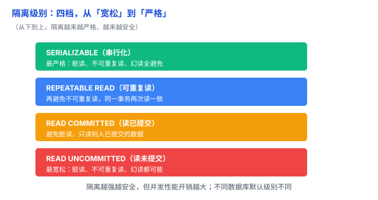

# 一致性 / 隔离级别：并发事务会「串门」，隔离级别决定看多严

上一篇讲了事务的隔离性（I），但「隔离」不是非黑即白，而是**分档**的。另外，「一致性」这个词在数据库里到处出现，意思还不一样。这篇把两个都讲清。

## 一、隔离级别：从「宽松」到「严格」的四档

并发事务互相干扰，会产生三种经典异常：

- **脏读（Dirty Read）**：读到别人**还没提交**的数据。对方可能回滚，那数据就是「脏」的。
- **不可重复读（Non-repeatable Read）**：同一事务里两次读**同一行**，结果不一样（中间别人改了并提交）。
- **幻读（Phantom Read）**：同一事务里两次做**范围查询**，结果**行数**不一样（中间别人插入了行）。

SQL 标准定义了四个隔离级别，从低到高：

| 隔离级别 | 脏读 | 不可重复读 | 幻读 |
|---|---|---|---|
| READ UNCOMMITTED（读未提交） | 可能 | 可能 | 可能 |
| READ COMMITTED（读已提交） | 避免 | 可能 | 可能 |
| REPEATABLE READ（可重复读） | 避免 | 避免 | 可能 |
| SERIALIZABLE（串行化） | 避免 | 避免 | 避免 |

级别越高越安全，但并发性能开销越大；越低越宽松，但可能读到不该读的数据。

## 二、一个具体例子：脏读

两个事务同时跑：

- **事务 A**：转账，A 扣 100、B 加 100，但**还没提交**；
- **事务 B**：这时读 A 的余额，读到了「已经扣了 100」的中间值。

如果 A 后来**回滚**了，B 读到的就是一个「从来没真正存在过」的值——这就是脏读。在 READ COMMITTED 及以上级别，B 就不会读到这种还没提交的数据。

## 三、「一致性」这个词，其实是两回事

「一致性」在数据库和分布式系统里被用滥了，看到它先问一句「哪种一致性」：

- **事务一致性（ACID 里的 C）**：事务让数据始终满足约束，比如「余额不能为负」——上一篇 [事务（ACID）](04-事务（ACID）.md) 讲过。
- **分布式一致性（强一致 / 最终一致）**：多个副本之间的数据是否同步——[关系型 vs 非关系型](01-关系型与非关系型.md) 里的「最终一致」就是这个。

这俩是两码事：一个是「单库内数据满足约束」，一个是「多副本数据同步」。别混。

## 四、易错点

1. **默认隔离级别不一样**：MySQL InnoDB 默认 REPEATABLE READ，PostgreSQL 默认 READ COMMITTED——同一套代码换个库，行为可能不同。
2. **「一律用 SERIALIZABLE 最保险」**：串行化最安全但最慢，并发一高就成瓶颈。按业务要的准确程度选。
3. **「隔离级别是死规定」**：不同数据库的实现方式（锁、MVCC）不一样，比如 MySQL 的可重复读靠 MVCC + 间隙锁，基本把幻读也挡住了，比 SQL 标准要求的更强。
4. **把两种「一致性」混为一谈**：先分清是事务一致性还是分布式一致性，再往下谈。

## 五、总结

- **隔离级别**：读未提交 → 读已提交 → 可重复读 → 串行化，安全递增、性能递减。
- **三种异常**：脏读、不可重复读、幻读。
- **一致性**：一词多义，事务一致性（ACID 的 C）≠ 分布式一致性（强一致 / 最终一致）。

一句话：**隔离级别是「并发事务看多严」的档位——越低越宽松、可能读到脏数据，越高越安全、性能越吃亏；而「一致性」得先分清是 ACID 的 C 还是分布式的一致，别混着用。**
