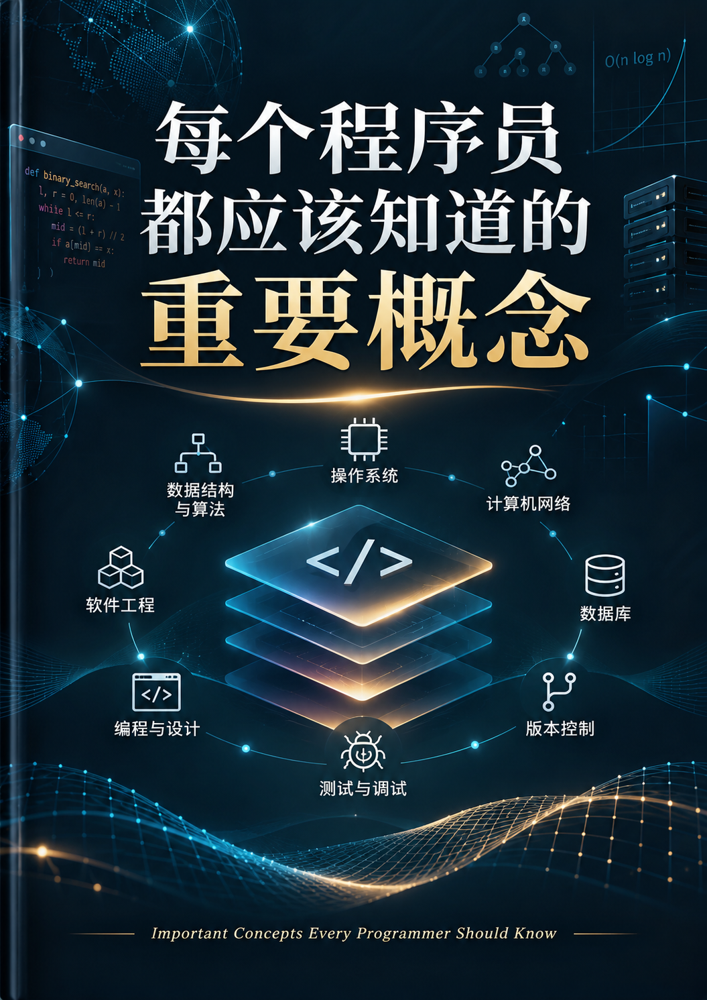

# 每个程序员都应该知道的重要概念

> 讲清楚那些每个程序员都该懂的、最基本也最重要的概念。
> 目标不只是解释计算机名词，还要帮助程序员建立计算机技术直觉。

## 说明

- `★` = 核心
- `☆` = 重要
- 按「通用 + 基础 + 讲得透」三个标准筛选，不求全、求透。

***

## 1. 计算机系统（程序在一台机器上怎么跑起来）

- ★ [内存：栈与堆](src/01-计算机系统/01-栈与堆.md)
- ★ [缓存与局部性原理](src/01-计算机系统/02-缓存与局部性.md)
- ★ [字符编码](src/01-计算机系统/03-字符编码.md)
- ★ [进制](src/01-计算机系统/04-进制.md)
- ☆ [浮点数](src/01-计算机系统/05-浮点数.md)
- ★ [进程 vs 线程](src/01-计算机系统/06-进程与线程.md)
- ★ [虚拟内存](src/01-计算机系统/07-虚拟内存.md)
- ☆ [文件系统](src/01-计算机系统/08-文件系统.md)
- ☆ [编译 vs 解释](src/01-计算机系统/09-编译与解释.md)

## 2. 编程语言通用概念（换语言也不变的内功）

- ★ [类型系统](src/02-编程语言通用概念/01-类型系统.md)
- ★ [值传递 vs 引用传递](src/02-编程语言通用概念/02-值传递与引用传递.md)
- ★ [作用域与闭包](src/02-编程语言通用概念/03-作用域与闭包.md)
- ★ [递归](src/02-编程语言通用概念/04-递归.md)
- ★ [异常与错误处理](src/02-编程语言通用概念/05-异常与错误处理.md)
- ☆ [泛型](src/02-编程语言通用概念/06-泛型.md)
- ☆ [面向对象 vs 函数式](src/02-编程语言通用概念/07-面向对象与函数式.md)

## 3. 数据结构与算法

- ★ [数组、链表、哈希表](src/03-数据结构与算法/01-数组链表哈希表.md)
- ★ [栈、队列](src/03-数据结构与算法/02-栈与队列.md)
- ☆ [树、堆、图](src/03-数据结构与算法/03-树与堆与图.md)
- ★ [复杂度分析（大 O 表示法）](src/03-数据结构与算法/04-复杂度分析.md)
- ★ [排序与查找](src/03-数据结构与算法/05-排序与查找.md)
- ☆ [分治、贪心、动态规划的入门直觉](src/03-数据结构与算法/06-分治贪心动态规划.md)（不讲复杂理论，只讲「什么时候用哪种思路」）

## 4. 网络

- ★ [HTTP / HTTPS、请求-响应模型](src/04-网络/01-HTTP与HTTPS.md)
- ★ [TCP vs UDP](src/04-网络/02-TCP与UDP.md)
- ★ [DNS](src/04-网络/03-DNS.md)
- ★ [REST API、状态码](src/04-网络/04-REST-API与状态码.md)
- ☆ [延迟数字（latency numbers every programmer should know）](src/04-网络/05-延迟数字.md)

## 5. 数据库

- ★ [关系型 vs 非关系型](src/05-数据库/01-关系型与非关系型.md)
- ★ [SQL 基础](src/05-数据库/02-SQL基础.md)
- ★ [索引](src/05-数据库/03-索引.md)
- ★ [事务（ACID）](src/05-数据库/04-事务（ACID）.md)
- ☆ [一致性 / 隔离级别](src/05-数据库/05-一致性与隔离级别.md)

## 6. 安全（最少要知道的那点）

- ★ [哈希 vs 加密（密码该怎么存）](src/06-安全/01-哈希与加密.md)
- ★ [常见攻击：SQL 注入、XSS](src/06-安全/02-SQL注入与XSS.md)
- ☆ [HTTPS / TLS 证书](src/06-安全/03-HTTPS与TLS证书.md)

## 7. 工程实践与工具

- ★ [Git 与版本控制](src/07-工程实践与工具/01-Git与版本控制.md)
- ★ [单元测试](src/07-工程实践与工具/02-单元测试.md)
- ★ [调试（不只是 print）](src/07-工程实践与工具/03-调试.md)
- ☆ [构建与依赖管理](src/07-工程实践与工具/04-构建与依赖管理.md)

## 8. 贯穿计算机的通用设计思想

> 不属于任何具体领域，而是横贯前面所有领域的思想。

- ★ 抽象（Abstraction）
- ★ 分层（Layering）
- ★ 分治（Divide & Conquer）
- ★ 机制与策略分离（Mechanism vs Policy）
- ★ 并发（Concurrency）——竞态条件、锁、死锁、同步/异步、事件循环
- ☆ 间接层（Indirection）——「任何问题都能通过加一层间接来解决」
- ☆ 局部性（Locality）
- ☆ 权衡（Trade-off）

***

📎 写作与配图规范见 [约定.md](约定.md)
