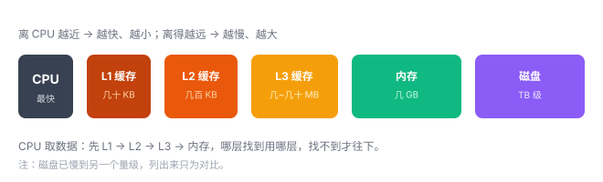
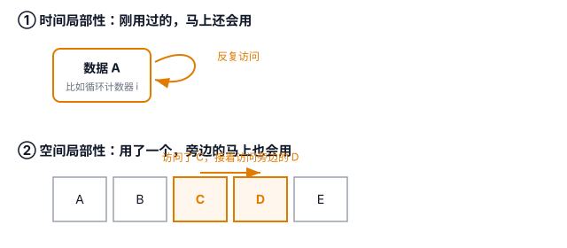
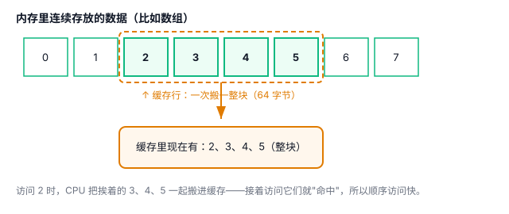

# 缓存与局部性原理：为什么顺序访问快

你有没有想过一个问题：CPU 快得离谱，内存却跟不上，两者能差出几十到上百倍。如果 CPU 每执行一步都要跑一趟内存拿数据，那它大部分时间都在"干等"，快也白搭。

那程序为什么还能跑这么快？答案藏在 CPU 和内存之间的一层"小仓库"里，叫**缓存**。

## 一、快如闪电的 CPU，慢吞吞的内存

先建立一个数量级的直觉：

- CPU 读一次 L1 缓存：约 **1 纳秒**
- CPU 读一次内存：约 **100 纳秒**

相差**几十到上百倍**，具体看硬件。这就像一个人干活极快，但每次要用的工具都得跑到很远的大仓库去拿，来回路上花的时间是干活的上百倍。

## 二、缓存：夹在中间的小仓库

解决思路很朴素：**常用工具放近处，别每次跑大仓库。**

于是 CPU 和内存之间，垫了好几层"缓存"（L1、L2、L3）：

规律就一条：**离 CPU 越近，越快，也越小（越贵）；离得越远，越慢，也越大（越便宜）。**

- **L1**：离 CPU 最近，几十 KB，最快
- **L2**：几百 KB
- **L3**：几 MB 到几十 MB
- **内存**：几 GB，最慢

CPU 取数据时，先去 L1 找，找不到去 L2，再找不到去 L3，最后才去内存。这个"先近后远"的找法，让绝大多数访问都能在缓存里"命中"。

## 三、局部性原理：缓存凭什么管用

缓存能救场，靠的不是运气，而是程序访问数据的一个规律，叫**局部性**。它分两种：

**1. 时间局部性：刚用过的，马上还会用。**
比如循环里那个计数器 `i`，每转一圈都用一次。第一次从内存搬进缓存后，后面几百次都直接在缓存里拿。

**2. 空间局部性：用了一个，旁边的马上也会用。**
比如遍历数组 `arr[0]`、`arr[1]`、`arr[2]`……它们是挨着存放的。访问了 `arr[0]`，`arr[1]` 几乎肯定马上被访问。

正是这两个规律，让缓存"猜"得特别准——它提前把你可能要用的数据搬到近处，等你真要用时，已经在手边了。

## 四、为什么顺序访问快：缓存行

这里有个关键细节：**CPU 从内存搬数据，不是一次搬一个字节，而是搬"一整块"。** 这一整块叫**缓存行（cache line）**，通常是 **64 字节**。

因为"空间局部性"，CPU 赌你访问了这块里的一个数据，接下来就会访问它旁边的。所以它干脆把整块一起搬进缓存。

这直接解释了顺序访问为什么快：

- **顺序访问** `arr[0]`、`arr[1]`、`arr[2]`……：访问 `arr[0]` 时，CPU 把包含它的整块（连着 `arr[1]`、`arr[2]`）一起搬进缓存。后面访问它们时**通常已经在缓存里了**，命中，飞快。
- **随机访问**：每次都跳到很远的地方，缓存里常常没有，动不动就得去内存拿，"未命中"多，慢。

## 五、对你的代码有什么影响

一个经典例子：遍历二维数组（指 C 这类按行连续存储的数组）。

- **按行遍历**：外层 `i`、内层 `j`，访问 `a[i][j]` —— 内存地址是连续的，顺序访问，通常**更快**。
- **按列遍历**：外层 `j`、内层 `i`，访问 `a[i][j]` —— 每访问一个元素都跳过整整一行，随机访问，通常**更慢**。

同样遍历一遍，按行常常比按列快，原因就是缓存。

所以写代码时，**尽量让数据访问是"连续、顺序"的**，让缓存帮你的忙。

## 六、总结

- CPU 比内存快几十到上百倍，中间靠**多级缓存**（L1/L2/L3）垫着。
- 缓存有效，靠**局部性**：刚用过的还会用（时间），旁边的也会用（空间）。
- **顺序访问快**，主要是因为 CPU 一次搬**一整块**（缓存行），顺序访问命中率高，随机访问命中率低。

一句话：**让程序变快的最简单办法，是让它的数据访问"就近、顺序"，喂给缓存吃。**
