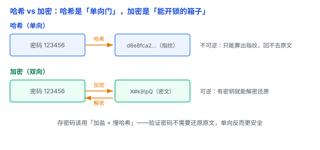

# 哈希 vs 加密：密码该怎么存，很多人第一步就错了

存密码这件事，太多人栽在第一步——要么明文存，要么用加密存。这篇讲清**哈希**和**加密**的本质区别，以及密码到底该怎么存。

## 一、哈希：一条「单向门」

**哈希（Hash）** 是通过哈希函数，把输入数据映射成一个**固定长度**的值。

其中，**密码学哈希函数**有几个重要特点：

- **单向性**：从数据算哈希值很容易，但仅凭哈希值反推出原始数据，在计算上极其困难。
- **确定性**：相同输入总能得到相同的哈希值。
- **雪崩效应**：输入哪怕只改变一点，输出通常也会发生很大变化。

打个比方：**指纹**。你按下指纹（数据 → 哈希）很容易，但拿着指纹推不出你这个人长什么样（哈希 → 数据，回不去）。

（顺带点破：数据结构里的「哈希表」（见 [数组、链表、哈希表](../03-数据结构与算法/01-数组链表哈希表.md)）和这里的「哈希」是同一个数学思想——把数据映射成固定值，但**密码学哈希**额外要求「单向、抗碰撞」。）

这里先点明一个细节：**「不可逆」不等于「猜不出来」**。攻击者拿到哈希后，可以不断猜密码、算哈希去比对——这正是后面要「慢哈希」的原因。

## 二、加密：一只「能开锁的箱子」

**加密（Encryption）** 是**双向**的：用密钥把明文变密文，还能用密钥解回来。

- 明文 + 密钥 → 密文；密文 + 密钥 → 明文。
- 对称加密（加解密同一把钥匙，如 AES）、非对称加密（公钥加密、私钥解密，如 RSA）。

打个比方：**带锁的箱子**。锁上（加密）要钥匙，打开（解密）也要钥匙。只要钥匙在，就能还原。

## 三、核心区别：单向 vs 双向

| 对比维度 | 密码学哈希 | 加密 |
|---|---|---|
| 方向 | 单向 | 双向 |
| 能否还原原文 | 不能直接还原 | 有正确密钥可以解密 |
| 输出 | 固定长度摘要 | 密文，长度因算法而异 |
| 主要用途 | 完整性校验、密码验证 | 数据保密、敏感信息保护 |
| 典型算法 | SHA-256、Argon2id | AES、RSA |

一句话：**哈希是「进去就出不来」的单向门，加密是「有钥匙就能开」的箱子。**

## 四、密码到底该怎么存：加盐 + 慢哈希

现在回答标题里的问题。存密码的正确姿势，三步：

1. **绝不明文存**：数据库泄露 = 所有密码裸奔。
2. **不用加密存**：加密可逆，密钥一旦泄露等于明文；而且验证密码根本不需要还原原文，用加密纯属多一个风险点。
3. **存「加盐的慢哈希」**：
   - **加盐（salt）**：给每个用户随机加一段「盐」再哈希。这样两个用户密码相同，哈希也不同；还能防「彩虹表」（预先算好的一堆常见密码 → 哈希的对照表）。盐本身不用保密，通常就和哈希值一起存在数据库里——要保护的只是密码本身。
   - **慢哈希**：用 Argon2id、scrypt、bcrypt 这类**故意做得很慢**的算法（计算成本可以调整）。慢对正常用户无感——登录时只算一次；但攻击者要试几百万、几亿个密码，就得付出巨大的时间和算力成本。

验证密码时，把用户输入的密码加同样的盐、跑同样的慢哈希，再比对结果——**从头到尾都不需要还原出明文**，这正是用哈希而非加密的根本原因。

## 五、易错点

1. **用 MD5 / SHA-1 / SHA-256 直接存密码**：这些是「快哈希」，算得快，暴力破解也快；不加盐还能被彩虹表秒杀。快哈希适合校验文件，不适合存密码。
2. **把「哈希」说成「加密」**：这是方向性错误——哈希不可逆，加密可逆。
3. **用加密存密码**：可逆 = 有还原的钥匙，多一个泄露点。存密码要的是「不可还原」。
4. **不加盐**：相同密码 → 相同哈希，攻击者能看出哪些用户用了相同密码，还能拿预先算好的哈希表批量破解常见密码。
5. **自己发明哈希算法**：别。用成熟、经过审计的 Argon2id / scrypt / bcrypt，密码学最忌讳「自己造轮子」。

## 六、何时用

- **存密码、校验完整性**：用哈希——密码用加盐慢哈希，文件校验用快哈希（如 SHA-256）。
- **要还原数据、保密传输**：用加密——HTTPS 传输、存需要读回的敏感数据。
- **存密码 = 哈希，存机密 = 加密**，别搞反。

一句话：**哈希是单向的「指纹」，加密是可逆的「带锁箱子」——存密码要用「加盐 + 慢哈希」，因为验证密码根本不需要还原原文，单向反而更安全。**
