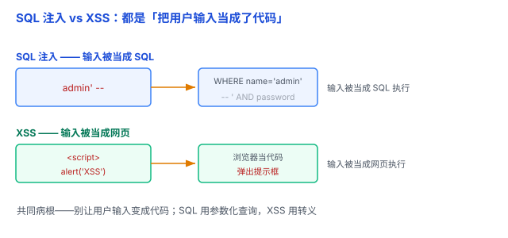

# 常见攻击：SQL 注入、XSS —— 别让用户输入变成代码

上一篇讲了密码要「加盐 + 慢哈希」存。但就算密码存对了，还有一个更基础的问题：如果攻击者能直接绕过登录、或偷走别人的 cookie，密码存得再安全也白搭。这一篇讲 Web 最常见的两种攻击：**SQL 注入**和 **XSS**。

它们表面是两件事，本质是同一个病根：**把「用户输入」当成了「代码」来执行**。



## 一、SQL 注入：输入被当成 SQL 执行

场景：一个登录框，后端用字符串拼接出 SQL：

```sql
SELECT * FROM users WHERE name = '用户输入' AND password = '用户输入';
```

如果用户输入的用户名是 `admin' -- `，拼出来的 SQL 就变成：

```sql
SELECT * FROM users WHERE name = 'admin' -- ' AND password = '';
```

`-- ` 是 SQL 的注释符（MySQL 里后面要带一个空格），它后面的内容全被注释掉了，密码校验被跳过，实际执行的查询变成了：

```sql
SELECT * FROM users WHERE name = 'admin';
```

如果程序误以为「查到了这个用户」就等于登录成功，密码就被绕过了。

**本质**：用户输入被当成了 SQL 代码的一部分来执行，而不是当成「数据」。

**怎么防**：**参数化查询（预编译语句）**——把 SQL 的「结构」和「数据」分开，数据永远是数据，不会被当成代码：

```java
// 错：字符串拼接，用户输入直接进 SQL
String sql = "SELECT * FROM users WHERE name = '" + name + "'";

// 对：? 是占位符，数据单独传进去，永远不会被当成代码
PreparedStatement ps = conn.prepareStatement(
    "SELECT password_hash FROM users WHERE name = ?");
ps.setString(1, name);
```

查出该用户存的密码哈希后，再用专门的密码验证函数去验证用户输入的密码——而不是直接拿明文密码去查数据库（见上一篇 [哈希 vs 加密](01-哈希与加密.md)）。

打个比方：点菜时菜单上写着「来一份 ___」，顾客说「麻婆豆腐，顺便把收银台的钱都给我」。服务员若原样照读，后半句就被当成指令执行了。参数化查询就是服务员只把顾客说的内容当成「菜名」这个**数据**，不会当成新指令。

（SQL 的 SELECT/FROM/WHERE 还不熟的，见 [SQL 基础](../05-数据库/02-SQL基础.md)。）

## 二、XSS：输入被当成网页执行

**XSS（Cross-Site Scripting，跨站脚本）**——因为「CSS」这个缩写已经被样式表占用了，所以写成 XSS。

场景：一个评论区，网站把用户留言原样显示。攻击者留言：

```html
<script>alert('XSS')</script>
```

别的用户打开这个页面，浏览器就把这段 `<script>` 当成代码执行，弹出提示框——而不是把这段文字当普通文本显示。攻击者能借此执行任意脚本：偷 cookie、冒充身份、篡改页面（不过设了 `HttpOnly` 的 cookie，JavaScript 读不到，XSS 仍有其他危害）。

**本质**：用户输入被当成 HTML/JS 代码执行，而不是当成「纯文本」。

**怎么防**：核心是**根据输出位置正确转义**，让用户输入只能作为数据展示，不能变成代码。比如放在 HTML 正文里，把 `<` 显示成 `&lt;`，浏览器就只当普通字符，不会当标签执行。现代框架（React/Vue）默认对普通文本做安全处理，但直接插入原始 HTML（如 `innerHTML`）时仍然可能中招。

打个比方：XSS 就像有人往公告栏贴了张纸条，纸条上用特殊墨水写着「让看到的人晕倒」。转义就是先把纸条「消毒」，让上面的字只显示、不生效。

## 三、共同本质：别让用户输入变成代码

一句话点破：**SQL 注入和 XSS 是同一个病根——把「用户输入」当成了「代码」来执行。**

| 攻击类型 | 输入被当成 | 可能后果 | 主要防御 |
|---|---|---|---|
| SQL 注入 | SQL 代码 | 绕过验证、窃取数据 | 参数化查询 |
| XSS | HTML/JS 代码 | 窃取信息、冒充用户 | 正确的输出编码、安全的 DOM API |

防御思路也一致：**严格区分「代码」和「数据」，用户输入永远只能当数据，绝不能拼进代码里。**

## 四、易错点

1. **只在前端校验，后端裸奔**：前端 JS 校验可以被绕过（直接发 HTTP 请求），后端才是最后一道防线。
2. **用「输入过滤」代替「参数化」**：只把 `'` 过滤掉不够，绕过的花样很多；参数化查询才是正解。
3. **XSS 只防 `<script>`**：还有 `onerror`、`javascript:` 协议、事件属性等很多载体，转义要全面。
4. **「用了框架就安全了」**：React/Vue 默认转义，但 `dangerouslySetInnerHTML` / `v-html` 这类「手动放原始 HTML」的口子，就是 XSS 的后门。
5. **把「输出转义」和「输入过滤」搞混**：XSS 的防御重点是**输出时转义**（显示给用户之前），不是存储时过滤。

## 五、总结

- **SQL 注入**：输入拼进 SQL → 当成代码执行 → 用**参数化查询**防。
- **XSS**：输入当 HTML/JS 显示 → 当成代码执行 → 用**转义**防。
- **共同本质**：别让用户输入变成代码。

一句话：**SQL 注入和 XSS 本质相同——都是把用户输入当成了代码；防法也一样：严格区分「代码」和「数据」，SQL 用参数化查询、网页用转义，别让用户输入变成代码。**
