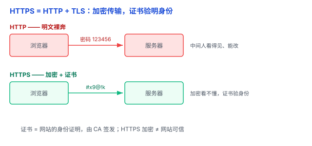

# HTTPS / TLS 证书：网址前那把「小锁」，到底锁住了什么

浏览器地址栏的那把「小锁」，很多人见过，但未必懂它到底锁住了什么。这篇讲 HTTPS 背后的两个东西：**TLS**（加密传输）和**证书**（验明身份）。

（HTTP 的请求-响应模型、GET/POST 见 [HTTP / HTTPS](../04-网络/01-HTTP与HTTPS.md)，这篇只讲 HTTPS 的「S」——加密和证书。）

## 一、HTTP 为什么危险：明文裸奔

HTTP 传输的数据是**明文**，像一张谁都能看的明信片。任何能在中间截获或控制通信的人，都可能：

- **窃听**：密码、信用卡号被看光。
- **篡改**：把你发的内容偷偷改掉。
- **冒充**：你以为在访问银行，其实是攻击者架的假网站。

## 二、HTTPS = HTTP + TLS：三件防护

HTTPS 就是给 HTTP 外面套了一层 **TLS**（Transport Layer Security，传输层安全协议；它的前任叫 SSL，现在都用 TLS，只是很多人还习惯叫 SSL）。

TLS 提供三件事：

- **加密（保密）**：数据加密，中间人看不懂。
- **完整性**：数据被改过，接收方能发现。
- **身份认证**：验证所连接的服务器是否拥有该域名对应的有效身份证明。

打个比方：HTTP 是明信片，HTTPS 是**上锁的信封**——只有收发双方能打开，还能验证寄信人是不是本人。

（这里用到的「加密」就是上一篇 [哈希 vs 加密](01-哈希与加密.md) 讲的「带锁箱子」——数据要还原，所以用加密而不是哈希。）

## 三、证书：网站的「身份证」

加密解决了「看不懂」，但没解决「对方是谁」——攻击者也能架一个加密的假网站。怎么办？靠**证书**。

**证书**由**可信的 CA（证书颁发机构，Certificate Authority）** 签发，就像经过第三方认证的身份证明。浏览器里内置了一份可信 CA 名单。

访问网站时，网站出示证书，浏览器验证：

- 是不是可信 CA 签发的？
- 有没有过期？
- 域名对不对得上？

全对，浏览器才会把它标为「安全连接」。

（补充一句：过去浏览器常用地址栏的「小锁」表示 HTTPS；如今 Chrome 等浏览器已经换了图标，但背后的安全机制没变。）

**证书链**：浏览器信任根 CA → 根 CA 信任中间 CA → 中间 CA 签发网站证书。这是一条「信任链」，一级级传下去。

## 四、握手：怎么「偷偷」商量出加密钥匙

TLS 握手（以现代 TLS 1.3 为例，简化版）是这样的：

1. 浏览器说：我要建立安全连接，我支持这些加密算法。
2. 浏览器和服务器交换密钥协商所需的信息，各自计算出相同的共享秘密。
3. 服务器出示证书，并证明自己拥有对应的私钥；浏览器验证服务器的身份。
4. 双方根据协商得到的共享秘密，生成后续通信使用的对称密钥。
5. 后续传输的数据使用对称加密进行保护。

关键点：**非对称密码学帮助双方安全地协商密钥并验证身份，对称加密负责高效保护真正传输的数据。**

打个比方：TLS 握手就像两个人在公开场合商量出一个共同的秘密——旁边的人虽然听到了他们的交流，却算不出这个秘密。之后，双方就用这个共同秘密生成加密钥匙，安全交流。

（值得琢磨的「为什么」：两个从未见过面的人，即使交流被全程监听，也能协商出只有他俩知道的秘密。这正是现代密钥交换最巧妙的地方，这里不展开数学细节，先留个印象。）

## 五、易错点

1. **「HTTPS = 网站可信」**：这是最深的误解。HTTPS 只保证「通信加密、对方身份是它声称的那个」，**不保证网站本身是好人**——钓鱼网站照样能申请证书、有小锁。
2. **「自签证书和 CA 证书一样」**：自签证书没有可信 CA 背书，浏览器会警告「不安全」。别为了省事关掉这个警告。
3. **「HTTPS 慢很多」**：握手有一次性的开销，之后对称加密很快，现代 HTTPS 的性能开销通常很小。
4. **「加密了就百毒不侵」**：加密防窃听、防篡改，但防不了 SQL 注入、XSS 这类应用层攻击（见 [常见攻击](02-SQL注入与XSS.md)）——那是在数据「加密之前」就出问题了。
5. **「只有购物网站才需要 HTTPS」**：任何传数据的网站（登录、表单）都该用。现在浏览器对 HTTP 直接标「不安全」。

## 六、总结

- HTTP 明文裸奔，HTTPS 加 TLS 提供加密、完整性、身份认证。
- 证书 = 网站的身份证明，由可信 CA 签发，形成证书链。
- 握手 = 双方协商出共享密钥，再用对称加密保护数据。

一句话：**HTTPS = HTTP + TLS——TLS 负责「加密传输」，证书负责「验证域名身份」；但 HTTPS 只保护通信、验证域名，不证明网站是好人，别把「小锁」当成「好人卡」。**
