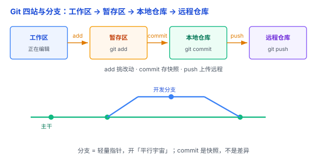

# Git 与版本控制：给代码拍「存档」、开「平行宇宙」

改代码最怕什么？改着改着改坏了，回不去了。多人协作最怕什么？两个人改了同一个文件，互相覆盖。Git 就是来解决这两件事的。

## 一、为什么需要版本控制：改坏了要能「读档」

没有版本控制，只能手动复制文件夹备份——「最终版」「最终版2」「真的最终版」……很快就乱成一团。

**版本控制** = 给代码拍**存档**，任何时候都能回到任意一个存档点，还能看清每次是谁、什么时候、改了什么。

Git 是**分布式**版本控制：开发者通常可以在本地保存完整的仓库历史，即使没有网络，也能查看历史、创建分支、提交代码。相比之下，SVN 通常依赖中央服务器管理版本历史。

## 二、核心：commit 是「快照」，不是「差异」

Git 每次 `commit`（提交）保存的是那一刻**所有文件的完整快照**（snapshot），而不是「改了哪几行」的差异记录。

这是 Git 和 SVN 最根本的区别之一：SVN 存差异，Git 存快照。快照让回退、分支、合并都快得多。

（严格说，Git 底层存储会做压缩去重，但**逻辑上每次提交都是一份完整快照**——你理解成「给整个项目文件夹拍一张照片」就够了。）

打个比方：Git 的提交是给项目拍「照片」，而不是记「这张照片比上一张多了哪几个像素」。

## 三、四个区域：工作区 → 暂存区 → 本地仓库 → 远程仓库

一个文件要经过几站：

1. **工作区（working directory）**：你现在正在编辑的文件。
2. **暂存区（staging area / index）**：用 `git add` 把改动「选中」，放进暂存区。
3. **本地仓库（local repo）**：用 `git commit` 存档到本地。
4. **远程仓库（remote repo）**：用 `git push` 上传到 GitHub 等，分享给团队。

**暂存区是 Git 独有的设计**：它让你「挑着提交」——不是所有改动都要一次提交完，可以先 `add` 想提交的部分，`commit` 时只提交选中的。

## 四、分支：开一个「平行宇宙」

**分支（branch）** 是 Git 最强大的地方，也是新手最容易卡住的地方。

关键要明白：**分支只是一个指向某个提交的指针**，极其轻量——创建分支几乎不花时间、不复制文件。

- `git branch` 创建分支 = 在岔路口竖一块路牌。
- `git switch` / `git checkout` 切换分支 = 走到另一条岔路上。
- 每条分支独立发展，最后 `git merge` 合并 = 两条岔路合流。

**HEAD** 是一个特殊指针，通常指向当前所在的分支，表示你正在使用哪个分支。

打个比方：分支就像**平行宇宙**——主干上稳定运行，你在「开发分支」这个平行宇宙里放心大胆地改；改好了 `merge` 合回主干，改砸了直接丢弃这个平行宇宙，主干毫发无损。

（这正是很多新手的心理误区：以为开分支会复制一份代码、很重很危险。其实它轻如一块路牌。）

## 五、基本命令速览

| 命令 | 作用 |
|---|---|
| `git init` / `git clone` | 初始化 / 克隆仓库 |
| `git add` | 将改动加入暂存区 |
| `git commit` | 将暂存区内容提交到本地仓库 |
| `git push` / `git pull` | 推送远程 / 拉取远程更新 |
| `git branch` | 查看 / 创建分支 |
| `git switch` / `git checkout` | 切换分支 |
| `git merge` | 合并分支 |
| `git status` / `git log` | 查看当前状态 / 提交历史 |

## 六、易错点

1. **「commit 了就安全了」**：commit 只存到**本地**，`push` 才上传到远程。电脑丢了，没 push 的 commit 就没了。
2. **「分支很重、很复杂」**：分支只是一个指针，轻如路牌。不敢开分支是新手最大的心理障碍。
3. **「手动复制文件夹当版本控制」**：复制文件夹记不了历史、合不了分支、协不了作。用 Git。
4. **「把敏感信息提交进去了」**：密钥、密码、令牌绝不能进仓库（呼应第 6 章 [哈希 vs 加密](../06-安全/01-哈希与加密.md) 讲的敏感信息）。用 `.gitignore` 排除编译产物、`node_modules`、密钥文件。
5. **「解决冲突 = 瞎删一段」**：合并冲突要理解两边分别改了什么再取舍，不能闭眼乱删。
6. **「git pull 是个黑盒」**：`git pull` 其实是先 `fetch` 拉取远程更新，再把更新整合到当前分支（通常用 `merge`，也可以 `--rebase`）。理解这一点，遇到问题才好排查。

## 七、总结

- 版本控制 = 存档，Git 存的是**快照**，不是差异。
- 四站：工作区 → 暂存区 → 本地仓库 → 远程仓库。
- 分支 = 轻量指针，开「平行宇宙」，最后 merge 合流。

一句话：**Git 用「快照」给代码存档、用「指针」开平行宇宙分支——add 挑改动、commit 存快照、push 上传远程；分支轻如路牌，别怕开分支。**
