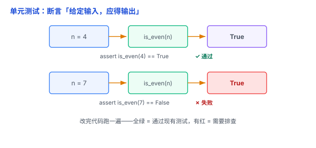

# 单元测试：给函数写「验收标准」，改代码才有底气

改代码最怕什么？不是写不出，而是怕「改坏了别的地方，自己还不知道」。单元测试就是给这个焦虑的答案。



## 一、痛点：为什么改代码总提心吊胆

没有测试，验证改动只能靠「人肉点一遍」：改一个函数，手动跑程序、手动输入、肉眼核对输出。又慢、又漏、又不可重复，而且每改一次都要重新点一遍。

**单元测试**把「验证」这件事自动化：给函数写一段「验收代码」，断言「输入 X，就该输出 Y」。以后每次改动，跑一遍就知道有没有改坏。

打个比方：盖楼时，每块砖先单独检测强度，而不是盖完整栋楼才发现某块砖是坏的。单元测试就是给每块「砖」（函数）单独做的检测。

## 二、单元测试长什么样：一个「断言」

**单元测试**针对代码中一个相对独立的功能单元（通常是函数、方法或类），验证它的**行为**是否符合预期——比如返回值是否正确、对象状态是否变化、异常是否正确抛出。

核心只有一个词：**断言（assert）**——「我断言，这个函数给定这个输入，一定返回这个结果」。

举个例（判断偶数）：

```python
def is_even(n):
    return n % 2 == 0

def test_is_even():
    assert is_even(4) == True    # 4 是偶数
    assert is_even(7) == False   # 7 是奇数
    assert is_even(0) == True    # 边界：0
    assert is_even(-2) == True   # 边界：负数
```

`assert` 后面跟「你期望的正确结果」。跑测试时，只要有一个断言不成立，测试就**失败**，并告诉你哪里不对。

（语言不同、测试框架不同，但本质都是「断言」——给输入，验输出。）

## 三、三个好处：为什么值得写

1. **改代码有底气（防回归）**：改完跑一遍，全绿说明通过了现有测试，降低改坏其他功能的风险；有红说明存在需要排查的问题。
2. **测试即文档**：测试用例本身就是「这个函数该怎么用、什么情况返回什么」的活文档，比注释可靠。
3. **逼你想清楚接口**：写测试要先想「输入什么、输出什么」，反过来逼你把函数设计得更清晰。

## 四、什么值得测，什么不值得

- **值得测**：业务逻辑、计算、边界条件、容易出错的地方（金额计算、日期处理、排序、校验）。
- **通常不必单独测**：没有业务逻辑的简单 getter/setter、纯粹的赋值操作，以及价值较低的重复样板代码。

一句话：**测「会算错」的逻辑，不测「不会错」的样板**。

## 五、易错点

1. **只测 happy path**：只测「输入正常」的情况，不测边界（0、负数、空值、极大值）和异常（传错类型）。bug 往往藏在边界里。
2. **为覆盖率而测**：覆盖率（测试覆盖了多少代码）是参考，不是目标。写一堆没意义的测试刷高数字，不如少而精。
3. **测试依赖外部，时好时坏**：如果测试依赖真实网络、外部数据库或当前时间，可能因为环境变化而不稳定。可以用 Mock、Stub 这类「替身」隔离这些依赖，让测试更可靠。
4. **测试写得太脆**：测试盯着实现的每个细节，改一点实现就崩一片。应该测「行为」（输入输出），而不是「内部怎么实现」。
5. **只写一次，不维护**：测试也是代码，要跟着功能一起改。测试红了不去修，测试就废了。

## 六、一个进阶词：TDD（提一下）

**TDD（测试驱动开发）**：先写测试（定义「什么算对」），再写实现让它通过。顺序反过来，但思想一致——用测试先钉住「正确」的标准。入门阶段不必强求，先养成「写代码配测试」的习惯就很好。

## 七、总结

- 单元测试 = 给函数写「验收标准」，用断言自动化验证。
- 好处：防回归、当文档、逼清晰。
- 测业务逻辑和边界，不测样板；测行为，不测实现细节。

（和 [Git 与版本控制](01-Git与版本控制.md) 是好搭档：测试保证「改不坏」，Git 保证「改坏了能回退」。）

一句话：**单元测试是用「断言」给每个函数写验收标准——给输入、验输出；改完代码跑一遍，全绿有底气，有红立刻知道哪里坏了。**
