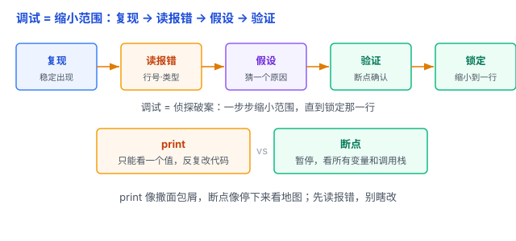

# 调试：程序员的「侦探工作」，不只是 print

调试和上一篇的测试是两码事：**测试**主要是检查程序有没有问题，**调试**则是在发现问题后，找出原因、修复问题，并验证是否真的修好了。这一篇讲怎么高效地做。

## 一、调试的本质：像侦探一样缩小范围

调试不是「瞎改碰运气」，而是一套**缩小问题范围**的方法：

1. **复现**：尽量让 bug 稳定出现。能复现最好，因为更容易定位问题、验证修复；无法复现时，也可以依靠日志、监控等线索排查。
2. **读报错**：错误信息里通常有行号、错误类型、调用栈，是现成的线索。
3. **形成假设**：猜一个可能的原因。
4. **验证假设**：用工具确认猜得对不对。
5. **缩小范围**：反复做，把问题从「整个程序」缩小到「某一行的某个值」。

打个比方：调试像侦探破案——先保护现场（复现），再找线索（报错信息），锁定嫌疑（缩小范围），最后对质（验证假设）。

## 二、print 的局限：能用，但很原始

print 是最入门的调试手段，但毛病明显：

- **慢**：每加一个 print 都要改代码、重跑。
- **污染**：调试完忘了删，代码里一堆调试输出。
- **浅**：只能看「某个值是多少」，看不出「程序此刻的完整状态」。

print 像沿着路撒面包屑找路；而更好的工具能让你**在关键路口停下来看地图**。

## 三、更好的工具：断点和调用栈

**断点（breakpoint）**：在代码某一行打个标记，程序运行到这一行会**暂停**，让你检查此刻相关变量的值和程序状态。

- **单步执行**：一行一行走，看程序每一步做了什么。
- **观察变量（watch）**：盯着某个变量的值，看它随执行怎么变。
- **调用栈（call stack）**：看「谁调用了谁」——这个函数是被哪条路径调进来的。

这些是**调试器（debugger）**的核心功能，几乎所有语言和 IDE 都自带。

打个比方：断点就是在代码里放「监控摄像头」，程序跑到这暂停，你就能看清这一刻的所有状态，而不是只靠 print 看到的那个数字。

## 四、日志：print 的「正规军」

如果一定要用「输出」来调试，用**日志（logging）**代替 print：

- **分级**：DEBUG / INFO / WARNING / ERROR，按严重程度分。
- **可开关**：调试完不用删，关掉某个级别就不输出了。
- **带上下文**：时间、文件、行号自动记录。

print 是一次性的「临时喊话」，日志是「留档的记录」，生产环境出了问题也靠它排查。

## 五、一个神奇的技巧：橡皮鸭

**橡皮鸭调试（rubber duck debugging）**：卡住时，对着桌上的橡皮鸭（或同事）一行行解释你的代码在干什么。

奇怪的是，很多时候你解释到一半，自己就发现了问题——因为解释迫使你把模糊的「感觉」变成清晰的「逻辑」，漏洞就暴露了。

（不用真买橡皮鸭，对着空气讲、写下来讲，效果一样。）

## 六、易错点

1. **不读报错信息就搜**：报错信息里通常直接写着「哪一行、什么错」，是最高效的线索，先读它。
2. **不复现就修**：bug 偶发、不能稳定复现，就很难验证「到底修没修好」。先想办法复现。
3. **碰运气式调试**：乱改一通、同时改好几个地方，最后好了也不知道是哪个改好的。应该一次只改一处、验证一处。
4. **print 忘删**：调试完记得清理，或用可开关的日志。
5. **只压「症状」不找「根因」**：看到报错就加个 if 把它压下去，根因还在，别的地方还会再炸。顺着调用栈追到源头。

## 七、总结

- 调试 = 侦探式缩小范围：复现 → 读报错 → 假设 → 验证。
- 工具：print、日志、断点、单步和调用栈，各有适用场景，关键是根据问题选合适的方法。
- 方法：二分缩小、一次一处、橡皮鸭。

一句话：**调试是「缩小范围」的侦探工作——先复现、再读报错、猜原因、用断点验证；print 只是撒面包屑，断点才能停下来看地图，别瞎改，先定位。**
