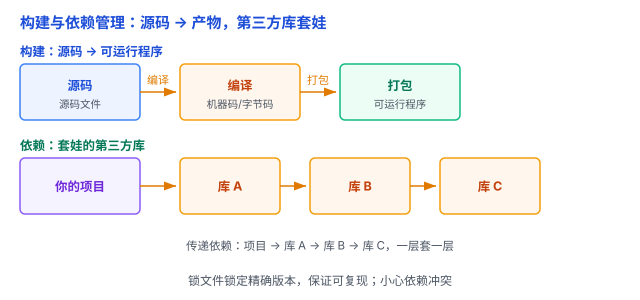

# 构建与依赖管理：从「源码」到「能跑」，以及那些「现成的积木」

写完代码，怎么变成能运行的程序？用到的第三方库谁来管？这篇讲**构建**和**依赖管理**——它们是「代码 → 能跑」这条路上的两件基础设施。

## 一、构建：把源码变成「能跑的东西」

写完源代码，离「能运行」还有一段距离。**构建（build）** 就是把源码变成可运行产物的**自动化**过程：

- **编译**：源码 → 机器码/字节码。
- **打包**：编译产物 → 可部署的格式（jar、war、二进制、静态资源）。
- **测试、检查**：构建时顺便跑测试、做代码检查。

（「编译」和「解释」的区别见 [编译 vs 解释](../01-计算机系统/09-编译与解释.md)。这里只要记住：编译只是构建的**其中一步**，构建是更大的概念。）

没有构建工具时，这些步骤要手动一条条敲命令，容易漏、难重复。构建工具把它们写进脚本（菜谱），一条命令搞定。

打个比方：源码是**食材**，构建是**照着菜谱做菜**——切配（编译）、下锅（打包）、试味（测试），最后端出能吃的菜（可运行程序）。

## 二、依赖管理：别自己造现成的轮子

几乎没有项目从零写一切，都会用第三方库——这就是**依赖（dependency）**。

依赖管理解决三件事：

1. **声明**：在依赖清单里写明「我要哪些库、大概什么版本」（package.json、pom.xml、requirements.txt 等）。
2. **下载**：构建时自动把依赖拉下来，不用手动拷贝 jar 包。
3. **锁版本**：用**锁文件（lockfile）** 记录「这次实际用了哪个精确版本」，保证下次构建、别人机器上构建，结果都一样（**可复现**）。

打个比方：依赖是**现成的积木/半成品**——做菜用现成调料，不用从种酱油开始。依赖清单是「购物清单」，锁文件是「这次买的到底是哪个牌子、哪批货」。

（依赖清单和锁文件都要提交进 Git，但构建产物、`node_modules` 这类生成物不该提交——见 [Git 与版本控制](01-Git与版本控制.md)。）

## 三、传递依赖和依赖冲突：最容易踩的坑

依赖会**套娃**：你的项目依赖 A，A 又依赖 B，B 又依赖 C——这就是**传递依赖（transitive dependency）**。

麻烦在于**依赖冲突**：A 要 C 的 1.0 版，B 要 C 的 2.0 版，两个版本不兼容，装哪个？这就是「菱形依赖」问题。

不同语言的工具各有解法（就近原则、显式声明、版本解析算法），但核心都一样：**要有机制把冲突版本统一掉，而不是让项目里同时存在两个 C**。

## 四、为什么值得做：三个好处

1. **可复现**：锁文件保证「这台机器能跑，那台也能跑」，新同事 clone 下来一条命令就构建成功。
2. **可协作**：依赖清单就是「项目需要什么」的声明，大家看同一个清单，不会各装各的版本。
3. **可自动化**：构建和依赖管理是 CI/CD（持续集成/部署）的地基——自动构建、自动测试、自动发布都靠它。

## 五、易错点

1. **「只有编译才叫构建」**：构建还包括打包、测试、代码检查。别把它理解窄了。
2. **「手改锁文件」**：锁文件是工具自动生成的，手动编辑容易和实际依赖对不上。要改就改依赖清单，让工具重新生成锁文件。
3. **「忽略传递依赖」**：出问题的往往不是直接依赖，而是套娃进来的传递依赖。排查依赖问题要看到那一层。
4. **「不锁版本，依赖天天变」**：依赖清单写「最新版」或宽泛范围，今天能跑明天可能挂。锁文件就是防这个。
5. **「盲目升级依赖」**：升级可能引入破坏性变更，要看 changelog、跑测试再升级。

## 六、总结

- 构建 = 把源码自动化变成可运行产物（编译、打包、测试）。
- 依赖管理 = 声明、下载、锁版本；锁文件保证可复现。
- 小心传递依赖和依赖冲突。

一句话：**构建是把「源码」按菜谱做成「能跑的菜」，依赖管理是管好「现成的积木」——用清单声明、用锁文件锁定精确版本，才能保证这次能跑、下次还能跑。**
