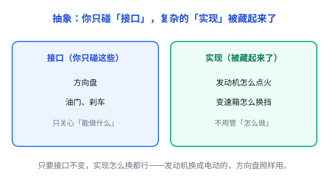

# 抽象：把细节藏起来，只留一个「怎么用」

你按一下遥控器的「开机」键，电视就亮了。你不会去想：按键的电路怎么导通、红外信号怎么编码、电视里哪块芯片在接收。不是你做不到，而是**你根本不需要**——这些细节被「藏」起来了，你只需要知道一件事：按「开机」，电视就开。

这就是**抽象**（Abstraction）：抓住重要的东西，忽略不重要的细节，对外提供一个简单的使用方式。至于背后复杂的实现，则可以藏起来——严格说，「把细节藏起来」这一步叫**封装**（或**信息隐藏**），它常和抽象结伴出现，但抽象的核心是「抓重点、丢次要」。

## 一、没有抽象，会怎么样

要是没有抽象，你写程序就得这么干：直接写内存地址（而不是写个变量名）、手动操作寄存器、自己算每个函数该跳到哪条指令……任何一个小改动，都得把整个系统从头想到尾。

抽象解决的问题，一句话：**让大脑装得下。** 人脑同一时间只能装有限的细节。抽象让我们一次只关心一层，把其他层「外包」出去，腾出脑力想更重要的事。

## 二、抽象的核心：把「接口」和「实现」分开

抽象的本质，是在**接口**和**实现**之间划一条线：

- **接口**：你能做什么。就像方向盘、油门、刹车——你只管这几个操作。（这里的「接口」泛指「你和一样东西打交道的入口」，不一定是编程语言里的 `interface` 关键字。）
- **实现**：它具体怎么做。发动机怎么点火、变速箱怎么换挡——藏起来了，不用你管。

对使用者来说，只要接口和对外行为保持一致，**内部实现通常就能独立修改**。发动机从汽油换成电动的，方向盘、油门、刹车还是照样用。这是抽象最大的好处：**改动被关进笼子里，不往外扩散。**

抽象还有第二个好处：**复用**。它把不同事物的共同点提取出来，让它们用同一套规则。机械硬盘和 SSD 的工作原理完全不同，但操作系统把它们都抽象成「可读写的存储设备」，应用程序就不用为每种硬盘单独写一套代码。

## 三、抽象到处都是：一层套一层

计算机就是一座巨大的「抽象塔」，每一层都藏起下面一层的细节：

| 你用的 | 它藏起来了 |
| --- | --- |
| `x = 5`（变量名） | 具体的内存地址、寄存器 |
| `sort(arr)`（函数） | 排序算法的具体步骤 |
| `user.getName()`（对象） | 数据如何存储、获取 |
| `fetch(url)`（Web API） | 网络请求的底层处理 |
| 读写文件（操作系统） | 数据存在哪些磁盘块、怎么读写 |
| `SELECT`（SQL） | 数据库如何查找数据 |

从晶体管 → 逻辑门 → CPU 指令 → 汇编 → 高级语言 → 库和框架，每一层都是对下一层的抽象。你写 `x = 5` 时，压根不知道（也不需要知道）这个 5 最后落在内存哪个地址、哪个寄存器上（变量到地址这层，见 [内存：栈与堆](../01-计算机系统/01-栈与堆.md)）；你写的是高级语言，把「翻译成机器指令」这件苦差事丢给了编译器（见 [编译 vs 解释](../01-计算机系统/09-编译与解释.md)）。

这里有个关键点：**抽象是相对的。** 对你来说「函数」是抽象；对写编译器的人来说，「函数」就是他要处理的现实。你眼里的「实现」，是别人眼里的「接口」，一层人管一层事。把抽象一层层往上叠，就是「分层」——这也是本章后面要讲的思想。

## 四、抽象的代价：不是免费的

抽象这么好，但它有几个代价，得心里有数：

**1. 可能更慢。** 有些抽象会引入额外开销，比如虚函数调用、框架层层包装。但也有些抽象能被编译器优化掉、几乎没有额外成本（C 的普通函数可能被内联、C++ 模板在编译期展开）。极致追求性能的场景（游戏引擎、高频交易），有时需要绕过某些抽象、直接操作底层。

**2. 抽象会「漏」。** 有个著名说法叫**泄漏的抽象**（Leaky Abstraction）：你以为细节被藏干净了，但它偶尔还是会漏出来捣乱。比如你以为内存是一块均匀的、每个格子一样快，其实有缓存，有的访问快、有的慢上百倍（见 [缓存与局部性原理](../01-计算机系统/02-缓存与局部性.md)）。你最终还是得懂一点底层，出了怪问题才查得动。

**3. 抽象太多 = 过度设计。** 为了「以后可能复用」提前抽象，结果代码绕来绕去，没人看得懂。有个原则叫 **YAGNI**（You Aren't Gonna Need It，你不是真的会需要它）：等真需要了再抽象，别提前。

## 五、什么时候该抽象，什么时候不该

**该抽象的信号：**

- 同一段逻辑出现两三次 → 抽成函数。
- 有明确的「变化点」（以后可能换实现）→ 用接口把它隔离开。
- 复杂度高到不屏蔽细节就没法继续想 → 加一层抽象。

**不该抽象的信号：**

- 只用一次的代码，先别急着抽。
- 还不确定变化方向时，过早抽象往往猜错，改起来更痛。
- 抽象层本身比它藏起来的细节还难懂时，就别抽象了。

## 六、总结

- **抽象 = 藏起细节，只留接口**：你只关心「能做什么」，不关心「怎么做」。
- 它让人脑**一次只装一层**，也让改动**被关进笼子里**、不往外扩散。
- 代价是：可能有性能开销、细节会「漏」出来、过度抽象反而添乱。

> 一句话总结：**抽象就是「会踩油门就行，不用懂发动机」——把复杂度藏起来，让你只跟简单的接口打交道。**
