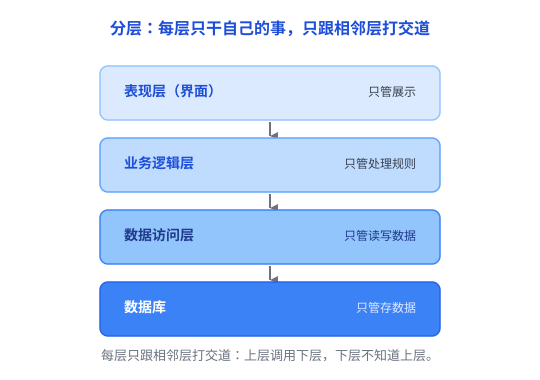

# 分层：把复杂系统切成一层层，每层只管自己那摊事

你网购下单，点一下「提交订单」。就这一下，背后发生了多少事？App 要展示页面、要校验库存、要扣款、要把订单写进数据库、还要通知仓库发货……如果这些全写在一坨代码里，谁也看不懂、改不动。

于是人们想了个办法：**分层**（Layering）。把一个复杂系统从上到下切成若干层，每层只干自己该干的事，层与层之间通过明确的接口打交道，其他层的事一概不管。

这也是上一篇文章 [抽象](01-抽象.md) 的「垂直版」：抽象是把一个东西的细节藏起来，分层是把一堆东西按「谁管什么」一层层摞起来。

## 一、为什么要分层

先看看**不分层**会怎样。假设一个系统不分层：界面代码里直接拼 SQL、顺带处理业务规则、甚至直接操作硬件。结果就是——想改个按钮颜色，得顺着代码一路找到数据库那几行；数据库换个品牌，界面代码也得跟着改。所有东西搅成一团，牵一发动全身。

分层就是来治这个毛病的：它把「界面」「规则」「数据」这些不同职责切开，各自独立。这样，**每个部分的变化都被关在它自己那一层里**——界面怎么变，数据库不用知道；数据库怎么变，界面也不受影响。

换句话说：**系统一复杂，就得分层；分了层，一处改动才不容易牵连到别处。**

## 二、分层长什么样：以软件架构为例

离程序员最近的分层，是软件架构里经典的「三层架构」：

- **表现层**：界面，负责展示、接收用户操作。
- **业务逻辑层**：处理规则（比如「余额不足不能下单」）。
- **数据访问层**：负责读写数据库。
- **数据库**：负责把数据存下来。

这里的「三层」指应用程序的三个逻辑层；数据库是外部的数据存储系统，不算在这三层里。

> 注意：分层是按「职责的性质」来切——展示、逻辑、数据；而开头说的订单、库存、支付，是按「业务」来拆，是另一个维度，别把两者混为一谈。

分层有两条常见的设计原则，但别把它们当成铁律：

1. **尽量通过明确的层间接口交互。** 传统「严格分层」要求只调用相邻层、避免跨层调用；但有些「宽松分层」允许适当跨层，比如表现层直接读一份只读数据，就不必硬绕一层。
2. **控制依赖方向。** 传统三层架构通常由上层调用下层，避免相互依赖、形成循环依赖。不过，不同架构的依赖方向可能不同，关键是让依赖关系清晰、可控。

真正重要的不是死守某一种调用方式，而是**明确职责、控制依赖，让变化尽量局限在一层内部**。守住了这一点，任何一层的内部怎么改，其他层都无感——这才是分层的威力。

## 三、分层到处都是：不只在软件里

计算机世界里，分层几乎无处不在：

- **网络分层**：你在浏览器里发一个请求，数据要依次经过 应用层 → 传输层（TCP）→ 网络层（IP）→ 链路层（以太网、Wi-Fi），底层再通过网线、无线电波这些物理媒介传输，每一层只负责自己那一段（见 [HTTP / HTTPS](../04-网络/01-HTTP与HTTPS.md)）。
- **操作系统分层**：你的程序 → 系统调用 → 内核 → 硬件。程序想读写文件，只需调用系统调用，不用自己碰磁盘（见 [进程 vs 线程](../01-计算机系统/06-进程与线程.md)）。

一个特别形象的生活类比是**寄快递**：你写好地址把包裹交给快递点，快递点负责分拣，运输公司负责运，最后投递员送上门。你不需要知道运输走的是飞机还是货车——每一层只管自己那摊事，把「封装好」的东西交给下一层。

## 四、分层的代价和坑

分层这么好，但它也有代价：

**1. 可能有性能开销。** 有些分层会引入额外的函数调用、数据转换或协议封装——比如网络通信里，不同协议层要加各自的头部。但并不是每一层都会产生明显开销，合理的分层通常不会成为性能瓶颈。

**2. 分层太死板，有时反而碍事。** 有些场景下「严格分层」是负担。比如有些高性能数据库会使用 Direct I/O，绕过操作系统的 Page Cache、自己管理缓存，以减少不必要的数据复制。这说明有些场景需要绕过某些默认机制，但这并不意味着分层本身没有价值。

**3. 层数太多 = 过度设计。** 一个小脚本也要硬套「表现层、业务层、数据层、再加个中间件层」，杀鸡用牛刀，反而更难维护。

**4. 最隐蔽的坑：分层名存实亡。** 如果业务层直接依赖了数据库的具体实现（比如写死某家的 SQL 方言），那分层就只是「代码分了个文件夹」，没有真正隔离。分层的价值不在「看起来分了层」，而在「层的边界真的挡住了变化」。

## 五、什么时候分层，什么时候不分

**该分层的信号：**

- 系统够复杂，不同部分的变化节奏不一样（界面常改、底层很少改）→ 分层把它们隔开。
- 需要多人分工（你写界面、我写逻辑、他写数据库）→ 层就是天然的边界。
- 想复用某层（比如同一套业务逻辑，既能给网页用也能给 App 用）→ 分层让复用变容易。

**不该分层的信号：**

- 系统很小、几乎不变，分层反而绕。
- 对性能极度敏感、需要跨层优化的场景，硬分层会碍事。

## 六、总结

- **分层 = 把复杂系统切成一层层**，每层管自己的职责、通过明确的接口跟别层打交道。
- 核心不是死守某种调用方式，而是**明确职责、控制依赖**——守住了，改动就被关在各自的层里。
- 代价是：可能有性能开销、太死板、过度分层，以及最隐蔽的「假分层」。

> 一句话总结：**分层就是「各管一段，层层传递」——每层只对自己那一小段负责，把复杂切成一块块好处理的。** 它和 [抽象](01-抽象.md) 是一对：抽象横向「藏细节」，分层纵向「叠责任」。
