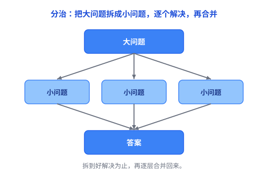

# 分治：把大问题拆成小问题，逐个击破

你面对一个大问题：把一亿个数排好序、给一个超大的系统加功能，或者把一间堆满杂物的屋子收拾干净。直接上手，会觉得无从下手——太大、太乱了。

这时候有个通用的办法：**分治**（Divide and Conquer，字面意思就是「分而治之」）。把大问题拆成若干个小问题，小问题好解决，逐个解决掉，再把结果合并起来。

## 一、为什么要分治

因为**大问题难，小问题简单**。一件事一旦大到超出我们大脑能同时处理的规模，我们就对付不了它。分治的思路就是：**先缩小到能对付的尺寸，再动手。**

一个最直观的生活例子是**大扫除**：你不会拿着一块抹布满屋子乱转，而是把房子分成「客厅、卧室、厨房」几块，一块一块收拾干净，最后整个房子就干净了。每一块都不难，合起来却是个大工程。

## 二、分治三步

分治通常包含三个步骤：

1. **分解（Divide）**：把大问题拆成若干个规模更小、结构相似的小问题。
2. **解决（Conquer）**：逐个解决小问题。小到一定程度，就能直接解决，不用再拆。
3. **合并（Combine）**：把小问题的解拼起来，得到大问题的解。



用一个具体例子把这三步串起来——**归并排序**怎么把 8 个数排好序：

```
[8 3 7 2 6 1 5 4]
        ↓
[8 3 7 2] [6 1 5 4]
         ↓
[8 3] [7 2] [6 1] [5 4]
           ↓
[8] [3] [7] [2] [6] [1] [5] [4]
           ↓
[3 8] [2 7] [1 6] [4 5]
         ↓
[2 3 7 8] [1 4 5 6]
        ↓
[1 2 3 4 5 6 7 8]
```

- **分解**：不断对半拆，拆到每个只剩 1 个数字。
- **解决**：只剩 1 个数字时，它天然就是有序的，不用排。
- **合并**：把两个有序的小数组合并成一个更大的有序数组，一层层合上去。

三步在这张图里一目了然。

不过要说明：**不是所有问题都需要显式的合并这一步。** 比如二分查找，把搜索范围一分为二后，只继续查其中一半，最后直接得到答案，不需要把两个子结果拼起来。严格来说它更接近「减治」，但也常被宽泛地放在分治思想下一起讨论（见 [排序与查找](../03-数据结构与算法/05-排序与查找.md)）。

其中「结构相似」是分治的关键：拆出来的小问题，和你原来那个大问题是**同一种问题**，只是规模更小。所以你可以用**同样的方法**去解决它——这天然适合用**递归**来实现（递归就是一个函数在解决问题的过程中，再次调用自己去处理更小的同类问题，见 [递归](../02-编程语言通用概念/04-递归.md)）。

## 三、分治长什么样：从算法到工程

分治不仅是一种经典算法思想，广义的「分而治之」也广泛应用于并行计算和软件工程：

- **算法里**：归并排序、快排都是经典分治（见 [排序与查找](../03-数据结构与算法/05-排序与查找.md)）。更完整的算法视角见 [分治、贪心、动态规划的入门直觉](../03-数据结构与算法/06-分治贪心动态规划.md)。
- **并行计算里**：MapReduce 把海量数据切成一堆小块，分到成千上万台机器上同时算，最后汇总结果——「分」到机器、「治」到局部、「合」回全局。
- **软件工程里**：大型项目可以拆成多个模块，由不同团队负责开发，最后集成起来，这是广义的「分而治之」。不过它和算法里的严格分治不太一样：订单、支付、库存这些模块职责完全不同，并不是同一种子问题。

## 四、什么时候能用分治

不是所有问题都能拆。能不能分治，主要看两条：

1. **子问题之间相对独立**——能分开解决，不会互相牵制。比如收拾房间，卧室和厨房各收各的，互不影响。
2. **子问题和原问题是同一种问题**——可以用同样的方法解决，这样递归才能一层层拆下去。

反过来，如果拆出来的子问题之间高度依赖——解决一个必须不断等待另一个，或者合并结果的成本特别高——那分治可能就不划算，这时候得考虑其他方法。

## 五、分治的代价和坑

**1. 拆分和合并本身要花钱。** 拆得太细不一定更好。比如并行处理一亿个数，如果给每个数都单独创建一个计算任务，光是任务调度、数据传输的开销就可能非常大。所以不是拆得越细越好，还得看拆分、合并的成本值不值。

**2. 递归有栈开销。** 分治常用递归实现，而递归太深会占栈空间，最坏情况会栈溢出（见 [内存：栈与堆](../01-计算机系统/01-栈与堆.md) 里的栈溢出）。

**3. 别硬拆。** 有些问题天生是「整体问题」，拆开就失真。硬套分治只会把简单问题变复杂。

## 六、总结

- **分治 = 拆小 → 逐个解决 → 合并**，核心是「结构相似、能独立解决」。
- 它不只用在算法，也在并行计算、软件工程里处处可见。
- 前提是子问题相对独立、同构；代价是拆分合并有开销、递归可能占栈。

顺带把这三种「拆」的差别放在一起看：

| 思想 | 解决的核心问题 |
| --- | --- |
| 抽象 | 信息太多，怎样只关注重要的部分？ |
| 分层 | 职责太多，怎样组织和管理它们？ |
| 分治 | 问题太大，怎样拆成容易解决的小问题？ |

> 一句话总结：**分治就是「大到对付不了，就先拆到能对付，再拼回来」——把难题变成一堆小题。** 它和 [抽象](01-抽象.md)、[分层](02-分层.md) 是一路：都是把「大而复杂」变成「小而简单」，只是拆的东西不同——抽象藏细节、分层叠责任、分治拆问题。
