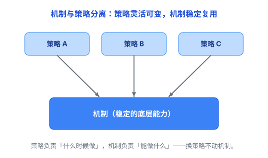

# 机制与策略分离：把「能做什么」和「什么时候做」分开

你写了一个排序函数，能排整数。后来产品说「也要能排字符串」「还要能倒序排」。要是每次都得改排序函数本身，你会崩溃——排序那套逻辑没错，错的是「它被写死了只能排整数」。

这里藏着一个通用的设计思想：**把「能做什么」（机制）和「什么时候、按什么规则做」（策略）分开。**

## 一、什么是机制，什么是策略

一辆车，**发动机、方向盘、刹车是它「能做的事」——这是机制**；**「往哪开、开多快、什么时候停」是司机「怎么用这辆车」——这是策略**。

- **机制（Mechanism）**：提供底层能力，回答「怎么做 / 能做什么」。它是稳定的、通用的，跟具体场景无关。
- **策略（Policy）**：决定规则，回答「什么时候用、按什么规则用」。它是易变的、跟场景强相关。

换一个司机（策略），车（机制）一点不用改；反过来，要是每换一次目的地都得改造发动机，那就没法开了。

## 二、为什么要分开

因为**机制稳定、策略易变**。把它们搅在一起，最大的坏处有两个：

1. **改规则就得动底层。** 比如排序函数写死了「从小到大」，哪天要「从大到小」，就得去改排序函数本身——每次改规则都去动那套已经验证过的稳定代码，危险。
2. **机制没法复用。** 一个绑死「整数排序」的函数，没法拿去排字符串。机制本来跟场景无关，绑上策略就废了。

分开之后，机制保持稳定、可以到处复用；策略想怎么换就怎么换，不动底层。

## 三、计算机里到处都是这对组合

- **排序的 compare**：排序算法负责「怎么排序」，比较函数负责「谁排在谁前面」。想从小到大？用一种比较规则；想从大到小？换一种比较规则。排序算法本身不用改（见 [排序与查找](../03-数据结构与算法/05-排序与查找.md)）。
- **操作系统调度**：「暂停一个进程、切到另一个」这套底层能力是机制；「先服务谁、给谁多少时间片」是调度策略。Linux 可以换调度策略（普通程序用公平调度、实时任务用优先级调度），而底层上下文切换机制不变（见 [进程与线程](../01-计算机系统/06-进程与线程.md)）。
- **Web 框架**：「接收请求、匹配路由、调用处理函数」是机制；「哪个 URL 对应哪个函数、哪些接口需要鉴权」是策略。
- **权限控制**：「检查读/写/执行权限位」是机制；「谁被授予什么权限」是策略，由管理员决定。

你发现了吗？排序、操作系统、Web 框架看起来毫不相关，却都在做同一件事：把经常变化的规则，从相对稳定的能力里分离出来。

## 四、代价和坑

分离是有成本的，哪怕分离是对的，也得付：

**1. 多一条要设计的边界。** 机制和策略之间得定一个清晰的接口——比如 compare 函数的签名、调度器暴露的配置项。想清楚「哪些归机制、哪些归策略」本身就要花心思，边界定不好，两边都会别扭。

**2. 策略多了也要管。** 等策略积累成一大堆规则（上百条配置、几十个插件），管理策略本身又成了一件复杂的事——分离解决了一个问题，可能又冒出另一个。

## 五、什么时候该分离

判断要不要分离，主要看两个信号：

**信号一：规则经常变，能力却稳定。** 这是分离收益最大的情况。排序的「从大到小 / 按字符串排」、调度的「先服务谁」、路由的「哪个 URL 对应哪个函数」——这些规则三天两头变，但底层的排序、切换、分发能力常年不变。把会变的拆出来，改规则时就不用碰稳定代码。

**信号二：同一个能力，要服务多个场景。** 一个排序函数如果能同时排数字、排字符串、排结构体，它就值得把「怎么比较」拆成策略；一个转发机制如果能同时服务「放行、限流、黑名单」多套规则，它也值得拆。复用的地方越多，分离越划算。

反过来，下面这些情况**别硬拆**：

- **规则和能力一起变**。如果每次改规则，底层能力也得跟着改，那拆了也白拆——边界一直在动，分离反而制造麻烦。
- **只有一种用法，以后也不会变**。一个函数、一个模块，如果从出生到下线都只有一个场景，提前给它造接口、留配置项，就是纯负担——这是 YAGNI（你不会需要它，见 [抽象](01-抽象.md)）。
- **场景极简单**。十几行的小工具，直接写死最清楚，硬套「机制 / 策略」框架只会更啰嗦。

一句话记住判断方法：**问自己——「这个规则以后会不会变？」「这个能力会不会被别的场景复用？」** 两个问题只要有一个答案是「会」，就值得考虑分离；如果规则很稳定、场景很简单，就没必要提前设计。

## 六、总结

- **机制 = 能做什么（稳定、通用）；策略 = 什么时候、按什么规则做（易变、跟场景相关）。**
- 分离的价值：机制稳定可复用，策略灵活可替换。
- 代价：过度分离会变抽象、变难懂；简单场景别硬拆。

> 一句话总结：**软件设计的一条重要原则——让稳定的部分保持稳定，让变化的部分容易变化。** 机制与策略分离正是这么做的：把会变的规则（策略）从稳定的能力（机制）里拆出来，改规则就不必动底层。它和 [抽象](01-抽象.md)、[分层](02-分层.md)、[分治](03-分治.md) 是一路：抽象藏细节、分层叠责任、分治拆问题，而机制与策略分离，是把「稳定」和「易变」分开。
