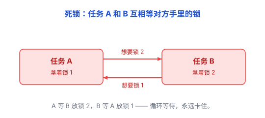

# 并发：让多件事同时推进，又要防它们打架

想象你一个人做晚饭：要煮饭（30 分钟）、炒菜（10 分钟）、煲汤（1 小时）。如果**一件事彻底做完才做下一件**，你大部分时间在干等——煮饭那 30 分钟里，你其实可以先把菜切了。聪明的做法是几件事**同时推进**：饭在煮，你去炒菜；汤在煲，你去洗锅。

计算机也一样，大量时间花在**等**上：等磁盘、等网络、等用户输入。这些要几毫秒到几秒，而 CPU 的许多基本操作只需要纳秒级时间。等待时，CPU 完全可以去干别的。

**并发（Concurrency）就是让多件事「同时推进」：一件事在等，另一件事继续干。**

这里先分清两个容易混的词：

- **并发（Concurrency）**：结构上「同时推进多件事」，可能只是一个人来回切换（交替执行）。
- **并行（Parallelism）**：物理上「同时执行多件事」，靠多核（多个人真同时干）。

并发解决「怎么同时应对很多事」，并行解决「怎么让很多事更快地同时做完」。本文主要讲并发，但竞态、锁这些坑，两者都会遇到。

实现并发的方式有很多——多线程、多进程、协程、事件循环等。它们实现方式不同，但目的相似：让多个任务能够交替或同时推进。

## 二、并发最大的麻烦：共享数据打架（竞态条件）

多件事同时推进时，常常要**共用同一份数据**——问题就从这里来。

经典例子：`count` 一开始是 0，两个任务各执行一次 `count = count + 1`。你期望结果是 2，实际却可能是 1。

为什么？`count = count + 1` 看起来是一步，其实是三步：**读出 count → 加 1 → 写回**。两个任务交错执行时：

```
任务 A：读出 count（=0）
任务 B：读出 count（=0）       ← 也读到 0
任务 A：算出 1，写回（count=1）
任务 B：算出 1，写回（count=1）   ← 把 A 的结果覆盖了
```

两个任务都读到 0，都写回 1，白加了一次。

这种「结果取决于任务执行的先后顺序」的 bug，叫**竞态条件（Race Condition）**。它最烦人的地方是：**不是每次都错，偶尔才错**——同样的代码跑十次，九次正常，就那一次翻车，极难复现。

## 三、用「锁」保护共享数据

防止打架最简单的办法是**锁（Lock）**：给共享数据上一把锁，让多个任务不能同时修改它。

就像家里只有一个灶台，两个人要炒菜就得排队：谁先拿到锅铲（锁），谁先炒；另一个等对方放下。

```
任务 A：加锁 → 读 count → 加 1 → 写回 → 解锁
任务 B：等锁…… → 加锁 → 读 count → 加 1 → 写回 → 解锁
```

有了锁，读-改-写这组动作就变成「原子的」——中途不会被别人插进来。当然，前提是**所有**访问这份数据的任务都遵守同一套加锁规则；只要有谁绕过锁直接改数据，照样会乱。

## 四、锁又带来新问题：死锁

但锁不是万能药。任务 A 拿着锁 1 等锁 2；任务 B 拿着锁 2 等锁 1——**两个人都等对方先放手，谁也动不了，永远卡住**。这叫**死锁（Deadlock）**。



就像两个人迎面走上独木桥，走到中间各占一半，都让对方先退，结果僵在原地。

死锁的关键是**循环等待**——「你拿着我的、我等着你的」，它是形成死锁的必要条件之一。避免它的常见办法：所有任务按**同样的顺序**拿锁（要么都先拿锁 1 再拿锁 2，要么都反过来），就不会互相卡住。

## 五、另一种并发方式：异步，不必原地等待

除了用多个线程同时处理任务，还可以利用**异步**，让一个线程在等网络、磁盘时，先去处理别的任务。

- **同步（Synchronous）**：发起一个操作，就**原地等着**，拿到结果才继续。像打电话——说完一句，等对方回一句。
- **异步（Asynchronous）**：发起一个操作，**不等**，先干别的，结果好了再通知你。像发消息——发出去就去忙别的，看到回复再回。

异步不一定需要多个线程，也不意味着完全没有竞态；它的好处是让程序充分利用等待时间，而不是傻等。

## 六、单线程也能并发：事件循环

异步最常见的落地，是**事件循环（Event Loop）**——JavaScript / Node.js 的核心模型。

思路是：**一个线程，不停地从一个「任务队列」里取任务来执行**；遇到慢操作（读文件、等网络）就把它交给底层，自己不停下，继续执行队列里的下一个任务；等慢操作完成，再把「继续处理结果」这件事排回队列。

所以一个单线程的 JS 程序，能同时「在等」十几个网络请求，却不需要多线程和锁。它的好处是：**同一时刻只有一段 JavaScript 在执行**，处理完一个任务才轮到下一个，因此避开了「两个线程同时改一个变量」这类数据竞争。

但别把话说满：**单线程不等于没有竞态**。设想一个任务先读出一个共享的数字，然后去等网络；在它等待的时候，另一个任务插进来，也读出了同一个数字。等两个任务各自醒来，都拿着旧值加 1 再写回——结果还是只加了一次。

单线程只保证「同一时刻只有一段代码在跑」，不保证「一个跨越多步等待的操作不被打断」。凡是「读 → 等 → 写」这种中间要等的过程，都可能被别的任务穿插，产生竞态。

（关于进程和线程这些并发的基本单位，见 [进程与线程](../01-计算机系统/06-进程与线程.md)。）

## 七、代价和坑

**1. 竞态极难排查。** 偶发、难复现，上线前测不出来，上线后随机爆炸。只要多个任务共享数据，就要特别小心。

**2. 锁和异步各有代价。** 锁太多 → 大家频繁排队，性能反而下降，还容易死锁、忘了释放；异步 → 回调套回调（「回调地狱」）、出错难排查。

**3. 复杂度爆炸。** 任务一多，交错的情况指数级增长，人脑根本算不过来。

## 八、什么时候需要并发

- **大量等待（等网络、等磁盘）** → 并发收益最大，让别的任务先跑。
- **纯计算、要压满多核** → 靠并行（多线程/多进程真同时跑），这是并行的主场。
- **任务本来就串行、也没啥可等的** → 别硬上并发，简单串行最省心。

## 总结

- **并发 = 让多件事同时推进，别把时间浪费在干等上。**
- 核心难点是**共享数据打架**（竞态），用**锁**保护，但锁会引出**死锁**。
- 另一条路是**异步 + 事件循环**：单线程也能并发，绕开多线程竞争，但竞态并未完全消失。
- 代价：竞态难查、锁有开销、异步有回调地狱、复杂度爆炸。

> 一句话总结：**并发，就是让多个任务一起推进，而不是一个做完再做下一个——它提高了资源利用效率，也带来了任务之间互相干扰的风险。** 它和前面几篇是一路：抽象藏细节、分层叠责任、分治拆问题、机制与策略分离拆「稳定与易变」，而并发处理的是「多件事怎么一起干、又互不踩脚」。
