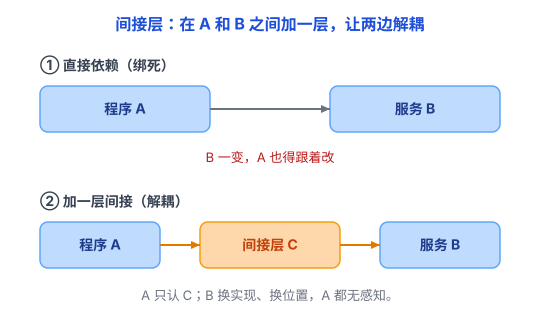

# 间接层：在中间加一层，让两边不再绑死

你打客服电话，不会直接接到某个具体客服，而是先打到「总机」，总机再帮你转给「现在负责这件事的人」。客服今天换人、明天调岗，你拨的号码永远不用变——因为中间那台「总机」替你挡住了这些变化。

计算机里到处都是这种「总机」：**不直接把 A 和 B 连起来，而是在中间加一层 C，让 A、B 都只跟 C 打交道**。这一层 C，就叫**间接层（Indirection）**。

计算机界有句流传很广的名言：「任何问题都能通过加一层间接来解决。」——后面还常被人补一句调侃：「除了『间接层太多』这个问题。」

## 一、什么是间接层

生活里：你寄快递，地址写「某省某市某区某路某号」，而不是写「交给张三本人」。地址就是一层间接——邮局（中间层）按地址投递，你不需要认识张三，甚至不需要知道他在不在家。

技术里：**A 不直接依赖或访问 B，而是通过 C 来找到或使用 B。** C 可以是一个中间服务、一张映射表，也可以是一个接口。

```
直接依赖：  A ────▶ B
加间接层：  A ────▶ C ────▶ B
```

注意，「C」不一定是一个真正的软件层——它可能只是一张映射表（域名 → IP）、一个编号（文件描述符），或一个抽象约定（接口）。不管长什么样，作用都一样：A 只认 C 提供的「怎么用」，不认识 B 的真身。

一句话：**间接层，就是给「变化」和「使用」之间加的一道缓冲。**



## 二、为什么要加它（痛点：直接依赖会绑死）

没有间接层，A 直接依赖 B，最大的坏处是**绑死**：

- B 的实现改了，A 得跟着改。
- B 换地方了（换服务器、换文件路径），A 得改。
- 十几个 A 都依赖同一个 B，B 一变，全部要改。

加一层间接后，只要 C 对外提供的约定保持稳定，B 在这一约定内的实现和位置变化，就可以尽量不影响 A。

## 三、计算机里到处都是间接层

这是本文的重点——你会发现，这一招几乎无处不在：

- **域名系统 DNS**：你访问 `github.com`，而不是记一串 IP。DNS 把「域名」翻译成「IP」，这就是一层间接。服务器 IP 换了（迁移机房），域名不变，你照样能访问（见 [DNS](../04-网络/03-DNS.md)）。
- **虚拟内存**：程序用「虚拟地址」，不直接用「物理内存地址」。中间的硬件（MMU）负责翻译。好处：程序不用管数据实际放在哪块物理内存、别的程序用了哪些地址，甚至内存不够时能临时换到磁盘（见 [虚拟内存](../01-计算机系统/07-虚拟内存.md)）。
- **文件描述符**：程序用一个整数 `fd` 代表打开的文件，而不是直接去碰磁盘。操作系统在中间维护「fd → 文件」的对应表。
- **接口 / 抽象类 / 函数指针**：调用方不直接调某个具体函数，而是调「接口」；具体实现随时能换（见 [抽象](01-抽象.md)）。
- **数据库索引**：查数据不是一行行扫，而是先查「索引」再定位到具体行（见 [索引](../05-数据库/03-索引.md)）。
- **反向代理**：用户不直接连服务器，先连代理，代理再转发。于是能顺便做负载均衡、缓存、鉴权。
- **编译器的中间表示（IR）**：源代码先变成一种「中间语言」，再变成机器码。这样「各种语言」（前端）和「各种 CPU」（后端）就能自由组合，不用为每种语言 × 每种 CPU 各写一遍。

看出来了没？域名、虚拟地址、文件描述符、接口、索引——名字不同，招数却很相似：**不直接访问目标，而是通过一个中介来找到或使用它。** 有的为了隔离变化，有的为了提高效率，有的为了降低复杂度。

其实前面几篇的思想，骨子里都在用间接层：

- [抽象](01-抽象.md)：用接口挡住实现细节——接口就是一层间接。
- [分层](02-分层.md)：一层一层叠起来，每一层都通过「下一层提供的接口」间接干活。
- [机制与策略分离](04-机制与策略分离.md)：把「会变的策略」和「稳定的机制」拆开，中间靠一个接口间接连接。

所以「间接层」更像是这几招共同的**底层手段**。

其实再往深一层看，间接不只是为了隔离变化，更是为了**让使用者不必直接面对目标的全部复杂性**：

- 通过文件描述符，程序不用直接处理内核里的文件对象；
- 通过虚拟地址，程序不用直接管理物理地址；
- 通过接口，调用方不用知道具体实现；
- 通过域名，用户不用记住服务器的 IP 地址。

这四件事背后是一个更通用的道理：**使用者只需要知道「怎么用」，不一定需要知道目标「在哪里、怎么实现」。**

## 四、代价和坑

那句名言的后半句，说的就是代价：

**1. 有额外开销，但不一定更慢。** 每多一跳，就多一份开销：查域名要发请求（所以有了 DNS 缓存）、虚拟地址翻译要查表（所以有了 TLB）、代理转发多一个处理和转发环节。不过缓存、连接复用等优化也可能让整体性能不降反升。准确说，间接层通常有额外开销，但整体性能不一定下降。

**2. 更难懂。** 本来是 A→B，一眼看到底；加了间接变成 A→C→D→B，追踪一次调用要穿过好几层，出 bug 更难排查。

**3. 层数失控。** 这是最经典的坑——「一个问题解决不了，就再加一层」，层层叠叠，最后复杂到没人看得懂。所以那句名言才被人反着补：「任何问题都能加一层间接解决，除了『间接层太多』这个问题。」

## 五、什么时候加、什么时候别加

**该加**：两边需要「各自变化」。

- 要解耦：A 不想知道 B 的实现。
- 要可替换：B 以后可能换（换数据库、换算法、换服务器）。
- 要复用：一层 C 能服务很多个 A 和 B。

**别加**：

- 就一个 A 一个 B，B 永远不变——直接连最清楚。
- 性能极端敏感的热路径——每一跳都要算账。
- 为了「显得高级」而加——层数多不等于设计好。

判断就一句：**加这层间接，到底挡掉了什么会变的东西？** 挡得住，就值；挡不住，就是白加一层。

## 六、总结

- **间接 = 不直接面对目标，而是通过一个中介（服务、映射表、接口）来使用它。**
- 价值：隐藏复杂性、隔离变化、提高效率，让系统更灵活、更能复用。
- 代价：多一层要理解和维护的关系，以及最危险的「层数失控」。

> 一句话总结：**间接的本质，就是不直接面对目标，而是通过一个中介来使用它。这一层中介可以隐藏复杂性、隔离变化，让系统更灵活；代价是多了一层需要理解和维护的关系。** 它是 [抽象](01-抽象.md)、[分层](02-分层.md)、[机制与策略分离](04-机制与策略分离.md) 这些思想的共同底层手段；域名、虚拟地址、文件描述符、接口、索引，背后都是同一招。
