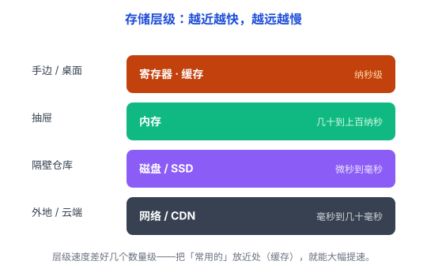

# 局部性：为什么程序总爱访问刚用过的、挨着的

你有没有发现，办公时经常用到的东西，往往就那么几样？刚看过的文件，过一会儿可能还要看；拿起某份资料，接下来可能还要翻它旁边的几页。

计算机程序也有类似的访问习惯：刚访问过的数据，往往还会访问；刚访问过的位置，附近的数据也可能很快被访问。

这就是**局部性（Locality）**。

## 一、什么是局部性

局部性说的是：程序在某一小段时间里，只访问**一小块**数据，而不是在整个存储里乱翻。它有两种：

- **时间局部性（Temporal Locality）**：刚访问过的数据，很快会再访问。比如循环里的计数器 `sum`，每转一圈都要读写一次。
- **空间局部性（Spatial Locality）**：访问过一个数据，它**附近**的数据很快也会被访问。比如遍历数组，读了 `a[0]` 接着读 `a[1]`、`a[2]`。

一句话记住：**时间局部性 =「刚用过的还会用」；空间局部性 =「挨着的接着用」。**

注意：局部性本身是**程序访问数据的规律**，不是「把常用的放近处」这个动作——后者是缓存利用这条规律干的事。把两者分清楚，后面才好理解缓存为什么管用。

> 想从「缓存」这个具体机制看这两个规律，见 [缓存与局部性原理](../01-计算机系统/02-缓存与局部性.md)；本文把它当成一条贯穿全局的通用思想来展开。

## 二、为什么它这么重要（痛点：存储快慢差好几个数量级）

因为存储是「越近越快，但越贵越小」，不同层级的速度差得离谱：

- 寄存器：极快，访问常以 CPU 时钟周期衡量
- CPU 缓存：纳秒级（L1 通常比 L2、L3 快）
- 内存：几十到上百纳秒
- 磁盘 / SSD：微秒到毫秒级（SSD 快，机械硬盘慢）
- 网络 / 跨地域：毫秒到几十毫秒

最近和最远，能差好几个数量级。如果程序访问数据毫无规律、到处乱跳，就更容易发生缓存未命中，不得不去较慢的存储层取数据，性能可能大打折扣。

而局部性救场的地方在于：**既然程序爱重复访问刚用过的、以及附近的数据，我们就可以把它们提前搬到离 CPU 近的快速存储里**——等它真要用时，已经在手边了。

## 三、计算机里到处都是局部性

缓存只是最出名的一个。这一招贯穿整个计算机：

- **CPU 缓存**：把最近用过的内存块搬进 L1/L2/L3，下次命中就快（见 [缓存与局部性原理](../01-计算机系统/02-缓存与局部性.md)）。
- **虚拟内存 / TLB**：程序访问内存有局部性，所以「最近用过的页表项」会被缓存起来（TLB），下次翻译地址不用再查内存（见 [虚拟内存](../01-计算机系统/07-虚拟内存.md)）。
- **磁盘**：顺序读比随机读快得多——机械硬盘不用来回移动磁头，SSD 也能更好预取，靠的正是空间局部性。
- **浏览器缓存 / CDN**：经常被重复访问的网页、图片，可以缓存在本地或边缘节点；CDN 还会让用户尽量访问网络上较近的节点，减少传输延迟（见 [HTTP / HTTPS](../04-网络/01-HTTP与HTTPS.md)）。
- **数据库**：索引、热数据缓存、把关联数据放在一起，都是利用局部性（见 [索引](../05-数据库/03-索引.md)）。
- **数据结构**：数组比链表「缓存友好」——数组元素挨着存，遍历时命中率高；链表节点东一个西一个，容易落空。这也能解释一件常被忽略的事：**算法复杂度相同，不代表实际运行速度相同**——数组和链表遍历都是 O(n)，但数组空间局部性好，实际往往更快。

看出来了没？缓存、虚拟内存、磁盘、网络、数据库——名字不同，招数一样：既然访问具有**重复性**和**邻近性**，就没必要每次都从头、从远处找数据。于是计算机用缓存、预取、数据布局来利用这条规律。

## 四、代价和坑

局部性是「经验规律」，不是「保证」，所以有坑：

**1. 程序写得不好，局部性就失效。** 随机跳转、大跨度跳跃访问，缓存一直「落空」，程序照样慢。

**2. 经典反例：按列遍历二维数组。** C 语言里二维数组按「行」连续存储，按行遍历是顺序访问（快），按列遍历是跳着访问（慢）。对足够大的二维数组，同样的数据、同样的循环次数，只改一下访问顺序，运行速度就可能出现数倍甚至更大的差距（细节见 [缓存与局部性原理](../01-计算机系统/02-缓存与局部性.md)）。

**3. 别迷信「放近处就一定快」。** 缓存、预取本身也有开销（多一层、要维护一致性、可能白搬）。数据量小、只访问一次的场景，缓存反而添乱。

**4. 局部性不是唯一的原则。** 它是程序最常见的访问特征，但并非所有缓存都只靠它、也不是所有性能优化都依赖它。它是一条「通常成立」的经验，不是放之四海皆准的铁律。

## 五、怎么用（什么时候该利用它）

- **顺序访问**：能顺序读就顺序读，别乱跳。
- **数据紧凑**：把经常一起访问的数据尽量放在一起。
- **把常用的放近处**：热数据放缓存/内存，冷数据放磁盘/归档。
- **别过度设计**：数据量小、一次性访问，别折腾缓存。

判断就一句：**这段代码的数据访问，是有规律的（顺序、重复），还是乱跳的？** 有规律，就顺着它的规律走，让缓存和预取帮你的忙。

## 六、总结

- **局部性 = 程序倾向于访问「刚用过的」（时间）和「挨着的」（空间）——这是一条访问规律。**
- 计算机利用它（缓存、预取、数据布局），让数据获取更快。
- 代价：它是规律不是保证，写不好就失效；缓存本身也有成本。

> 一句话总结：**局部性，就是程序倾向于重复访问刚用过的数据，以及访问相邻的数据。计算机利用这一规律，通过缓存、预取和合理的数据布局，让数据获取更快、程序运行更高效。** 它是缓存、虚拟内存、磁盘、CDN 这些机制共同的底层依据，和前面的 [抽象](01-抽象.md)、[分层](02-分层.md)、[分治](03-分治.md)、[机制与策略分离](04-机制与策略分离.md)、[并发](05-并发.md)、[间接层](06-间接层.md) 是一路：它们讲「怎么组织」，局部性讲「怎么利用访问规律来提速」。
