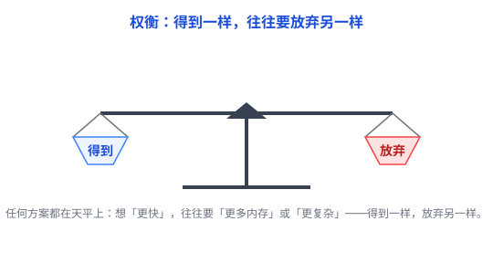

# 权衡：没有银弹，只有取舍

你买手机，想要「性能强、续航久、又轻又便宜」——可现实中，性能强往往更耗电，续航久往往又重又大，又轻又便宜往往性能一般。你只能在里面挑自己最看重的，别的就得让一让。

计算机里的每一次设计、每一个选择，几乎都在做同一件事：**为了得到 A，往往要放弃一部分 B。** 这就叫**权衡（Trade-off）**。

计算机界有句流传很广的话：「没有银弹（No Silver Bullet）」。它提醒我们，不要指望某一种技术能够解决所有问题。

## 一、什么是权衡

权衡的本质是：**资源是有限的，而目标之间常常互相冲突。** 想要「更快」，往往要付出「更多内存 / 更多复杂度」；想要「更简单」，往往要放弃「更灵活」。

它不是「做不做」，而是「用哪个换哪个」——**鱼与熊掌不可兼得，你必须清楚自己在拿什么换什么。**

## 二、为什么会有权衡（痛点：没有免费的午餐）

因为很多好东西天生互相打架：

- **时间 vs 空间**：想把结果算得快，就把中间结果存起来（缓存、查表），拿空间换时间；想把内存省下来，就现算（压缩、流式），拿时间换空间。
- **性能 vs 可读**：写到极致的代码常常难懂；一眼看懂的代码常常不是最快的。
- **简单 vs 灵活**：一个写死的小函数最简单，但没法复用；抽象出接口更灵活，但更绕。
- **一致 vs 可用**：分布式系统发生网络分区时，如果坚持强一致性，部分请求可能无法得到正常响应；如果坚持让所有请求都能得到正常响应，就可能无法保证强一致性——CAP 定理讨论的就是这个。

如果你以为存在「又简单又灵活、又快又省内存」的方案，就会一直找不到「完美答案」，或者迷信某个被吹上天的「银弹」。**意识到没有银弹，才是做取舍的第一步。**

## 三、计算机里到处都是权衡

回头看前面讲过的设计思想，你会发现它们都在做权衡：

- **抽象、分层、间接层、机制与策略分离**：用额外的抽象、结构和接口，换取更好的可维护性与灵活性（见 [抽象](01-抽象.md)、[分层](02-分层.md)、[间接层](06-间接层.md)、[机制与策略分离](04-机制与策略分离.md)）。
- **分治**：通过拆分问题降低求解难度，但可能增加拆分、合并的成本（见 [分治](03-分治.md)）。
- **并发**：提高资源利用率和响应能力，但增加协调任务的复杂度，以及可能出现的竞态、死锁（见 [并发](05-并发.md)）。
- **缓存与局部性**：利用额外存储和数据管理成本，换取更快的数据访问（见 [局部性](07-局部性.md)）。

还有两个日常最常见的：

- **数据库索引**：拿「写更慢、占更多空间」换「查更快」（见 [索引](../05-数据库/03-索引.md)）。
- **压缩**：拿「先花时间压缩 / 解压」换「更少的存储和传输」。

每种设计都在解决一个问题，也可能带来新的问题。**那个代价，就是它做的权衡。** 大多数设计都不是只有收益、没有代价——关键是看收益是否值得付出的成本。

## 四、代价和坑（权衡本身的坑）

**1. 把「没有绝对最好」误解成「怎么选都一样」。** 权衡不是虚无主义——针对具体场景，往往有明确的取舍方向。数据量小，就别上复杂的分布式方案；性能不敏感，就别牺牲可读性。

**2. 过度优化。** 提前为「可能用不上」的性能 / 灵活性付出大量复杂度和时间，最后发现根本没这个需求（见 [机制与策略分离](04-机制与策略分离.md) 里的 YAGNI）。

**3. 用错方向。** 为了 1% 的性能提升，牺牲 90% 的可读性，结果以后每次改代码都提心吊胆。付出的代价和换来的回报，得配得上。

## 五、怎么做权衡

没有「正确答案」，但有「正确的方法」。用一个具体例子说清楚。

**例子：到底该不该给数据库加索引？**

假设你有一张用户表，里面有 100 万条记录。现在两个方案：给某个字段建索引，还是不建。

- **方案 A**：不建索引——省空间、写入快，但查这个字段可能很慢。
- **方案 B**：建索引——查得快，但占更多空间，每次写入还要多维护一份索引。

到底选哪个？走三步：

**第一步：明确场景。** 这个字段每天查 10 万次、写入只有几百次？那查询收益很可能超过写入成本。反过来，这个字段几乎没人查，那建索引的收益就很小。

**第二步：比较收益与代价。**

| 维度 | 不建索引 | 建索引 |
| --- | --- | --- |
| 查询速度 | 可能较慢 | 符合条件的查询通常更快 |
| 写入成本 | 相对较低 | 需要维护索引 |
| 存储空间 | 较省 | 额外占空间 |
| 维护复杂度 | 较低 | 需要管理索引 |

**第三步：按实际需求选，再用结果验证。** 业务以查询为主，建索引很可能划算；字段几乎不参与查询，就没必要为了「数据库就该有索引」而建。最后还能用查询计划、执行时间、写入性能实测来验证判断。

这个例子真正要说明的是：**权衡不是凭感觉选，也不是机械地在两个优点之间二选一——而是先明确什么最重要，再比较收益与代价，最后用实际结果验证。**

所以，几条通用方法：

- **先问场景**：这个场景最看重什么？速度、内存、可读性、灵活性、成本……先分清主次。
- **算付出和回报**：这个取舍，付出去的是什么、换回来的是什么，值不值？
- **优先可逆、低成本的取舍**：能先用简单方案跑起来、再按需优化，就别一上来上重武器。
- **别急着二选一。** 权衡不意味着永远只能牺牲一边——有时改进设计，可以同时改善多个目标（比如只给高频查询建索引，而不是给所有字段都建）。但改进也有成本，关键还是看是否值得。

一句话：**没有「最好」的方案，只有「最合适这个场景」的方案——而「合适」，就是一系列收益与代价的比较。**

## 六、总结

- **权衡 = 在有限的资源和相互冲突的目标之间做选择。**
- 计算机里到处是成对的取舍：时间 / 空间、性能 / 可读、简单 / 灵活、一致 / 可用……
- 它本身也有坑：不是「都一样」，也怕「过度优化」「用错方向」。

> 一句话总结：**权衡，就是在有限的资源和相互冲突的目标之间，寻找最适合当前场景的方案。没有万能的技术，只有具体的问题、不同的选择，以及每种选择背后的收益与代价。** 它其实是前面几篇的总纲：[抽象](01-抽象.md)、[分层](02-分层.md)、[分治](03-分治.md)、[机制与策略分离](04-机制与策略分离.md)、[并发](05-并发.md)、[间接层](06-间接层.md)、[局部性](07-局部性.md)，每一篇讲一个思想，末尾都跟着一个「代价」——那个代价，就是它在做的权衡。
